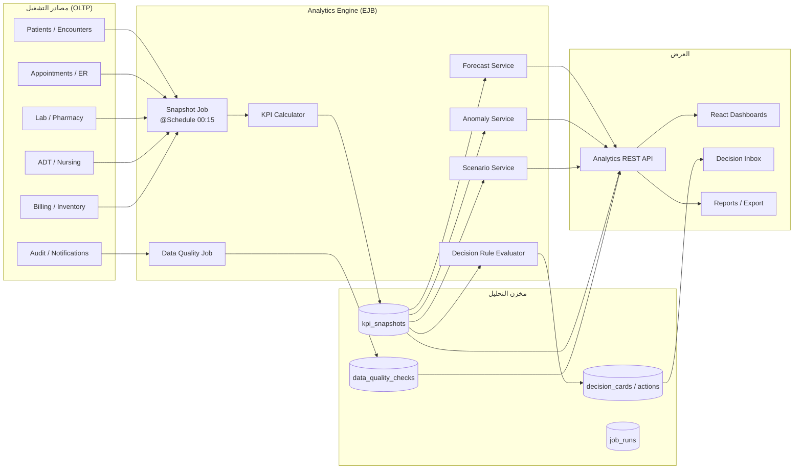

# 02 — Analytics Engine

**محرك التحليلات: وصفي ← تشخيصي ← تنبؤي ← توجيهي، بلا صندوق أسود**

| Field | Value |
|---|---|
| Document ID | ANL-ENG-001 |
| Version | 0.1 |
| Status | Approved (baseline 0.1) |
| Related | `01-kpi-catalog.md`, `03-decision-card-model.md`, `04-ai-guardrails.md`, `architecture/02-backend-architecture.md`, `database/02-data-dictionary.md` |

---

## 1. النطاق وما لا يشمله

**يشمل:** حساب المؤشرات، اللقطات اليومية، المقارنات التشخيصية، التوقعات البسيطة القابلة للتفسير، كشف الشذوذ الإحصائي، محاكاة السيناريو، فحوص جودة البيانات، وتغذية بطاقات القرار.

**لا يشمل (مقصود):**

| مستبعد | السبب |
|---|---|
| تشخيص طبي أو اقتراح علاج | خارج النطاق السريري والقانوني (انظر `04-ai-guardrails.md`) |
| تعلّم آلي عميق / شبكات عصبية | لا بيانات كافية، ولا قابلية تفسير، ولا حاجة أكاديمية |
| تحليلات لحظية على الجداول التشغيلية الثقيلة | تُجمّد النظام؛ اللقطات اليومية كافية |
| استعلامات SQL يكتبها المستخدم | خطر حقن وأداء؛ الصيغ مسجّلة كـ `query_key` فقط |
| تنفيذ تلقائي لأي توصية | كل قرار حساس يمر ببشري مخوّل (BR-DEC-003) |
| لوحة فردية لتقييم الموظفين | خطر إساءة استخدام؛ المؤشرات تُعرض على مستوى الوحدة |

---

## 2. المستويات الأربعة

| المستوى | السؤال | المخرجات | القيود |
|---|---|---|---|
| **Descriptive** وصفي | ماذا حدث؟ | KPI-001..036، سلاسل زمنية، توزيعات | لا تفسير سببي |
| **Diagnostic** تشخيصي | أين ولماذا محتمل؟ | مقارنة قسم/فترة/طبيب، مساهمة كل شريحة، أبطأ مرحلة TAT | الصياغة «مرتبط بـ» لا «سبب» (BR-ANL-004) |
| **Predictive** تنبؤي | ما المتوقع؟ | توقع طلب/إشغال/استهلاك + فاصل ثقة + دقة اختبار خلفي | ≥ 90 نقطة، أفق ≤ 30 يومًا، لا extrapolation بعيد |
| **Prescriptive** توجيهي | ما الإجراء المقترح؟ | بطاقة قرار بأدلة وخيارات وثقة | لا تنفيذ آلي؛ موافقة بشرية إلزامية |

**قاعدة التسلسل:** لا بطاقة توجيهية بلا طبقة وصفية سليمة. لا توقع بلا سلسلة تاريخية موثوقة. لا كشف شذوذ بلا حد أدنى للعينة.

---

## 3. المعمارية



**النشر:** كل المكونات داخل `smart-hospital-ejb` (EAR واحد)، بلا خدمة تحليلات منفصلة. لا اتصال خارجي ولا إرسال بيانات إلى سحابة.

---

## 4. تدفق البيانات والجدولة

| المهمة | التوقيت | التكرار | المدخلات | المخرجات | عند الفشل |
|---|---|---|---|---|---|
| `KPI_SNAPSHOT_DAILY` | 00:15 محليًا | يومي | الجداول التشغيلية لليوم السابق | `kpi_snapshots` | إعادة تلقائية 3 مرات، ثم تنبيه تشغيلي |
| `DATA_QUALITY_DAILY` | 00:45 | يومي | 6 فحوص | `data_quality_checks` | يُعاد تشغيله يدويًا من لوحة العمليات |
| `DECISION_RULES_EVAL` | 01:15 | يومي | اللقطات + القواعد | `decision_cards` | لا يُنشئ بطاقات جزئية؛ Transaction واحدة |
| `KPI_BACKFILL` | عند الطلب | يدوي/إداري | فترة محددة | إعادة حساب لقطات | يعمل في Background مع `job_runs` |
| `AUDIT_CHAIN_VERIFY` | 02:00 | يومي | `audit_logs` | `job_runs` + KPI-036 | حادثة أمنية فورية |
| `SNAPSHOT_RETENTION` | 03:00 | شهري | لقطات > 5 سنوات | أرشفة/تجميع | لا حذف للتفاصيل قبل الأرشفة |

**قواعد التنفيذ:**

1. المهام تُنفّذ عبر EJB Timer (`@Schedule`) داخل `@Singleton @Startup`، مع قفل قاعدة بيانات (`SELECT ... FOR UPDATE SKIP LOCKED` على `job_runs`) يمنع التشغيل المزدوج عند إضافة عقدة ثانية مستقبلًا.
2. كل مهمة Idempotent: إعادة حساب نفس `(kpi_id, snapshot_date, dimension_type, dimension_id)` تستبدل القيمة ولا تُكرر الصف.
3. كل مهمة تكتب صفًا في `job_runs` (`job_name`, `started_at`, `finished_at`, `status`, `processed_count`, `error_message`).
4. لا تُحتسب لقطة اليوم الحالي قبل انتهاء اليوم المحلي؛ لوحة اليوم تعرض «بيانات حتى آخر لقطة» مع طابع زمني.
5. البيانات المتأخرة (Late-arriving) تُعالج بإعادة حساب نافذة 7 أيام تلقائيًا، وليس اليوم فقط.

**المنطقة الزمنية:** التجميع بالتوقيت المحلي (`branches.timezone`)، والتخزين UTC. `snapshot_date` تاريخ محلي. تغيير التوقيت يستلزم Backfill موثّقًا.

---

## 5. حساب اللقطات (Snapshot Computation)

### 5.1 النمط

لكل مؤشر تعريف تنفيذي مسجّل في `kpi_definitions`:

| الحقل | الاستخدام |
|---|---|
| `code` | KPI-014 |
| `formula` | وصف مقروء للصيغة (ليس SQL قابلًا للتنفيذ) |
| `query_key` | مفتاح ثابت في كود EJB (`LAB_TAT_MEDIAN`) |
| `source_tables` | للتوثيق والتحقق |
| `granularity` | DAY/WEEK/MONTH |
| `dimension_type` | GLOBAL/DEPARTMENT/... |
| `min_cohort` | الحد الأدنى للعينة |
| `formula_version` | إصدار التعريف |
| `target_value` | NULL حتى المعايرة |

**لماذا `query_key` لا SQL؟** منع الحقن، وضمان المراجعة، وإمكانية تحسين الاستعلام دون تغيير التعريف.

### 5.2 القيم المفقودة والاستبعاد

| الحالة | المعالجة |
|---|---|
| حقل زمني `NULL` | يُستبعد السجل من المؤشر، ويُحتسب في `excluded_count` |
| نتيجة بلا اعتماد | لا تدخل TAT؛ تظهر في «قيد الاعتماد» |
| زيارة مفتوحة | لا تدخل ALOS؛ تظهر في «قيد الإقامة» |
| قسم محذوف/غير نشط | يبقى في التاريخ، ويُعرض ضمن «أقسام مؤرشفة» |
| عينة < `min_cohort` | لا تُخزَّن قيمة؛ يُخزَّن `sample_size` فقط وتُعرض «غير كافٍ» |
| بيانات مصدر مشكوك فيها | وسم اللقطة `quality_flag = SUSPECT` بعد مراجعة |

### 5.3 الوسيط (Median) في MySQL 8

MySQL لا يوفر `MEDIAN()` أصليًا. الخيارات المعتمدة:

- `PERCENT_RANK()` / `CUME_DIST()` لاختيار القيمة عند الرتبة 0.5، أو
- `NTILE(2)` مع متوسط الحدّين للعينة الزوجية، أو
- جلب القيم المرتبة إلى Java وحساب الوسيط (مقبول حتى 100k صف لكل مؤشر).

**القاعدة:** الوسيط هو الافتراضي لكل مؤشرات الزمن (TAT، الانتظار، الإقامة) لأن التوزيعات ملتوية. المتوسط يُعرض إضافيًا فقط عند الحاجة.

### 5.4 إعادة الحساب (Backfill)

| السيناريو | النطاق | الأثر |
|---|---|---|
| بيانات متأخرة | 7 أيام | استبدال اللقطات |
| تغيير صيغة مؤشر | 12 شهرًا أو منذ الإصدار | `formula_version` جديد |
| تصحيح بيانات مصدر | الفترة المتأثرة | وسم + إعادة حساب |
| ترحيل بيانات تاريخية | حسب الدفعة | تشغيل ليلي، لا يوقف النظام |

كل Backfill يُسجّل في `job_runs` مع المستخدم والسبب. لا يُسمح بتعديل لقطة منفردة يدويًا.

---

## 6. الطبقة التشخيصية (Diagnostic)

### 6.1 المقارنة

- **مقارنة زمنية:** الفترة الحالية ↔ الفترة السابقة ↔ نفس الفترة من العام الماضي (إن توفرت).
- **مقارنة مكانية:** قسم/عيادة ↔ خط أساس المستشفى، مع تطبيع لكل 1000 زيارة.
- **مقارنة هيكلية:** مساهمة كل شريحة في التغير الإجمالي (Contribution Decomposition).

### 6.2 قاعدة الصياغة

| ممنوع | المسموح |
|---|---|
| «تأخر المختبر بسبب نقص الموظفين» | «TAT ارتفع في وردية المساء؛ 62% من الزيادة جاءت من مرحلة النقل» |
| «الطبيب الفلاني سبب انخفاض الإشغال» | «جناح ب يساهم بـ 1.8 نقطة من انخفاض الإشغال الكلي» |
| «العلاقة سببية» | «مرتبط بـ / يساهم في / يتزامن مع» |

**الحد الأدنى:** لا مقارنة قسم فيه < 10 حالات. لا مقارنة طبيبين علنية؛ تُعرض للمدير الطبي فقط وبصياغة تطويرية.

### 6.3 تحليل المسار (Funnel)

لكل مسار قابل للقياس (وصفة → صرف → إعطاء)، تُحسب نسب التحويل والانحدار بين المراحل. هذا يكشف «أين» يضيع الوقت أو الحالات، دون ادعاء «لماذا».

---

## 7. المحرك التنبؤي (Predictive)

### 7.1 الطرق المعتمدة

| الطريقة | متى تُستخدم | الحد الأدنى | ملاحظة |
|---|---|---|---|
| **Seasonal Naive** (نفس يوم الأسبوع، وسيط آخر 4 أسابيع) | طلب يومي موسمي | 28 نقطة | خط أساس قوي وصعب التجاوز |
| **Moving Average** (7/14/28) | سلسلة مستقرة | 28 نقطة | نافذة تُختار بالاختبار الخلفي |
| **Croston** | طلب متقطع (أصناف نادرة) | 12 حدثًا | يفصل الحجم عن الفاصل |
| **Linear Trend** (اختياري) | اتجاه واضح فقط | 90 نقطة | لا يُستخدم مع موسمية قوية |

**ممنوع:** ARIMA معقدة، LSTM، Prophet، أو أي مكتبة خارجية في v1. الهدف تفسير يمكن الدفاع عنه أكاديميًا.

### 7.2 اختيار الطريقة

1. تُشغّل الطرق المرشحة على اختبار خلفي متجدد (آخر 30 يومًا).
2. تُختار الطريقة بأقل `WAPE`، بشرط ألا تتجاوز تعقيدًا معقولًا.
3. إذا لم تتفوق أي طريقة على Seasonal Naive بفارق ≥ 5%، تُستخدم Seasonal Naive.
4. تُخزَّن نتيجة الاختبار مع التوقع (الطريقة، WAPE، عدد النقاط، تاريخ التدريب).

### 7.3 فاصل الثقة

- يُحسب من توزيع البواقي (Residuals) في الاختبار الخلفي.
- فاصل 80% = `forecast ± q80(residuals)`، وفاصل 95% = `forecast ± q95(residuals)`.
- لا يُفترض توزيع طبيعي؛ تُستخدم الكميات التجريبية.
- إذا كان عدد البواقي < 20، يُعرض الفاصل مع تحذير «تقديري».

### 7.4 قيود العرض

| القيد | القيمة |
|---|---|
| أفق التوقع | ≤ 30 يومًا (يُعرض 7/14/30) |
| نقاط التاريخ | ≥ 90 نقطة يومية (أو 12 شهرًا شهريًا) |
| القيم السالبة | تُقصّ عند 0 للطلب والإشغال |
| الشفافية | الطريقة + WAPE + الفاصل + تاريخ التدريب إلزامية |
| الاستخدام | تخطيط قدرات، لا قرار طبي أو مالي مباشر |

### 7.5 عقد التوقع

```json
{
  "kpi": "KPI-014",
  "dimension": { "type": "SERVICE", "id": "LAB-CBC" },
  "horizonDays": 14,
  "method": "SEASONAL_NAIVE",
  "backtest": { "wape": 0.18, "points": 30, "trainedAt": "2026-11-10T22:00:00Z" },
  "points": [
    { "date": "2026-11-12", "value": 42, "lower80": 36, "upper80": 49 },
    { "date": "2026-11-13", "value": 39, "lower80": 33, "upper80": 46 }
  ],
  "caveats": ["بيانات تجريبية", "الفاصل تقديري عند بواقٍ أقل من 20"]
}
```

---

## 8. كشف الشذوذ (Anomaly Detection)

### 8.1 الطريقة

- **Robust Z-Score:** `z = 0.6745 × (x − median) / MAD`، حيث `MAD = median(|xᵢ − median|)`.
- خط أساس متحرك: 28–90 يومًا، مع استبعاد الأيام الشاذة تاريخيًا من حساب MAD.
- عتبة افتراضية `|z| ≥ 3.5`، قابلة للتهيئة.
- شرط إضافي: تغير مطلق ≥ 20% أو ≥ 5 وحدات، لمنع تنبيهات تافهة على قيم صغيرة.

### 8.2 ضبط الإنذارات الكاذبة

| الإجراء | القيمة |
|---|---|
| حد أدنى للعينة | 10 حالات/يوم |
| نقاط أساس | ≥ 28 نقطة |
| تأكيد | نقطتان متتاليتان أو تجاوز 5σ لنقطة واحدة |
| موسمية | المقارنة بنفس يوم الأسبوع عند توفر 8 أسابيع |
| كتم | لا كتم للحرج؛ يمكن تأجيل غير الحرج 24 ساعة |
| مراجعة | كل تنبيه يتحول إلى بطاقة DR-004 للمراجعة البشرية |

### 8.3 الصياغة

> «نمط غير معتاد في عدد زيارات الطوارئ يوم الثلاثاء 10 نوفمبر (z = 4.2، العينة 63). يحتاج مراجعة تشغيلية.»

لا تُذكر أسماء موظفين، ولا تُصاغ كاتهام. (BR-ANL-005)

---

## 9. فحوص جودة البيانات

| # | الفحص | التعريف | الوزن الافتراضي |
|---|---|---|---|
| DQ-01 | اكتمال الحقول الإلزامية | `1 − (سجلات ناقصة / سجلات مفحوصة)` للمرضى والزيارات | 25% |
| DQ-02 | تناقض التواريخ | `1 − (سجلات بتاريخ خروج < دخول أو اعتماد < سحب / الإجمالي)` | 20% |
| DQ-03 | زيارة مغلقة بلا تشخيص | `1 − (زيارات مغلقة بلا تشخيص أساسي / زيارات مغلقة)` | 15% |
| DQ-04 | مريض بلا وسيلة اتصال | `1 − (مرضى نشطون بلا هاتف / مرضى نشطون)` | 15% |
| DQ-05 | وصفة معتمدة بلا صرف خلال 48 ساعة | `1 − (وصفات بلا صرف أو إغلاق / وصفات معتمدة)` | 15% |
| DQ-06 | نتيجة معتمدة بلا إصدار/إشعار | `1 − (نتائج معتمدة بلا إصدار أو إشعار / نتائج معتمدة)` | 10% |

**المؤشر المركب (KPI-030):** `Σ(وزن × نسبة نجاح الفحص)`، ويُعرض معه أسوأ فحص وعدد السجلات المتأثرة.

**قاعدة:** الفحوص تُشغّل على بيانات الأمس، وتُخزَّن في `data_quality_checks` مع `details_json` لعينة محدودة (بلا بيانات هوية كاملة). لا تُستخدم لمعاقبة الأقسام.

---

## 10. محاكاة السيناريو (Scenario Simulation)

### 10.1 الغرض

الإجابة على «ماذا لو؟» إداريًا: «ماذا لو انخفض عدم الحضور 20%؟»، «ماذا لو أضفنا 10 أسرّة؟»، «ماذا لو تحسّن TAT 15%؟».

### 10.2 الطريقة

- تعتمد على لقطات تاريخية ونموذج حسابي شفاف (بلا تعلّم آلي).
- كل سيناريو يحدد: المتغير، التغير، الفترة، والافتراضات.
- المخرجات تُعرض كنطاق (أدنى/أعلى) لا رقم واحد.
- **كل مخرجات السيناريو موسومة «تقديري»** ولا تتحول إلى قرار إلا ببطاقة قرار معتمدة.

### 10.3 مثال

```text
السيناريو: خفض No-show من 18% إلى 14% لمدة 30 يومًا
الافتراض: نفس عدد المواعيد ونفس معدل الإشغال
الأثر التقديري: +37 زيارة مكتملة، +2.1% إشغال عيادات
القيود: لا يحتسب أثر الحملة أو الموسمية؛ ليس تنبؤًا
```

**لا يُحفظ السيناريو ككيان دائم في v1.** يمكن حفظه كـ `report_run` بمعاملاته، ويُعاد توليده عند الطلب.

---

## 11. واجهات REST

| Method | Path | الصلاحية | الوصف |
|---|---|---|---|
| GET | `/analytics/kpis` | `ANL:READ` | قائمة المؤشرات + آخر قيمة |
| GET | `/analytics/kpis/{code}` | `ANL:READ` | تعريف + قيمة + جودة البيانات |
| GET | `/analytics/kpis/{code}/series` | `ANL:READ` | سلسلة زمنية (حد أقصى 730 نقطة) |
| GET | `/analytics/compare` | `ANL:READ` | مقارنة أبعاد/فترات |
| GET | `/analytics/forecast` | `ANL:READ` | توقع + فاصل + طريقة |
| GET | `/analytics/anomalies` | `ANL:READ` | شذوذ مفتوح/مغلق |
| GET | `/analytics/data-quality` | `ANL:READ` | آخر فحوص + مؤشر مركب |
| POST | `/analytics/export` | `ANL:EXPORT` | تصدير CSV/PDF مع الطريقة والقيود |
| POST | `/analytics/scenarios` | `ANL:READ` | محاكاة سيناريو (بلا حفظ) |

### 11.1 غلاف الاستجابة

```json
{
  "data": { "code": "KPI-014", "value": 47.5, "unit": "minutes" },
  "meta": {
    "periodFrom": "2026-10-01",
    "periodTo": "2026-10-31",
    "sampleSize": 812,
    "minCohort": 20,
    "computedAt": "2026-11-11T01:15:00Z",
    "formulaVersion": 3,
    "qualityFlag": "OK",
    "source": ["specimens", "lab_result_versions"]
  }
}
```

### 11.2 الأخطاء

| الكود | HTTP | المعنى |
|---|---|---|
| `KPI_NOT_FOUND` | 404 | مؤشر غير معروف/موقوف |
| `INSUFFICIENT_DATA` | 422 | العينة أقل من الحد الأدنى |
| `PERIOD_INVALID` | 400 | فترة معكوسة أو > 24 شهرًا |
| `FORECAST_NOT_READY` | 409 | نقاط تاريخية غير كافية |
| `EXPORT_TOO_LARGE` | 413 | تجاوز حد التصدير؛ استخدم Async |
| `DIMENSION_FORBIDDEN` | 403 | بُعد خارج نطاق المستخدم |

**قاعدة:** لا تُعاد بيانات خام من التحليلات؛ فقط قيم مجمّعة + أدلة.

---

## 12. الأداء والتخزين المؤقت

| البند | القرار |
|---|---|
| لوحة الإدارة | تقرأ `kpi_snapshots` فقط، P95 ≤ 2 ثانية (NFR-PERF-004) |
| السلسلة | حد أقصى 730 نقطة/طلب؛ ما زاد يُجمع أسبوعيًا/شهريًا |
| التوقع | يُحسب عند الطلب ويُخزَّن في ذاكرة مؤقتة 10 دقائق (مفتاح: KPI+بُعد+أفق) |
| الشذوذ | يُحسب من اللقطات (≤ 365 نقطة) عند الطلب |
| التصدير | Async عبر `report_runs` عند > 5000 صف |
| الفهارس | `(kpi_id, snapshot_date)`, `(kpi_id, dimension_type, dimension_id, snapshot_date)` |
| حجم متوقع | 36 مؤشرًا × 365 يومًا × 10 أبعاد ≈ 131k صف/سنة — صغير |
| الضغط | لا حاجة لـ Partitioning في v1؛ يُراجع بعد 3 سنوات |

**قاعدة N+1:** لا يُستدعى استعلام لكل بُعد؛ تُجلب اللقطات دفعة واحدة وتُجمّع في Java.

---

## 13. الفشل والمراقبة

| المؤشر | الحد | الإجراء |
|---|---|---|
| فشل مهمة اللقطات | أي فشل | تنبيه للمسؤول + إعادة تلقائية 3 مرات |
| لقطة ناقصة | يوم كامل بلا صفوف | تنبيه Critical |
| تأخر اللقطة | > 06:00 | تنبيه High |
| مدة المهمة | > 20 دقيقة | تحقيق (قد تحتاج فهارس) |
| تعارض قفل | أي | مراجعة تزامن |
| فشل تحقق التدقيق | أي | حادثة أمنية فورية |

**الشفافية:** كل لوحة تعرض «آخر تحديث» و«جودة البيانات» وروابط التعريف. لا قيمة بلا طابع زمني.

---

## 14. الأمن والخصوصية

1. كل نقاط النهاية تتطلب جلسة + صلاحية `ANL:READ` أو `ANL:EXPORT`.
2. النطاق (قسم/فرع) يُطبّق على الاستعلام، لا على الواجهة فقط.
3. لا تُعرض شرائح < 10 حالات؛ ولا تُصدَّر.
4. لا بيانات هوية في `kpi_snapshots`؛ الأبعاد معرّفات داخلية.
5. التصدير يُسجّل في `access_logs` (`EXPORT`) مع المستخدم والفترة.
6. لا إرسال بيانات إلى خدمة خارجية؛ كل الحساب محلي.
7. بطاقات القرار تحتوي أدلة مجمّعة، لا نصوص مرضى خام إلا بصلاحية سريرية.

---

## 15. الاختبار

| المستوى | ما يُختبر |
|---|---|
| Unit | كل صيغة على مجموعة بيانات ذهبية (Golden Dataset) بقيم محسوبة يدويًا |
| Property | المجاميع لا تتجاوز الإجمالي؛ النسب بين 0–100؛ الوسيط ضمن المدى |
| Integration | حساب لقطة كاملة على DB اختبارية ومقارنتها بالقيم المتوقعة |
| Backfill | إعادة حساب نفس اليوم لا تُكرر الصفوف |
| Performance | 36 مؤشرًا × 365 يومًا ضمن 20 دقيقة |
| Security | منع الوصول لبُعد خارج النطاق، ومنع تصدير شرائح صغيرة |
| Acceptance | TC-146..TC-153 (FR-ANL) وTC-154..TC-162 (FR-DEC) |

**مجموعة البيانات الذهبية:** 3 أشهر بيانات وهمية مع قيم معروفة يدويًا لكل مؤشر Tier-1. أي تغيير في الصيغة يفشل الاختبار حتى تُحدّث القيم المعتمدة.

---

## 16. التتبّع

| FR | كيف يُنفّذ هنا |
|---|---|
| FR-ANL-001 | لوحة وصفية من اللقطات |
| FR-ANL-002 | `kpi_definitions` + غلاف `meta` |
| FR-ANL-003 | خدمة المقارنة والمساهمة |
| FR-ANL-004 | محرك التوقع + Backtest |
| FR-ANL-005 | كشف الشذوذ + بطاقة DR-004 |
| FR-ANL-006 | فحوص DQ-01..06 |
| FR-ANL-007 | تصدير مع الطريقة والقيود |
| FR-ANL-008 | `min_cohort` + `INSUFFICIENT_DATA` |

**BR:** BR-ANL-001..005. **NFR:** NFR-PERF-004, NFR-PRV-001/002/003, NFR-SEC-005, NFR-OPS-004.

---

## 17. قرارات مفتوحة

| # | السؤال | الافتراضي |
|---|---|---|
| ANL-Q1 | هل تُعرض مؤشرات الأطباء للأطباء أنفسهم؟ | لا في v1؛ المدير الطبي فقط |
| ANL-Q2 | هل تُحفظ التوقعات تاريخيًا للمقارنة؟ | لا في v1؛ تُحسب عند الطلب |
| ANL-Q3 | هل تُحفظ السيناريوهات؟ | لا؛ تُحفظ كتقرير عند الحاجة |
| ANL-Q4 | مدة الاحتفاظ باللقطات اليومية | 5 سنوات ثم تجميع شهري |
| ANL-Q5 | هل تُستخدم بيانات 12 شهرًا الوهمية للتوقعات؟ | نعم للعرض الأكاديمي مع وسم واضح |
