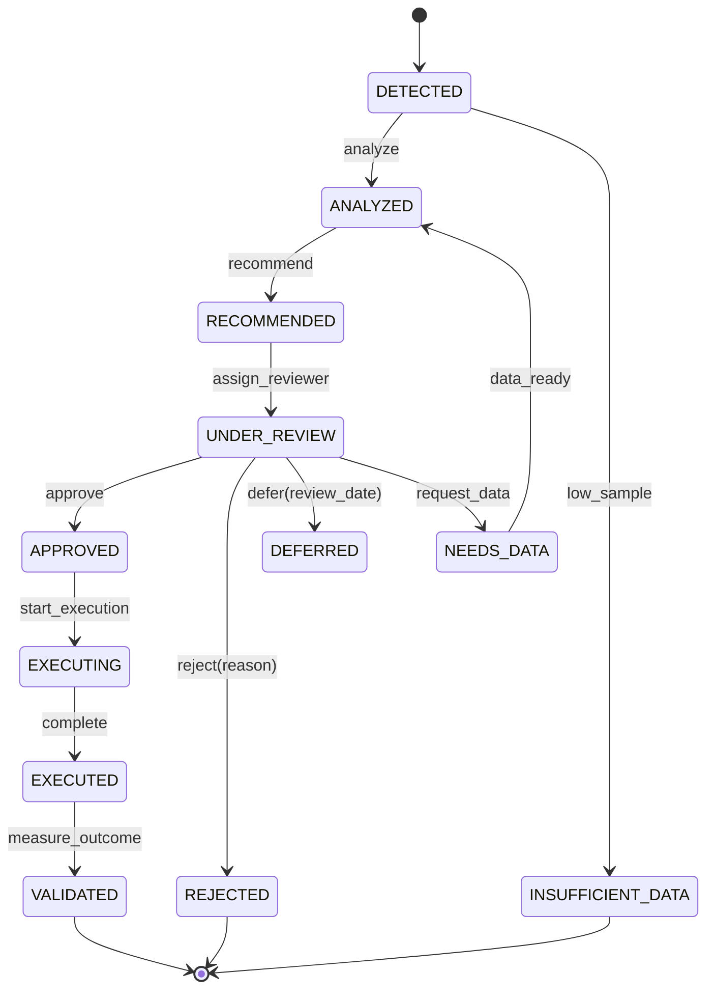

# 03 — Decision Card Model

**بطاقة القرار: من «نمط مكتشف» إلى «قرار موثّق قابل للقياس» — بشر في الحلقة دائمًا**

| Field | Value |
|---|---|
| Document ID | ANL-DEC-001 |
| Version | 0.1 |
| Status | Approved (baseline 0.1) |
| Related | `01-kpi-catalog.md`, `02-analytics-engine.md`, `04-ai-guardrails.md`, `workflows/02-state-machines.md` (SM-DECISION-CARD), `requirements/03` (FR-DEC-001..009) |

---

## 1. لماذا بطاقة لا «توصية»؟

التوصية النصية تضيع في محادثة أو بريد. **بطاقة القرار** كيان مؤسسي يحمل:

- **الدليل** (أي مؤشر، أي فترة، أي عينة، أي خط أساس).
- **السبب** (القاعدة التي أطلقتها).
- **الخيارات** (ليس أمرًا واحدًا).
- **الثقة** (محسوبة لا مكتوبة).
- **القرار** (قبول/رفض/تأجيل/طلب بيانات) مع سبب.
- **الاعتماد** (دور مخوّل ≠ منشئ التوصية).
- **التنفيذ** (من، متى، ماذا).
- **الأثر** (قياس قبل/بعد بنفس التعريف).

بدون هذه السلسلة، أي «ذكاء» يصبح رأيًا لا يمكن الدفاع عنه أمام الإدارة أو لجنة التقييم.

---

## 2. دورة الحياة



| الحالة | المعنى | SLA افتراضي | من يتحرك |
|---|---|---|---|
| `DETECTED` | القاعدة اكتشفت نمطًا | فوري | النظام |
| `ANALYZED` | أُضيفت الأدلة والخط الأساس | ≤ 15 دقيقة | النظام |
| `RECOMMENDED` | صيغت خيارات التوصية | ≤ 15 دقيقة | النظام |
| `UNDER_REVIEW` | أُسندت لمراجع بشري | ≤ 3 أيام عمل | المراجع |
| `APPROVED` | اعتمدها دور مخوّل | — | المعتمد |
| `REJECTED` | رُفضت بسبب | — | المراجع |
| `DEFERRED` | أُجّلت لتاريخ محدد | — | المراجع |
| `NEEDS_DATA` | تحتاج بيانات/توضيحًا | ≤ 5 أيام | مقدم الطلب |
| `EXECUTING` | بدأ التنفيذ الفعلي | حسب الخطة | المنفّذ |
| `EXECUTED` | اكتمل التنفيذ | — | المنفّذ |
| `VALIDATED` | قيس الأثر | بعد 28 يومًا | النظام + المالك |
| `INSUFFICIENT_DATA` | لا عينة كافية | — | النظام |

**قاعدة:** لا انتقال إلى `APPROVED` بلا أدلة + خط أساس + ثقة محسوبة (BR-DEC-001/002). ولا `EXECUTED` بلا مسؤول وتاريخ (FR-DEC-006).

---

## 3. القواعد الست (DR-001..DR-006)

### DR-001 — خطر نفاد المخزون

| العنصر | التفصيل |
|---|---|
| **السؤال** | هل صنف نشط سيصل إلى الصفر قبل وصول طلب الشراء القادم؟ |
| **الشرط** | `available_qty / avg_daily_consumption < supplier_lead_days + safety_days`، مع ≥ 30 يوم استهلاك و≥ 3 حركات |
| **الأدلة** | الرصيد المتاح (غير المنتهي/غير المحجوز)، متوسط الاستهلاك، تباين الاستهلاك (CV)، مهلة المورد، أوامر شراء مفتوحة، دفعات قريبة الانتهاء |
| **الخيارات** | (1) إنشاء مسودة طلب شراء، (2) تحويل من مخزن آخر، (3) رفع حد إعادة الطلب، (4) لا إجراء مع سبب |
| **المالك** | مدير المخزون / الصيدلية |
| **الثقة** | اكتمال بيانات المورد والاستهلاك + استقرار الطلب |
| **KPI** | KPI-027 (نفاد)، KPI-028 (دوران) |
| **الحراسات** | لا أمر شراء آلي · لا ازدواج مع أمر مفتوح · مراجعة القيمة قبل الاعتماد |
| **القياس** | 14 يومًا قبل/بعد؛ هل انخفضت أيام النفاد دون زيادة الهدر؟ |

### DR-002 — انحراف التوقع عن القدرة

| العنصر | التفصيل |
|---|---|
| **السؤال** | هل الطلب المتوقع (مختبر/إشغال/استهلاك) سيتجاوز القدرة المتاحة؟ |
| **الشرط** | التوقع الأعلى (فاصل 80%) > 110% من القدرة اليومية لأي 3 أيام خلال 14 يومًا، مع `WAPE ≤ 0.30` و≥ 90 نقطة |
| **الأدلة** | التوقع + الفاصل + طريقة الحساب + WAPE + القدرة الحالية + الحمل الفعلي آخر 14 يومًا |
| **الخيارات** | (1) تعديل جدول الورديات، (2) جدولة صيانة/أجهزة إضافية، (3) شراء مستلزمات مسبقًا، (4) لا إجراء |
| **المالك** | مدير التشغيل / مدير المختبر |
| **الثقة** | دقة الاختبار الخلفي + اكتمال البيانات + استقرار السلسلة |
| **KPI** | KPI-031 (دقة التوقع)، KPI-014/017 حسب الهدف |
| **الحراسات** | لا قرار توظيف آلي · لا يُعرض توقع بلا فاصل · لا يُستخدم لتقييم فرد |
| **القياس** | 28 يومًا قبل/بعد؛ هل انخفض التجاوز دون خفض الجودة؟ |

### DR-003 — خطر تجاوز TAT المختبر

| العنصر | التفصيل |
|---|---|
| **السؤال** | هل زمن دورة المختبر يتجه لتجاوز المستهدف بشكل منهجي؟ |
| **الشرط** | وسيط TAT آخر 7 أيام > `target_tat_minutes × 1.15`، أو مرحلة واحدة > 50% من TAT الكلي، مع ≥ 20 نتيجة |
| **الأدلة** | TAT كلي، TAT لكل مرحلة، عدد العينات، نسبة الرفض، الحمل اليومي، الوردية |
| **الخيارات** | (1) تعزيز الوردية في المرحلة الأبطأ، (2) مراجعة جدول النقل، (3) إعادة توزيع الأجهزة/الفحوصات، (4) مراجعة تعريف المستهدف |
| **المالك** | مدير المختبر |
| **الثقة** | حجم العينة + اكتمال أحداث العينة + استقرار الأسبوع |
| **KPI** | KPI-014، KPI-015 |
| **الحراسات** | لا اتهام أفراد · لا تحسين TAT على حساب الجودة · استبعاد أيام الأعطال المعروفة |
| **القياس** | 28 يومًا قبل/بعد؛ TAT + نسبة الرفض + إعادة الاعتماد |

### DR-004 — شذوذ تشغيلي

| العنصر | التفصيل |
|---|---|
| **السؤال** | هل هناك نمط يخرج عن المعتاد ويحتاج مراجعة بشرية؟ |
| **الشرط** | `|robust_z| ≥ 3.5` + تأكيد (نقطتان متتاليتان أو 5σ) + تغير مطلق ≥ 20%، مع ≥ 10 حالات/يوم و≥ 28 نقطة أساس |
| **الأدلة** | السلسلة، الوسيط، MAD، z، العينة، مؤشرات مرتبطة (TAT، إشغال، نفاد) |
| **الخيارات** | (1) مراجعة تشغيلية، (2) فتح تحقيق جودة، (3) لا إجراء مع سبب، (4) طلب بيانات إضافية |
| **المالك** | مسؤول الجودة / مدير التشغيل |
| **الثقة** | قوة الإشارة + حجم العينة + اكتمال البيانات |
| **KPI** | KPI-032 (نسبة المراجعة) |
| **الحراسات** | لا اتهام موظف · لا تفسير سريري · لا إجراء آلي · الصياغة «نمط يحتاج مراجعة» |
| **القياس** | 7 أيام؛ هل روجعت البطاقة؟ هل وُجد سبب موثّق؟ |

### DR-005 — تسرب الفوترة (Charge Capture)

| العنصر | التفصيل |
|---|---|
| **السؤال** | هل توجد خدمات منفذة لم تُفوتر؟ |
| **الشرط** | نسبة الخدمات غير المفوترة > 2% أو قيمتها > حد مالي معتمد خلال 7 أيام، مع ≥ 30 خدمة منفذة |
| **الأدلة** | عدد/قيمة الخدمات غير المفوترة، القسم/الخدمة، عمر التأخر، سبب عدم الفوترة إن سُجّل |
| **الخيارات** | (1) إنشاء مسودة فاتورة بعد مراجعة، (2) تصحيح ربط الخدمة، (3) إعفاء موثّق، (4) لا إجراء |
| **المالك** | مدير المالية |
| **الثقة** | اكتمال ربط `service_execution` + جودة بيانات الأسعار |
| **KPI** | KPI-026، KPI-025 |
| **الحراسات** | لا فوترة آلية · لا ازدواج (Unique على `service_execution_id`) · مراجعة بشرية قبل الإصدار · لا مساس بفاتورة مغلقة |
| **القياس** | 14 يومًا قبل/بعد؛ نسبة التسرب + قيمة التحصيل |

### DR-006 — ضغط سعة الأسرّة

| العنصر | التفصيل |
|---|---|
| **السؤال** | هل الإشغال الحالي/المتوقع سيضغط على القدرة ويؤثر على قبول المرضى؟ |
| **الشرط** | إشغال ≥ 90% لمدة 3 أيام متتالية، أو توقع 7 أيام ≥ 90%، أو زمن دوران سرير > المستهدف، مع بيانات ≥ 30 يوم سرير |
| **الأدلة** | الإشغال اليومي، الدخول/الخروج، ALOS، زمن التنظيف، المرضى بانتظار سرير، الأسرة المحجوزة/الصيانة |
| **الخيارات** | (1) تفعيل خطة السعة، (2) مراجعة حالات قابلة للخروج سريريًا، (3) فتح أسرة محجوزة، (4) تنسيق تحويل بين الأقسام |
| **المالك** | مدير التنويم / مدير العمليات |
| **الثقة** | اكتمال بيانات الأسرة + استقرار الإشغال + دقة التوقع |
| **KPI** | KPI-017، KPI-018، KPI-019 |
| **الحراسات** | لا خروج آلي · القرار السريري للطبيب · لا تخصيص سرير آلي · لا ضغط على الطوارئ بلا خطة |
| **القياس** | 28 يومًا قبل/بعد؛ الإشغال + الانتظار + إعادة التنويم |

---

## 4. نموذج البيانات

| الحقل | النوع | إلزامي | ملاحظة |
|---|---|---|---|
| `public_id` | ULID | نعم | للمشاركة والتدقيق |
| `rule_id` | FK | نعم | DR-001..006 |
| `status` | VARCHAR | نعم | حسب SM-DECISION-CARD |
| `priority` | VARCHAR | نعم | `P1_CRITICAL`, `P2_HIGH`, `P3_NORMAL` |
| `title_ar` | VARCHAR(200) | نعم | بلا أسماء أفراد |
| `summary_ar` | VARCHAR(1000) | نعم | وصف النمط |
| `evidence_json` | JSON | نعم | أدلة قابلة للتحقق |
| `period_from` / `period_to` | DATE | نعم | فترة البيانات |
| `baseline_json` | JSON | نعم | خط الأساس والمقارنة |
| `confidence` | DECIMAL(5,2) | نعم | 0–100 محسوبة |
| `confidence_breakdown_json` | JSON | نعم | مكونات الثقة |
| `options_json` | JSON | نعم | خيارات + أثر متوقع |
| `created_by` | BIGINT / NULL | نعم | NULL = النظام |
| `assigned_to` | BIGINT | نعم عند المراجعة | مراجع بشري |
| `approved_by` / `approved_at` | BIGINT / DATETIME | نعم عند الاعتماد | ≠ منشئ التوصية |
| `executed_by` / `executed_at` | BIGINT / DATETIME | نعم عند التنفيذ | |
| `outcome_json` | JSON | نعم عند القياس | قبل/بعد + القيود |
| `dedupe_key` | VARCHAR(120) | نعم | يمنع البطاقات المكررة |

**فهرس فريد جزئي:** `UNIQUE(dedupe_key, active_flag)` حيث `active_flag = 1` للبطاقات المفتوحة، `NULL` للمغلقة.

**`dedupe_key` =** `rule_code + ':' + dimension_type + ':' + dimension_id + ':' + period_bucket` (مثل `DR-003:SERVICE:LAB-CBC:2026-W45`). بطاقة مفتوحة لنفس المفتاح تُحدَّث أدلتها ولا تُكرَّر.

---

## 5. درجة الثقة (Confidence)

### 5.1 الصيغة

```text
confidence = 100 × (
    0.35 × sample_score +
    0.25 × data_quality_score +
    0.25 × model_score +
    0.15 × stability_score
)
```

| المكوّن | كيف يُحسب | المدى |
|---|---|---|
| `sample_score` | `min(1, sample_size / (2 × min_cohort))` | 0–1 |
| `data_quality_score` | متوسط فحوص DQ المتعلقة بالمصدر | 0–1 |
| `model_score` | `1 − WAPE` للتوقع، أو `1` للقواعد الحتمية | 0–1 |
| `stability_score` | `1 − min(1, CV)` لآخر 28 يومًا، أو ثبات الاتجاه | 0–1 |

**التصنيف:** ≥ 80 = عالية · 60–79 = متوسطة · < 60 = منخفضة. البطاقة المنخفضة لا تُعتمد إلا بعد «طلب بيانات» أو مراجعة إضافية موثّقة.

### 5.2 ما لا تفعله الثقة

- لا تعني «صحة القرار»؛ تعني «جودة الأساس الذي بُني عليه».
- لا تُرفع يدويًا؛ تُحسب من مكوناتها (BR-DEC-002).
- لا تُعرض بلا تفصيل؛ `confidence_breakdown_json` إلزامي.

---

## 6. الأولوية

| الأولوية | المعيار | SLA |
|---|---|---|
| `P1_CRITICAL` | خطر سلامة/مالي مباشر، أو انقطاع خدمة | مراجعة خلال 4 ساعات |
| `P2_HIGH` | أثر تشغيلي كبير (> 10% انحراف) | مراجعة خلال يوم عمل |
| `P3_NORMAL` | تحسين/مراقبة | مراجعة خلال 3 أيام عمل |

**قاعدة:** الأولوية تُحدد من القاعدة (Severity) × الثقة، لا من رأي المنشئ. `P1` يُشعر المالك ومدير العمليات فورًا.

---

## 7. الأدوار والصلاحيات

| الإجراء | الصلاحية | ملاحظة |
|---|---|---|
| عرض البطاقات | `DEC:READ` | حسب النطاق |
| قبول/رفض/تأجيل/طلب بيانات | `DEC:ACT` | مراجع مخوّل |
| اعتماد التوصية | `DEC:APPROVE` | ≠ منشئ التوصية (SoD) |
| تسجيل التنفيذ | `DEC:EXECUTE` | المنفّذ الفعلي |
| تعديل القواعد | `SYS:CONFIG` + اعتماد تقني | ليست صلاحية تشغيلية |
| تصدير بطاقة | `DEC:READ` + `ANL:EXPORT` | يُسجّل في `access_logs` |

**فصل المهام:** من ينشئ التوصية (النظام/المحلل) لا يعتمدها. من يعتمدها لا يسجّل تنفيذها إن أمكن (يفضّل). كل انتقال يُسجّل في `decision_card_actions` و`audit_logs`.

---

## 8. الأدلة (Evidence)

### 8.1 الحد الأدنى

| الحقل | إلزامي | مثال |
|---|---|---|
| `kpi_code` | نعم | `KPI-014` |
| `period` | نعم | `2026-10-01..2026-10-31` |
| `value` | نعم | `47.5` |
| `baseline` | نعم | `38.2` (وسيط 90 يومًا) |
| `sample_size` | نعم | `812` |
| `comparison` | نعم | `+24.3%` |
| `breakdown` | نعم للقواعد التشخيصية | حسب المرحلة/القسم |
| `data_quality` | نعم | `OK` / `SUSPECT` |
| `sources` | نعم | أسماء الجداول |

### 8.2 مثال `evidence_json`

```json
{
  "kpi": "KPI-014",
  "period": { "from": "2026-10-01", "to": "2026-10-31" },
  "value": 47.5,
  "unit": "minutes",
  "baseline": { "value": 38.2, "windowDays": 90 },
  "changePct": 24.3,
  "sampleSize": 812,
  "breakdown": [
    { "phase": "COLLECTED_TO_RECEIVED", "median": 18.0, "share": 0.38 },
    { "phase": "RECEIVED_TO_ANALYZED", "median": 21.5, "share": 0.45 },
    { "phase": "ANALYZED_TO_VERIFIED", "median": 8.0, "share": 0.17 }
  ],
  "target": { "value": 40, "source": "سياسة المختبر 2026" },
  "dataQuality": "OK",
  "sources": ["specimens", "specimen_events", "lab_result_versions"]
}
```

---

## 9. الخيارات والتوصية

كل بطاقة تحمل **2–4 خيارات**، ليس أمرًا واحدًا:

| الحقل | الوصف |
|---|---|
| `option_id` | O1/O2/O3 |
| `label_ar` | «تعزيز وردية النقل» |
| `expected_effect` | «خفض TAT 8–12 دقيقة» (نطاق لا رقم) |
| `effort` | `LOW/MEDIUM/HIGH` |
| `risk` | `LOW/MEDIUM/HIGH` |
| `prerequisites` | «توفر موظف إضافي» |
| `recommended` | خيار واحد فقط |

**قاعدة:** الخيار «لا إجراء» موجود دائمًا مع سبب. لا تُخفى التكلفة أو المخاطر.

---

## 10. قياس الأثر (Outcome)

| العنصر | القاعدة |
|---|---|
| نافذة ما قبل | 28 يومًا قبل `executed_at` |
| نافذة ما بعد | 28 يومًا بعد `executed_at` |
| المؤشر | نفس KPI ونفس التعريف والإصدار (BR-DEC-006) |
| المقارنة | قبل/بعد + الفترة المماثلة من العام السابق إن توفرت |
| النتيجة | `IMPROVED` / `NO_CHANGE` / `WORSENED` / `INCONCLUSIVE` |
| القيود | تُكتب صراحة (موسمية، تغيير سياسة، نقص بيانات) |
| القرار | لا يُنسب التحسن للقرار وحده؛ الصياغة «تزامن مع» |

**إذا كانت العينة بعد التنفيذ < الحد الأدنى:** النتيجة `INCONCLUSIVE`، ولا تُعرض كنجاح.

**بطاقة `VALIDATED`** تُغلق وتُغذي KPI-033. البطاقة التي لا تُقاس خلال 60 يومًا تُنبّه المالك.

---

## 11. الإشعارات والتكامل

| الحدث | الإشعار | القناة |
|---|---|---|
| إنشاء بطاقة P1 | المالك + مدير العمليات | In-app + SSE (Critical) |
| إسناد مراجعة | المراجع | In-app |
| اقتراب SLA | المراجع + المالك | In-app |
| اعتماد | المنفّذ | In-app |
| تنفيذ | المالك + منشئ التوصية | In-app |
| نتيجة القياس | المالك + لجنة الجودة | In-app + تقرير |
| بطاقة مكررة | لا إشعار؛ تُحدّث الأدلة | — |

كل الإشعارات تمر عبر Outbox (ADR-005) ولا تفقد الحدث.

---

## 12. أمثلة كاملة

### 12.1 DR-003 — TAT مختبر

```text
العنوان: ارتفاع TAT فحص CBC بنسبة 24% خلال أكتوبر
الفترة: 2026-10-01..2026-10-31
القيمة: 47.5 دقيقة (خط الأساس 38.2، الهدف 40)
العينة: 812 نتيجة
التفصيل: النقل 38%، التحليل 45%، الاعتماد 17%
الثقة: 84 (عينة 1.0، جودة 0.9، نموذج 1.0، استقرار 0.55)
الأولوية: P2
الخيارات:
  O1 تعزيز وردية النقل 14:00–22:00 (موصى به) — أثر 6–10 دقائق — جهد متوسط
  O2 مراجعة مسار العينات بين الأقسام — أثر 3–6 دقائق — جهد منخفض
  O3 لا إجراء — مراقبة أسبوعين
الحراسة: استُبعد يوم 12 أكتوبر (عطل مصعد موثّق)
```

### 12.2 DR-006 — ضغط أسرّة

```text
العنوان: إشغال جناح الباطنة ≥ 92% لثلاثة أيام
الفترة: 2026-11-08..2026-11-10
القيمة: 92.4% (خط الأساس 84.1%، الهدف التشغيلي ≤ 90%)
العينة: 3 أيام × 48 سريرًا
الأدلة: 6 مرضى بانتظار سرير، زمن تنظيف 3.1 ساعة (المستهدف 2.0)
الثقة: 78
الأولوية: P1
الخيارات:
  O1 تفعيل خطة السعة (موصى به)
  O2 مراجعة 4 حالات قابلة للخروج سريريًا — قرار الطبيب
  O3 فتح 4 أسرة محجوزة — يتطلب تأكيد التمريض
الحراسة: لا خروج آلي؛ لا تخصيص آلي
```

---

## 13. معايير القبول

- [ ] كل قاعدة من DR-001..006 لها شرط رقمي وحد أدنى للعينة.
- [ ] كل بطاقة تحمل أدلة وخط أساس وثقة مفصّلة.
- [ ] لا اعتماد من منشئ التوصية (SoD مطبّق في الخدمة).
- [ ] لا تنفيذ آلي لأي إجراء مالي/سريري.
- [ ] كل انتقال مسجّل في `decision_card_actions` + `audit_logs`.
- [ ] قياس الأثر يستخدم نفس KPI ونفس النافذة.
- [ ] البطاقة المكررة تُحدّث ولا تُكرَّر.
- [ ] البطاقة منخفضة الثقة لا تُعتمد بلا بيانات إضافية.

---

## 14. التتبّع

| FR | التنفيذ |
|---|---|
| FR-DEC-001 | توليد البطاقة من القاعدة |
| FR-DEC-002 | `evidence_json` + `baseline_json` |
| FR-DEC-003 | `confidence` + `confidence_breakdown_json` |
| FR-DEC-004 | قبول/رفض/تأجيل/طلب بيانات + سبب |
| FR-DEC-005 | اعتماد بدور مخوّل ≠ المنشئ |
| FR-DEC-006 | `executed_by` + `executed_at` + خطة |
| FR-DEC-007 | `outcome_json` + مقارنة قبل/بعد |
| FR-DEC-008 | لا تنفيذ آلي (Guard في الخدمة) |
| FR-DEC-009 | `decision_card_actions` + تدقيق |

**BR:** BR-DEC-001..008. **TC:** TC-154..TC-162. **SM:** SM-DECISION-CARD.
