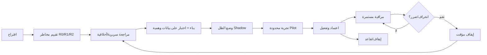

# 04 — AI & Algorithm Guardrails

**حدود الذكاء الاصطناعي: مساعدة إحصائية قابلة للتفسير، لا تشخيص ولا قرار آلي**

| Field | Value |
|---|---|
| Document ID | ANL-AI-001 |
| Version | 0.1 |
| Status | Approved (baseline 0.1) |
| Related | `02-analytics-engine.md`, `03-decision-card-model.md`, `requirements/12-benchmark-gap-analysis.md`, `architecture/06-security-architecture.md`, NFR-PRV |

---

## 1. ما نعنيه بـ «AI» في هذا النظام

لا يوجد نموذج توليدي (LLM) ولا شبكة عصبية في v1. «الذكاء» هنا يعني:

1. **قواعد إحصائية شفافة** (وسيط، MAD، WAPE، Jaro-Winkler).
2. **توقعات بسيطة** قابلة لإعادة الحساب يدويًا.
3. **قواعد عمل** (DR-001..006) مكتوبة ومُراجعة.
4. **مطابقة نصية** (EMPI) بدرجات تشابه قابلة للتفسير.

كل مخرج يجب أن يجيب على: **ما المدخلات؟ ما الطريقة؟ ما الثقة؟ ما القيود؟ ماذا يحدث إن كان خطأ؟**

---

## 2. تصنيف المخاطر

| المستوى | التعريف | أمثلة | الضابط |
|---|---|---|---|
| **R0 — محظور** | قرار سريري/مالي مباشر بلا بشر | تشخيص آلي، جرعة آلية، فرز آلي، صرف آلي، فوترة آلية | لا يُبنى |
| **R1 — مساعد** | يقترح/ينبّه، والقرار البشري إلزامي | EMPI، تفاعل دوائي، تنبيه تدهور، شذوذ، توقع | مراجعة بشرية + تفسير |
| **R2 — تشغيلي منخفض الأثر** | تحسين عرض/ترتيب بلا أثر سريري | ترتيب إشعارات، Smart Queue غير السريري | قابل للتعطيل + لا يخفي الحرِج |

**قاعدة:** أي ميزة `R ≥ 4` في تقييم `13-smart-features-catalog` لا تدخل v1 إلا بمراجعة بشرية إلزامية وحدود مكتوبة (وهو ما ينطبق على SF-07 وSF-08).

---

## 3. المبادئ غير القابلة للتفاوض

| # | المبدأ | التطبيق |
|---|---|---|
| G-01 | **البشر يقررون** | لا تنفيذ آلي لأي إجراء سريري أو مالي (BR-DEC-003 / FR-DEC-008) |
| G-02 | **لا تشخيص ولا جرعة** | النظام لا يقول «المريض مصاب بـ» ولا «أعطِ X ملغ» |
| G-03 | **الشفافية** | كل مخرج يحمل الطريقة والمدخلات والثقة والقيود |
| G-04 | **الحد الأدنى من البيانات** | التحليلات تعمل على مجاميع؛ لا هوية في اللقطات |
| G-05 | **لا إرسال خارجي** | لا API سحابي ولا LLM خارجي في v1 |
| G-06 | **قابلية الإيقاف** | مفتاح تعطيل لكل ميزة دون نشر جديد |
| G-07 | **لا اتهام أفراد** | الشذوذ «نمط يحتاج مراجعة»، لا «موظف مشبوه» |
| G-08 | **قابلية التكرار** | نفس البيانات + نفس الإصدار = نفس النتيجة |
| G-09 | **لا تعلّم على بيانات المرضى** | لا تدريب نماذج على PHI في v1 |
| G-10 | **الموافقة قبل التفعيل** | كل ميزة تمر ببوابة اعتماد موثّقة |

---

## 4. الاستخدامات المحظورة (Prohibited Uses)

| محظور | لماذا |
|---|---|
| تشخيص آلي من الأعراض أو الصور | ليس جهازًا طبيًا معتمدًا؛ خطر مباشر |
| اقتراح جرعة أو تعديلها آليًا | يتطلب تحققًا سريريًا وصيدليًا وقانونيًا |
| ترتيب أولوية الطوارئ آليًا | الفرز قرار بشري معتمد (ASM-016) |
| قرار خروج/تنويم آلي | مسؤولية طبية |
| دمج مرضى تلقائيًا | خطأ واحد يدمج سجلين |
| إصدار فاتورة أو أمر شراء آلي | التزام مالي يحتاج اعتمادًا |
| رفض/قبول موظف بناءً على نمط | أثر جنائي/إداري خارج النطاق |
| التعرف على الوجه أو تتبع الموقع | انتهاك خصوصية بلا أساس |
| تصنيف مرضى «مخاطر عالية» بلا معايرة | وصمة وتمييز |
| توليد نص طبي (LLM) بلا مراجعة | هلوسة وخطر سريري |
| إخفاء تنبيه Critical بسبب «ذكاء» الترتيب | خطر سلامة |

---

## 5. الاستخدامات المسموحة وضوابطها

| الميزة | المستوى | الضابط | من يوافق | كيف يُقاس |
|---|---|---|---|---|
| EMPI Scoring (SF-01) | R1 | لا دمج تلقائي؛ `POSSIBLE` يحتاج سببًا وصلاحية؛ كل دمج قابل للتراجع | مدير السجلات الطبية | دقة ≥ 90% على 20 زوجًا معروفًا (TC-018/019) |
| Allergy/Interaction (SF-07) | R1 | تحذير افتراضي؛ المنع بسياسة معتمدة؛ لا بديل آلي | الصيدلي + المدير الطبي | 10 سيناريوهات، 0 حالة فائتة (TC-099) |
| EWS/NEWS2 (SF-08) | R1 | قالب قابل للتهيئة؛ عتبات معتمدة طبيًا؛ لا تشخيص | المدير الطبي | مراجعة 20 حالة معروفة |
| TAT/Anomaly (DR-003/004) | R1 | مراجعة بشرية؛ لا اتهام؛ لا إجراء آلي | مدير الجودة | نسبة المراجعة ≥ 90% (KPI-032) |
| Forecast (SF-19 / DR-002) | R1 | فاصل ثقة + Backtest؛ أفق ≤ 30 يومًا؛ لا قرار آلي | مدير التشغيل | WAPE ≤ 0.30 على 30 يومًا |
| Scenario (SF-21) | R2 | وسم «تقديري»؛ ليس تنبؤًا | مدير التحليلات | مراجعة افتراضات |
| Smart Queue (SF-22) | R2 | لا يغيّر أولوية سريرية؛ قواعد معلنة | مدير العمليات | 10 حالات اختبار |
| Notification ranking (SF-24) | R2 | Critical لا يُكتم ولا يُؤجل | مسؤول الأمن | 100 إشعار → ≤ 5 للمستخدم، 0 Critical مفقود |
| Bed/Inventory rules (DR-001/006) | R1 | لا تنفيذ آلي؛ خيارات + اعتماد | مدير المخزون/التنويم | KPI-027/017 |

---

## 6. الإشراف البشري (Human Oversight)

| الدور | المسؤولية |
|---|---|
| **مالك الميزة** | يعرّف الغرض والحدود ويوافق على التفعيل |
| **المدير الطبي** | يعتمد أي عتبة سريرية (EWS، تفاعلات) |
| **الصيدلي** | يعتمد قواعد التفاعلات والبدائل |
| **مسؤول الجودة** | يراجع الشذوذ وبطاقات القرار |
| **مسؤول البيانات** | يراجع جودة المدخلات والتحيز |
| **مسؤول الأمن** | يراجع الوصول والتدقيق والإيقاف |
| **مسؤول التحليلات** | يشغّل الاختبار الخلفي والمراقبة |

**قاعدة الفصل:** من يبني القاعدة لا يعتمدها وحدها؛ ومن يعتمدها لا يعدّلها دون إصدار جديد.

---

## 7. التفسير (Explainability)

كل مخرج يجب أن يحتوي:

| العنصر | مثال |
|---|---|
| **المدخلات** | «812 نتيجة CBC، 1–31 أكتوبر» |
| **الطريقة** | «وسيط + MAD، خط أساس 90 يومًا» |
| **النتيجة** | «47.5 دقيقة، +24.3% عن الأساس» |
| **الثقة** | «84/100 — عينة كافية، جودة 0.9، استقرار 0.55» |
| **القيود** | «استُبعد يوم عطل المصعد؛ لا يشمل عينات مرفوضة» |
| **البديل** | «لو استُخدم المتوسط لكان 52.1 (متأثر بحالتين)» |
| **ما ليس** | «ليس تشخيصًا ولا حكمًا على أداء فرد» |

**ممنوع:** «النموذج يرى أن…» بلا تفصيل. **مطلوب:** جملة واحدة يفهمها مدير غير تقني.

---

## 8. الخصوصية والبيانات

| الضابط | التطبيق |
|---|---|
| الغرض | التحليلات التشغيلية فقط؛ لا تسويق ولا بيع |
| التقليل | مجاميع وأبعاد داخلية؛ لا أسماء/هواتف في اللقطات |
| الحد الأدنى للعينة | < 10 لا يُعرض ولا يُصدَّر |
| الاحتفاظ | لقطات 5 سنوات ثم تجميع؛ سجلات مصدر حسب السياسة |
| الوصول | صلاحية `ANL:READ` + نطاق؛ التصدير `ANL:EXPORT` ومسجّل |
| إعادة الاستخدام | أي استخدام ثانوي يحتاج موافقة مكتوبة |
| الإخفاء | لا بيانات هوية في أدلة البطاقات؛ أقصى ما يُعرض معرّف داخلي |
| التسريب | لا إرسال لأي خدمة خارجية؛ لا Telemetry |

---

## 9. دورة حياة الميزة/النموذج

| المرحلة | الشرط للانتقال |
|---|---|
| اقتراح | مشكلة محددة + مالك + مؤشر نجاح |
| تقييم | تصنيف R + تحليل ضرر محتمل |
| مراجعة | موافقة طبية/أخلاقية موثّقة |
| بناء | بيانات وهمية فقط + اختبارات |
| Shadow | يعمل بلا تأثير على المستخدم 2–4 أسابيع |
| Pilot | قسم واحد + مراقبة يومية |
| اعتماد | معايير القبول + خطة تراجع |
| مراقبة | لوحة أداء + تنبيه انحراف |
| تقاعد | إشعار + أرشفة + سبب |

**لا تُفعّل ميزة R1 بلا تجربة Shadow.** الاستثناء: القواعد الحتمية البسيطة (مثل منع صرف دفعة منتهية) ليست AI ولا تحتاج Shadow.

---

## 10. التحقق والمراقبة

### 10.1 قبل التفعيل

| المقياس | الحد |
|---|---|
| دقة EMPI | ≥ 90% على مجموعة معروفة (20 زوجًا) |
| حساسية تنبيه التفاعل | 100% على 10 سيناريوهات معتمدة |
| دقة التوقع | WAPE ≤ 0.30 على 30 يومًا |
| إنذارات كاذبة للشذوذ | ≤ 20% في مراجعة 30 يومًا |
| عدالة الشرائح | لا فرق > 10 نقاط بين مجموعتين سكانيتين في دقة المطابقة |
| زمن الاستجابة | ضمن NFR-PERF |

### 10.2 بعد التفعيل

| المؤشر | تنبيه | إجراء |
|---|---|---|
| انخفاض دقة التوقع | WAPE > 0.40 لأسبوعين | مراجعة الطريقة/البيانات |
| ارتفاع تجاوز التنبيهات | > 70% لمدة شهر | مراجعة القاعدة (Alert fatigue) |
| انحراف توزيع المدخلات | تغير > 25% في الوسيط | مراجعة/إعادة معايرة |
| شكوى/ضرر | أي | إيقاف فوري + تحقيق |
| بطاقات بلا مراجعة | > 20% بعد 7 أيام | تنبيه المالك |

**لوحة المراقبة:** لكل ميزة: الاستخدام، الدقة، التجاوز، الشكاوى، الحالة (نشط/موقوف).

---

## 11. الاستجابة للحوادث

| السيناريو | الإجراء الفوري | الإجراء اللاحق |
|---|---|---|
| تنبيه خاطئ تسبب في ضرر | إيقاف الميزة + إبلاغ المدير الطبي | تحليل جذر + مراجعة القاعدة |
| تفويت حالة حرجة | إيقاف + مراجعة السجلات | تصحيح + اختبار انحدار |
| تسريب بيانات | عزل + إبلاغ الأمن | تحقيق + إشعار حسب السياسة |
| انحراف نموذج | تحويل إلى الوضع اليدوي | إعادة معايرة/تقاعد |
| استخدام ميزة محظورة | إيقاف فوري | مراجعة صلاحيات + تدقيق |

**مفتاح الإيقاف:** `feature_flags` في `settings` (مثل `ai.empi.enabled=false`) يُقرأ عند كل طلب؛ لا يحتاج إعادة نشر.

---

## 12. سياسة النماذج الخارجية وLLM (مستقبلًا)

| البند | القرار |
|---|---|
| LLM خارجي في v1 | **ممنوع** |
| LLM محلي مستقبلًا | مسموح فقط بعد مراجعة أمنية وموافقة، وبلا PHI |
| إدخال بيانات مرضى في Prompt | ممنوع |
| تسجيل Prompts | ممنوع مع PHI؛ مسموح مع بيانات وهمية |
| مزود خارجي | يتطلب عقدًا، موقع بيانات، وعدم استخدام للتدريب |
| توليد نصوص طبية | يبقى ممنوعًا حتى اعتماد سريري وقانوني |
| تكلفة/اعتماد | لا يُدرج في v1 |

---

## 13. الامتثال والادعاءات

- النظام **ليس جهازًا طبيًا** ولا يدّعي ذلك.
- لا ادعاء «HIPAA compliant» أو «GDPR compliant» أو «FHIR compliant» (NFR-PRV-006).
- الضوابط التقنية موثّقة؛ الامتثال القانوني يحتاج مراجعة محلية.
- أي ميزة سريرية تحتاج اعتماد المدير الطبي والجهة الصحية المختصة قبل التفعيل.
- التوثيق متاح للمراجع: تعريف القاعدة، البيانات، الاختبار، القرار.

---

## 14. قائمة التحقق قبل تفعيل أي ميزة ذكية

- [ ] الغرض محدد ومكتوب، والمشكلة موثّقة.
- [ ] التصنيف R0/R1/R2 معتمد.
- [ ] مالك الميزة ومسؤول المراقبة محددان.
- [ ] المدخلات معروفة ومصدرها موثّق.
- [ ] الطريقة قابلة للتفسير وقابلة لإعادة الحساب.
- [ ] حد أدنى للعينة وقيود العرض مطبّقة.
- [ ] اختبار على بيانات وهمية + مجموعة ذهبية.
- [ ] تجربة Shadow/Pilot موثّقة (لـ R1).
- [ ] معايير القبول الرقمية مستوفاة.
- [ ] خطة إيقاف وتراجع جاهزة.
- [ ] موافقة المدير الطبي/الأخلاقية (إن لزم).
- [ ] لوحة مراقبة + تنبيهات مفعّلة.
- [ ] التدقيق يسجّل كل استخدام.
- [ ] لا تنفيذ آلي لأي إجراء حساس.
- [ ] المستخدم يعرف أن هذا «اقتراح» لا «قرار».

---

## 15. التتبّع

| المرجع | العلاقة |
|---|---|
| FR-DEC-008 | منع التنفيذ الآلي |
| FR-ANL-004/005 | توقع/شذوذ قابل للتفسير |
| BR-DEC-002/003 | ثقة محسوبة + بشر في الحلقة |
| BR-ANL-003/004/005 | فاصل ثقة + لا سببية + لا اتهام |
| NFR-PRV-001..006 | خصوصية وحد أدنى |
| NFR-SEC-005/010 | تفويض وتدقيق |
| SF-01..SF-28 | كتالوج الميزات وتصنيفها |
