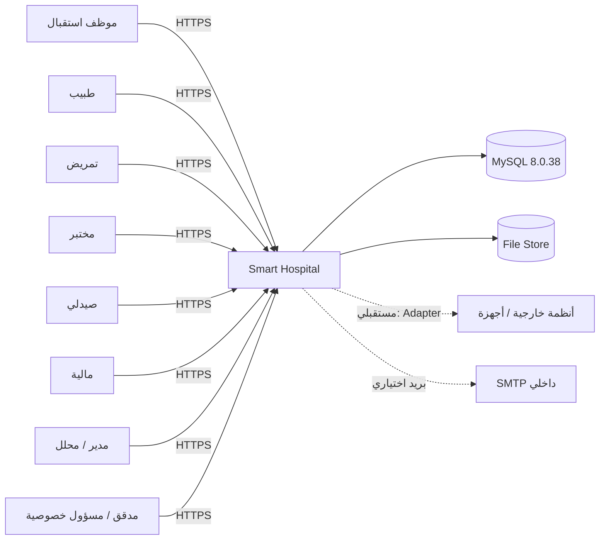
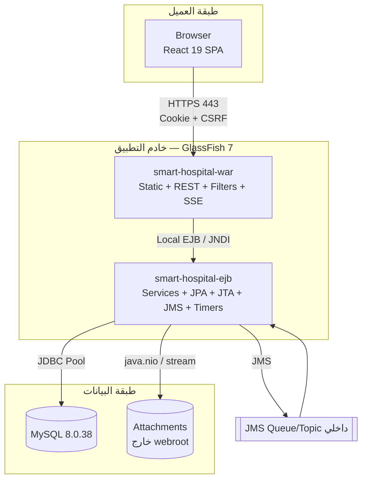
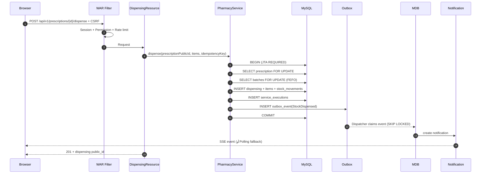
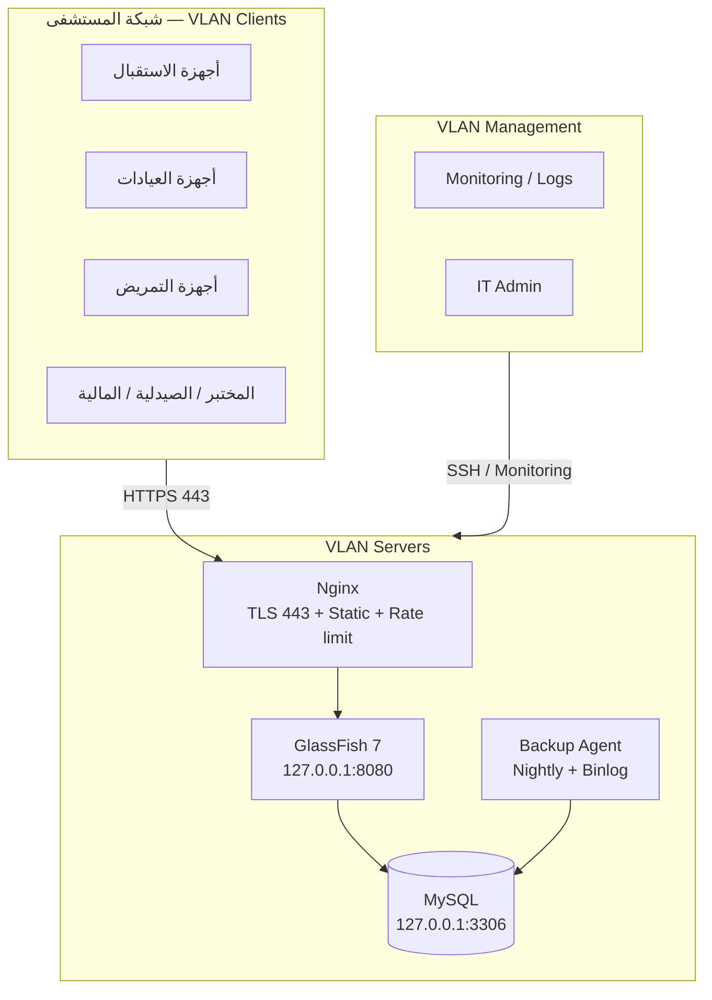

# 01 — System Architecture

| Field | Value |
|---|---|
| Document ID | ARC-SYS-001 |
| Version | 0.1 |
| Status | Approved (baseline 0.1) |
| Style | Modular Monolith · Layered · Event-assisted |
| Runtime | GlassFish 7 Full · JDK 17 · Jakarta EE 10 |
| Packaging | `smart-hospital-ear` (EJB + WAR) |

> **الجملة المعمارية:** نظام واحد يُنشر كوحدة واحدة، لكنه **ليس كتلة واحدة**: كل نطاق وظيفي وحدة لها حدود، وواجهة خدمة، وجداول، وأحداث. هذا يمنحنا بساطة النشر المؤسسي دون فقدان الانضباط الهندسي.

---

## 1. المبادئ المعمارية

| # | المبدأ | التطبيق العملي | كيف يُفرض |
|---|---|---|---|
| P1 | مصدر حقيقة واحد | MySQL مركزية واحدة، لا DB على العميل | ADR-015 + مراجعة النشر |
| P2 | المنطق في الخادم | React تعرض وتجمع مدخلات فقط | لا SQL/قواعد في الواجهة |
| P3 | حدود وحدات صريحة | حزمة لكل نطاق + `api` للواجهات فقط | مراجعة اعتماديات + ArchUnit-like |
| P4 | المعاملة تحمي الحقيقة | كل عملية طبية/مالية داخل JTA | `05-transactions-concurrency.md` |
| P5 | لا فقدان حدث | Outbox داخل نفس المعاملة | ADR-005 |
| P6 | الأمان جزء من الخدمة | صلاحية + نطاق بيانات في كل عملية | `06-security-architecture.md` |
| P7 | كل شيء قابل للتدقيق | سجل تدقيق Insert-only + Hash chain | ADR-009 |
| P8 | التهيئة لا الكود | اسم المستشفى/الأسعار/الأقسام بيانات | NFR-PRT-001 |
| P9 | التوسع بالنقاط لا بالكسر | Adapter/Topic/View للوظائف المستقبلية | §9 |
| P10 | البساطة التشغيلية | خادم واحد، نشر EAR واحد، لا XA | ADR-018 |

---

## 2. سياق النظام (System Context)



**الحدود:** كل مستخدمي النظام داخل شبكة المستشفى (LAN). لا وصول من الإنترنت في v1. لا تطبيق موبايل. لا بوابة مرضى.

---

## 3. الحاويات (Containers)



| الحاوية | المسؤولية | لا تفعل |
|---|---|---|
| **WAR** | تقديم SPA، REST Resources، Validation، Error Mapping، Security Filters، SSE Endpoint | لا JPA، لا معاملات، لا قواعد أعمال |
| **EJB** | الخدمات، المعاملات، الصلاحيات، JPA، Outbox، JMS، Timers، التحليلات | لا HTML، لا تفاصيل HTTP |
| **MySQL** | الحقيقة الدائمة، القيود، الفهارس، التدقيق | لا منطق أعمال في Triggers معقدة |
| **File Store** | مرفقات وتقارير مولّدة | لا تنفيذ، لا وصول مباشر من المتصفح |

---

## 4. الوحدات والحزم

**الجذر:** `com.smarthospital`

```
com.smarthospital
├── shared          // أدوات، أخطاء، أنواع مالية/زمنية، ULID، Outbox API
├── platform        // إعدادات، هيكل، خدمات وأسعار، قوالب
├── iam             // مستخدمون، أدوار، صلاحيات، جلسات، Break-Glass
├── patient         // مرضى، هويات، حساسيات، دمج
├── scheduling      // جداول، مواعيد، انتظار
├── clinical        // زيارات، توثيق، تشخيص، أوامر، وصفات
├── emergency       // وصول طارئ، فرز
├── admission       // تنويم، أسرة، نقل، خروج
├── nursing         // مهام، علامات، إعطاء دواء
├── laboratory      // طلبات، عينات، نتائج
├── radiology       // طلبات، دراسات، تقارير
├── pharmacy        // كتالوج، صرف، دفعات
├── surgery         // عمليات، قوائم سلامة
├── billing         // فواتير، مدفوعات، إقفال
├── inventory       // أصناف، مخازن، مشتريات
├── hr              // أطباء، تراخيص، مناوبات
├── notification    // إشعارات، قوالب، تسليم
├── reporting       // تقارير، تصدير
├── analytics       // KPIs، لقطات، توقعات
├── decision        // قواعد، بطاقات قرار
└── integration     // Adapters، رسائل خارجية
```

كل وحدة تتبع البنية الداخلية نفسها:

```
<module>
├── api        // Interfaces + DTOs + Enums — الوحيدة المسموح استيرادها خارجيًا
├── domain     // Entities + Value Objects + Domain Rules
├── repo       // JPA Repositories / Criteria queries
├── service    // @Stateless implementations + @Singleton coordinators
├── event      // Domain events + listeners (Outbox)
└── web        // (في WAR فقط) JAX-RS Resources لهذه الوحدة
```

**قاعدة الاستيراد:** من خارج الوحدة، يُسمح فقط بـ `com.smarthospital.<module>.api.*`. أي استيراد لـ `domain` أو `repo` أو `service` من وحدة أخرى = مخالفة معمارية تُرفض في المراجعة.

---

## 5. مصفوفة الاعتماديات

الاتجاه المسموح: **من مستوى أعلى إلى مستوى أدنى فقط**. لا دورات، ولا اعتماد عكسي.

| المستوى | الوحدات | تعتمد على |
|---|---|---|
| L0 | `shared`, `platform`, `iam` | `shared` فقط (بينها: `platform`/`iam` لا يعتمدان على نطاقات سريرية) |
| L1 | `patient` | L0 |
| L2 | `laboratory`, `pharmacy`, `radiology`, `surgery`, `inventory` | L0, L1 |
| L3 | `scheduling`, `clinical`, `emergency`, `admission`, `nursing`, `billing`, `hr` | L0–L2 |
| L4 | `notification`, `reporting`, `analytics`, `decision` | L0–L3 (قراءة/أحداث فقط) |
| L5 | `integration` | L0–L4 (Adapters) |

**أمثلة مسموحة:**
- `clinical` يستدعي `LaboratoryService.createOrder(...)` (L3 → L2).
- `billing` يقرأ `PatientService.getSummary(...)` (L3 → L1).
- `notification` يستهلك حدث `LabResultReleased` (L4 → حدث، لا استدعاء عكسي).

**أمثلة ممنوعة:**
- `laboratory` يستدعي `BillingService` — بدلًا منه ينشر `ServiceExecuted` ويستهلكه `billing`.
- `patient` يستدعي `ClinicalService` — ممنوع تمامًا.
- `notification` يكتب في `lab_results` — ممنوع؛ يقرأ DTO فقط.
- أي وحدة تستورد `com.smarthospital.other.repo.*`.

**الاستثناء الوحيد الموثّق:** `analytics` يقرأ **Views** للتقارير (`v_*`) بصلاحية قراءة فقط، ولا يكتب في جداول النطاقات. مسجّل في ADR-010.

---

## 6. تدفق طلب نموذجي (صرف دواء)



**نقاط مهمة:**
- لا يُعاد `201` قبل Commit (NFR-REL-001).
- الإشعار لا يُنشأ داخل معاملة الصرف، بل عبر Outbox (NFR-REL-003).
- `Idempotency-Key` يمنع الصرف المزدوج عند إعادة المحاولة (BR-BIL-005, NFR-REL-005).

---

## 7. عرض النشر (Deployment View)



**لماذا Nginx؟** إنهاء TLS، تقديم ملفات SPA بكفاءة، تحديد معدل الطلبات، وعدم كشف GlassFish مباشرة. يمكن الاستغناء عنه وتشغيل TLS داخل GlassFish، لكن ذلك يزيد تعقيد إعداد الشهادة داخل الخادم. التفصيل في `deployment/01`.

---

## 8. حدود المسؤوليات (ماذا وأين)

| السؤال | الإجابة | المكان |
|---|---|---|
| أين تُحسب الفاتورة؟ | EJB | `billing.service.InvoiceService` |
| أين تُفرض الصلاحية؟ | EJB + Filter | `iam` + `SecurityFilter` |
| أين يُمنع تعارض السرير؟ | DB + EJB | Unique + `BedAssignmentService` |
| أين تُخزَّن الجلسة؟ | GlassFish (ذاكرة) | `user_sessions` للتدقيق فقط |
| أين تُولَّد KPIs؟ | EJB Timer | `analytics` |
| أين تُبنى الواجهة؟ | Vite → WAR | `smart-hospital-war/web` |
| أين تُخزَّن المرفقات؟ | File Store | `/opt/smarthospital/files` |
| أين يُسجَّل التدقيق؟ | EJB | `audit` داخل `shared`/`iam` |

---

## 9. نقاط التوسع (Extension Points)

| الاحتياج المستقبلي | نقطة التوسع | لا نبنيه الآن |
|---|---|---|
| جهاز تحليل | `integration.lab.AnalyzerAdapter` + `IntegrationMessage` | بروتوكول جهاز محدد |
| FHIR | `integration.fhir.FhirMapper` + `external_identifiers` | خادم FHIR كامل |
| PACS | `radiology.StudyLink` | DICOM Viewer |
| SMS/بريد | `notification.ChannelProvider` | مزوّد محدد |
| فرع ثانٍ | `branch_id` + `BranchScope` | منطق توزيع |
| خادم تطبيق ثانٍ | Session Sticky أو Shared Session | Cluster الآن |
| تقارير ثقيلة | `reporting.AsyncJob` + Snapshot | Data Warehouse |

---

## 10. ربط المتطلبات غير الوظيفية بالمعمارية

| NFR | القرار المعماري | الدليل |
|---|---|---|
| NFR-SEC-005 | تفويض في الخدمة لا في الواجهة | `06` §4 |
| NFR-REL-001/002 | JTA + Commit قبل الاستجابة | `05` §2 |
| NFR-REL-003 | Outbox | `07` §2 |
| NFR-PERF-001/002 | فهارس + DTO + Pagination | `database/03` |
| NFR-PERF-004 | Snapshot يومي | ADR-010 |
| NFR-SCL-002 | JNDI DataSource | `deployment/06` |
| NFR-MNT-001 | WAR بلا JPA | §8 |
| NFR-MNT-002 | حدود الحزم | §5 |
| NFR-PRT-001 | إعدادات في DB | `deployment/06` |
| NFR-OPS-001 | EAR واحد + Ant | `roadmap/01` |

---

## 11. نموذج السعة (Capacity Model)

| البعد | الافتراض (ASM-001) | الذروة | الأثر |
|---|---|---|---|
| مستخدمون مسجّلون | ≤ 600 | — | جدول مستخدمين صغير |
| مستخدمون متزامنون | 120 | 200 | Pool 20–50 اتصالًا |
| زيارات/يوم | 1,500 | 2,000 | ~550k/سنة |
| طلبات مختبر/يوم | 1,200 | 1,800 | ~440k/سنة |
| وصفات/يوم | 1,000 | 1,500 | ~365k/سنة |
| أحداث تدقيق/يوم | 60k | 120k | ~22M/سنة → Partitioning |
| حجم DB سنة 1 | 15–25 GB | — | SSD 500 GB يكفي 5 سنوات مع المرفقات |
| RPS ذروة | 30 | 60 | GlassFish + pool كافيان |

> الأرقام **تقديرات تخطيط** لا التزامات أداء. تُعاير بعد Phase 8 وفق NFR-PERF.

---

## 12. أنماط الفشل والسلوك المتوقع

| الفشل | ما يحدث | ما لا يحدث | التعافي |
|---|---|---|---|
| MySQL متوقف | `/health` = DOWN، API 503، لا كتابة | لا سجل جزئي، لا نجاح وهمي | إعادة تشغيل + فحص Binlog |
| JMS متوقف | Outbox يتراكم، Core يعمل | لا فقدان حدث | Dispatcher يعالج لاحقًا |
| SSE ينقطع | الواجهة تتحول إلى Polling | لا شاشة معلّقة | إعادة اتصال تلقائية |
| القرص ممتلئ | رفض الرفع + تنبيه حرج | لا كتابة جزئية | تنظيف/توسيع |
| إعادة تشغيل GlassFish | الجلسات تنتهي (In-memory) | لا فقدان بيانات | إعادة دخول |
| فشل Nginx | لا وصول للواجهة | لا تأثير على DB | إعادة تشغيل الخدمة |
| خطأ في MDB | رسالة إلى DLQ بعد 5 محاولات | لا حلقة لا نهائية | مراجعة DLQ |

---

## 13. مضادّات الأنماط المرفوضة

| النمط | لماذا مرفوض |
|---|---|
| Microservices | تعقيد شبكة ونشر لا يتناسب مع خادم واحد وفريق صغير |
| JWT في `localStorage` | عرضة لـ XSS، ولا إبطال فوري |
| منطق أعمال في React | يخالف NFR-MNT-001 ويفتح ثغرات |
| Triggers معقدة في MySQL | يصعب اختبارها وتتبعها |
| `SELECT *` بلا Pagination | يقتل الأداء على 100k+ سجل |
| تخزين الملفات في `webroot` | خطر تنفيذ/تسريب |
| `FLOAT` للمال | أخطاء تقريب مالي |
| حذف فيزيائي لسجل موقع | يخالف BR-GEN-002 وADR-012 |
| XA بين DB وJMS | تعقيد وهشاشة؛ Outbox يحل محلّه |

---

## 14. المخاطر المعمارية المفتوحة

| المخاطرة | الأثر | التخفيف |
|---|---|---|
| حدود الحزم تُخترق تحت ضغط الوقت | تتحول الوحدات إلى كرة طينية | مراجعة اعتماديات في كل PR + قائمة استيراد محظورة |
| Analytics يقرأ جداول النطاقات مباشرة | اقتران خفي | Views فقط + مراجعة SQL |
| نمو سجل التدقيق | بطء وأرشيف | Partitioning شهري + أرشفة (RSK-020) |
| جلسات In-memory | خروج جماعي عند إعادة التشغيل | مقبول v1، موثّق، ومسار HA لاحق |
| الاعتماد على شخص واحد | توقف المعرفة | ADR + توثيق + مراجعة (RSK-021) |

---

## 15. المراجع

- `02-backend-architecture.md` — تفاصيل EJB/JPA.
- `03-frontend-architecture.md` — تفاصيل React.
- `04-api-contracts.md` — عقود REST.
- `05-transactions-concurrency.md` — JTA والأقفال.
- `08-adr.md` — القرارات الكاملة.
- `database/01-erd.md` — نموذج البيانات.
