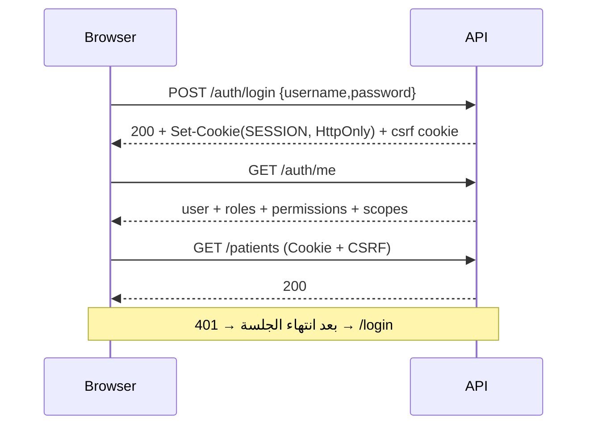

# 03 — Frontend Architecture

| Field | Value |
|---|---|
| Document ID | ARC-FE-001 |
| Version | 0.1 |
| Status | Approved (baseline 0.1) |
| Stack | React 19 · TypeScript 5.x · Vite · TanStack Query · React Router |
| Direction | RTL افتراضي · LTR للإنجليزية |
| Hosting | يُبنى إلى `smart-hospital-war/web` ويُخدَم من نفس الأصل |

---

## 1. المبادئ

| # | المبدأ | التطبيق |
|---|---|---|
| F1 | الواجهة لا تعرف قاعدة البيانات | لا SQL، لا مفاتيح أجنبية، لا حسابات مالية |
| F2 | الخادم هو الحكم | كل قاعدة تُعرض أيضًا تُفرض في الخادم |
| F3 | حالة الخادم ليست حالة واجهة | TanStack Query للبيانات، Zustand للـ UI فقط |
| F4 | RTL ليس "تحويلًا لاحقًا" | الاتجاه والخطوط من أول مكوّن |
| F5 | كل شاشة لها 4 حالات | Loading / Empty / Error / Success |
| F6 | الأداء ميزة | ميزانية حزمة + تحميل كسول للمسارات |
| F7 | الوصول للجميع | لوحة مفاتيح + تباين + ARIA |
| F8 | لا أسرار في المتصفح | لا توكن، لا مفاتيح، لا بيانات مريض في `localStorage` |

---

## 2. هيكل المشروع

```
frontend/
├── src/
│   ├── app/
│   │   ├── App.tsx
│   │   ├── router.tsx
│   │   ├── providers.tsx
│   │   └── guards.tsx
│   ├── shared/
│   │   ├── api/            // client, endpoints, error mapping
│   │   ├── auth/           // session, permissions, useCan
│   │   ├── ui/             // Button, Table, Modal, Field...
│   │   ├── layout/         // AppShell, Sidebar, Topbar
│   │   ├── i18n/           // ar.json, en.json, direction
│   │   ├── lib/            // dates, money, ULID, validation
│   │   └── hooks/
│   ├── modules/
│   │   ├── patients/
│   │   ├── scheduling/
│   │   ├── clinical/
│   │   ├── laboratory/
│   │   ├── pharmacy/
│   │   ├── admission/
│   │   ├── billing/
│   │   ├── inventory/
│   │   ├── reports/
│   │   ├── analytics/
│   │   └── admin/
│   ├── styles/
│   │   ├── tokens.css
│   │   └── global.css
│   └── main.tsx
├── public/
├── index.html
├── vite.config.ts
├── tsconfig.json
└── package.json
```

**قاعدة:** كل وحدة واجهة تعكس نطاقًا خلفيًا، وتستورد من `shared` فقط. لا استيراد مباشر بين وحدتين واجهتين إلا عبر `shared`.

---

## 3. التوجيه (Routing)

```
/login
/                          → تحويل حسب الدور
/app
  ├── /dashboard            → لوحة حسب الدور
  ├── /patients             → بحث + تسجيل
  ├── /patients/:publicId   → بطاقة + Timeline
  ├── /appointments         → تقويم + حجز
  ├── /reception            → Check-In + قائمة انتظار
  ├── /encounters/:id       → زيارة + توثيق
  ├── /lab                  → Worklist + نتائج
  ├── /pharmacy             → طابور وصفات + صرف
  ├── /admissions           → Bed Board + تنويم
  ├── /billing              → فواتير + دفع + إقفال
  ├── /inventory            → مخزون + دفعات
  ├── /reports              → تقارير
  ├── /analytics            → KPIs + بطاقات قرار
  ├── /admin                → مستخدمون، أدوار، إعدادات
  └── /audit                → تدقيق (AUDITOR)
```

| القاعدة | التطبيق |
|---|---|
| حارس المسار | `RequireAuth` + `RequirePermission` |
| تحميل كسول | `React.lazy` لكل وحدة |
| عنوان الصفحة | `document.title` بلغة المستخدم |
| 404/403 | شاشتان صريحتان، لا تحويل صامت |

---

## 4. إدارة الحالة

| النوع | الأداة | مثال | لا يُخزَّن |
|---|---|---|---|
| Server state | TanStack Query | قائمة مرضى، فاتورة | لا يُنسخ إلى Zustand |
| UI state | Zustand | الشريط الجانبي، الفلاتر المؤقتة | لا بيانات مريض |
| Form state | React Hook Form | نموذج تسجيل | لا يُحفظ في `localStorage` |
| URL state | `useSearchParams` | الصفحة، البحث، الترتيب | قابل للمشاركة |
| Session | Context + Query | المستخدم والصلاحيات | لا توكن |

**قاعدة TanStack Query:**

- `staleTime` 30 ثانية للبيانات المرجعية، 0 للبيانات السريرية الحية.
- `refetchOnWindowFocus` للقوائم الحرجة فقط.
- Invalidation بعد كل كتابة ناجحة.
- لا `retry` على 4xx، و`retry: 2` على 5xx/network.

---

## 5. عميل API

```ts
// shared/api/client.ts (تصميم)
export async function api<T>(path: string, init: RequestInit = {}): Promise<T> {
  const res = await fetch(`/api/v1${path}`, {
    ...init,
    credentials: "include",
    headers: {
      "Content-Type": "application/json",
      "X-CSRF-Token": getCsrfToken(),
      ...init.headers,
    },
  });
  if (!res.ok) throw await toApiError(res);
  return res.status === 204 ? (undefined as T) : res.json();
}
```

| البند | القرار |
|---|---|
| المصادقة | Cookie `HttpOnly` تلقائيًا (`credentials: include`) |
| CSRF | قراءة رمز من Cookie غير حساس + رأس `X-CSRF-Token` |
| الأخطاء | `ApiError { status, code, messageAr, messageEn, traceId, fieldErrors }` |
| 401 | مسح حالة الجلسة + تحويل إلى `/login` مع `returnTo` |
| 403 | شاشة صلاحية، لا إخفاء صامت |
| 409 | عرض تعارض + إعادة تحميل النسخة |
| Idempotency | رأس `Idempotency-Key` لعمليات الدفع/الصرف |
| الإلغاء | `AbortController` عند مغادرة الشاشة |
| التحميل | لا سبينر عالمي يمنع التفاعل؛ Skeleton لكل قسم |

---

## 6. المصادقة والجلسة



| الحالة | السلوك |
|---|---|
| انتهاء الجلسة أثناء العمل | حفظ المسار فقط (لا مدخلات حساسة) → دخول → عودة |
| مستخدم معطّل | 401 + رسالة "الحساب غير مفعّل" |
| تغيير كلمة المرور إلزامي | تحويل إلى `/change-password` قبل أي مسار |
| Break-Glass | شاشة سبب + مدة + تأكيد، ثم وسم واضح في الشريط العلوي |
| تسجيل الخروج | `POST /auth/logout` + مسح Query Cache |

**ممنوع:** تخزين التوكن أو كلمة المرور أو بيانات مريض في `localStorage`/`sessionStorage`.

---

## 7. التعريب وRTL

| البند | القرار |
|---|---|
| المكتبة | `i18next` + `react-i18next` |
| اللغات | `ar` (افتراضي)، `en` |
| الاتجاه | `dir="rtl"` لـ `ar`، `dir="ltr"` لـ `en` على `<html>` |
| الخط | `Noto Naskh Arabic` للعربي، `Inter` للإنجليزي (مضمّنة محليًا) |
| الأرقام | أرقام لاتينية في الحقول المالية والطبية (منع الالتباس) |
| التواريخ | `Intl.DateTimeFormat` بتوقيت المستشفى |
| العملة | `Intl.NumberFormat` + رمز قابل للتهيئة |
| الجمع العربي | صيغ `zero/one/two/few/many/other` |
| المصطلحات | مفاتيح موحدة، لا نصوص مبعثرة |

**قاعدة RTL:**

- استخدم خصائص منطقية: `margin-inline-start`, `padding-inline-end`, `inset-inline`.
- لا `left/right` ثابتة إلا لعناصر اتجاهية مقصودة (أيقونة سهم).
- الأيقونات الاتجاهية تُقلب بـ `transform: scaleX(-1)` عند الحاجة.
- الجداول: العمود الأول يبدأ من اليمين في RTL.

---

## 8. نظام التصميم (Design System)

### 8.1 الرموز (Tokens)

```css
:root {
  --color-primary-600: #0b6b5b;
  --color-primary-500: #0f8571;
  --color-danger-600: #b42318;
  --color-warning-600: #b54708;
  --color-success-600: #067647;
  --color-info-600: #175cd3;
  --color-surface: #ffffff;
  --color-bg: #f7f9fa;
  --color-text: #101828;
  --color-muted: #667085;
  --color-border: #d0d5dd;
  --radius-md: 8px;
  --space-1: 4px; --space-2: 8px; --space-3: 12px; --space-4: 16px;
  --font-ar: "Noto Naskh Arabic", serif;
  --font-en: "Inter", sans-serif;
  --shadow-card: 0 1px 2px rgba(16,24,40,.06), 0 1px 3px rgba(16,24,40,.10);
}
```

| الفئة | الاستخدام |
|---|---|
| Primary | إجراءات أساسية، روابط |
| Danger | حذف/إلغاء/حرج |
| Warning | تنبيه، نقص مخزون، قرب انتهاء |
| Success | اعتماد، دفع، اكتمال |
| Info | معلومات، إرشاد |
| Neutral | خلفيات، حدود، نص ثانوي |

**قاعدة:** لا يُعتمد اللون وحده لنقل الحالة (NFR-A11Y-004)؛ يُضاف نص/أيقونة.

### 8.2 المكوّنات الأساسية

`Button`, `IconButton`, `Input`, `Select`, `DatePicker`, `NumberField`, `Textarea`, `Checkbox`, `Radio`, `Switch`, `Tabs`, `Modal`, `Drawer`, `Toast`, `Alert`, `Badge`, `Table`, `Pagination`, `EmptyState`, `Skeleton`, `ConfirmDialog`, `PermissionGate`, `AuditTrail`, `PrintButton`.

**قاعدة:** كل مكوّن له: حالة `disabled`, `loading`, `error`, واختبار وصول. لا مكوّن بلا تسمية ARIA.

---

## 9. هياكل الشاشات حسب الدور

| الدور | الهيكل | الشاشة الافتراضية |
|---|---|---|
| R-03 استقبال | Sidebar: مرضى، مواعيد، انتظار، فواتير | `/reception` |
| R-04/R-05 طبيب | Sidebar: عيادتي، مرضى، مختبر، وصفات | `/dashboard` |
| R-06/R-07 تمريض | Sidebar: جناحي، مهام، علامات | `/admissions` (Ward Board) |
| R-08/R-09 مختبر | Worklist فقط + إشعارات | `/lab` |
| R-11 صيدلي | طابور وصفات + مخزون | `/pharmacy` |
| R-12/R-13 مالية | فواتير، دفع، تقارير | `/billing` |
| R-16 تدقيق | قراءة فقط + بحث تدقيق | `/audit` |
| R-02 إدارة | KPIs، مستخدمون، إعدادات | `/analytics` |

**قاعدة:** الواجهة تُخفي ما لا يملكه المستخدم، لكن **الخادم يرفض** أي محاولة بغض النظر عن الإخفاء.

---

## 10. النماذج (Forms)

| القاعدة | التطبيق |
|---|---|
| Schema | `zod` مشترك مع أنواع TypeScript |
| التحقق | عند الحقل + عند الإرسال |
| الأخطاء | عربية، عند الحقل، مع `aria-describedby` |
| الحفظ | زر واحد أساسي، تعطيل أثناء الإرسال |
| فقدان المدخلات | تحذير `beforeunload` عند وجود تغييرات |
| الحقول الحساسة | لا تُسجَّل في console |
| الإدخال السريع | اختصارات: `Enter` للحفظ، `Esc` للإلغاء، `F2` للبحث |
| النماذج الطويلة | تقسيم خطوات أو أقسام قابلة للطي |

---

## 11. الجداول والقوائم

| الميزة | القرار |
|---|---|
| Pagination | خادمية إلزامية |
| البحث | Debounce 300ms |
| الفرز | خادمي |
| الفلاتر | في URL |
| تحديد الصفوف | للإجراءات الجماعية المحدودة فقط |
| الأعمدة | قابلة للإخفاء/التثبيت للجداول الكبيرة |
| التصدير | CSV من الخادم، لا من المتصفح |
| الأداء | Virtualization عند > 100 صف معروض |

---

## 12. الطباعة

| البند | القرار |
|---|---|
| الأسلوب | `@media print` + قالب HTML مخصص |
| الخط | مضمّن، حجم 12–14pt |
| الاتجاه | RTL كامل |
| العناصر | شعار، اسم المستشفى، رقم المستند، التاريخ، المستخدم |
| الفواتير | نسخة للعميل + نسخة للأرشيف |
| نتائج المختبر | قيم مرجعية + وسم High/Low/Critical |
| PDF | "طباعة إلى PDF" من المتصفح |
| المعاينة | شاشة معاينة قبل الطباعة |

**ممنوع:** توليد PDF عربي عبر Canvas (جودة رديئة)، أو الاعتماد على خط النظام فقط.

---

## 13. SSE والتحديث الحي

```ts
// تصميم
const es = new EventSource("/api/v1/stream/notifications");
es.addEventListener("notification", (e) => queryClient.invalidateQueries(...));
es.onerror = () => { es.close(); startPolling(); };
```

| الحالة | السلوك |
|---|---|
| اتصال ناجح | تحديث فوري + شارة عدّاد |
| انقطاع | Fallback Polling كل 20 ثانية |
| صفحة مخفية | تقليل التحديث |
| جلسة منتهية | إغلاق SSE + تحويل للدخول |
| أكثر من تبويب | كل تبويب يتصل؛ الخادم يحدّ العدد |

---

## 14. الأداء

| المقياس | الهدف | كيف |
|---|---|---|
| الحزمة الأولية | ≤ 450 KB gzip | Code splitting + تحميل كسول |
| أول رسم مفيد | ≤ 3s على 10 Mbps | تقليل الخطوط والصور |
| تفاعل | ≤ 100ms | تجنب إعادة الرسم الكبيرة |
| جداول | ≤ 800ms للاستجابة | Pagination خادمية |
| الصور | WebP/AVIF + أحجام محددة | لا صور ضخمة |
| الخطوط | `font-display: swap` + subset عربي | ملفان كحد أقصى |

**ممنوع:** مكتبة UI ضخمة بلا داعٍ؛ تحميل كل الوحدات في الحزمة الأولى؛ صور base64 في CSS.

---

## 15. الأمان في الواجهة

| التهديد | الضابط |
|---|---|
| XSS | React escaping + لا `dangerouslySetInnerHTML` إلا لمحتوى معقّم |
| CSP | `default-src 'self'`، لا `unsafe-inline` في الإنتاج |
| CSRF | رأس رمز + SameSite |
| Clickjacking | `frame-ancestors 'none'` |
| تسريب بيانات | لا تخزين محلي، لا Logs حساسة |
| صلاحيات | `PermissionGate` للعرض + الخادم للحسم |
| روابط خارجية | `rel="noopener noreferrer"` |

---

## 16. الاختبار

| المستوى | الأداة | التغطية |
|---|---|---|
| Unit | Vitest | أدوات، حسابات عرض، صيغ |
| Component | Testing Library | نماذج، جداول، صلاحيات |
| E2E | Playwright | 12 سيناريو حرجًا |
| Accessibility | axe | كل شاشة رئيسية |
| Visual | Screenshot | RTL/LTR + حالات |

**سيناريوهات E2E الأساسية:** دخول → تسجيل مريض → حجز → زيارة → طلب مختبر → نتيجة → وصفة → صرف → فاتورة → دفع → تقرير.

---

## 17. البناء والنشر

```bash
cd frontend
npm ci
npm run build          # → dist/
# نسخ dist/* إلى smart-hospital-war/web/
ant -f smart-hospital-ear/build.xml
```

| البند | القرار |
|---|---|
| Base path | `/` (نفس الأصل) |
| API base | `/api/v1` |
| متغيرات البناء | `VITE_*` للقيم غير الحساسة فقط |
| الإصدار | `version` في `package.json` + عرضه في "حول" |
| التوافق | آخر إصدارين من Chrome/Edge |
| Polyfills | لا دعم IE |

---

## 18. المراجع

- `04-api-contracts.md` — العقود.
- `06-security-architecture.md` — CSP والجلسات.
- `deployment/03-installation.md` — خطوات البناء.
- `testing/01-test-plan.md` — خطة الاختبار.
