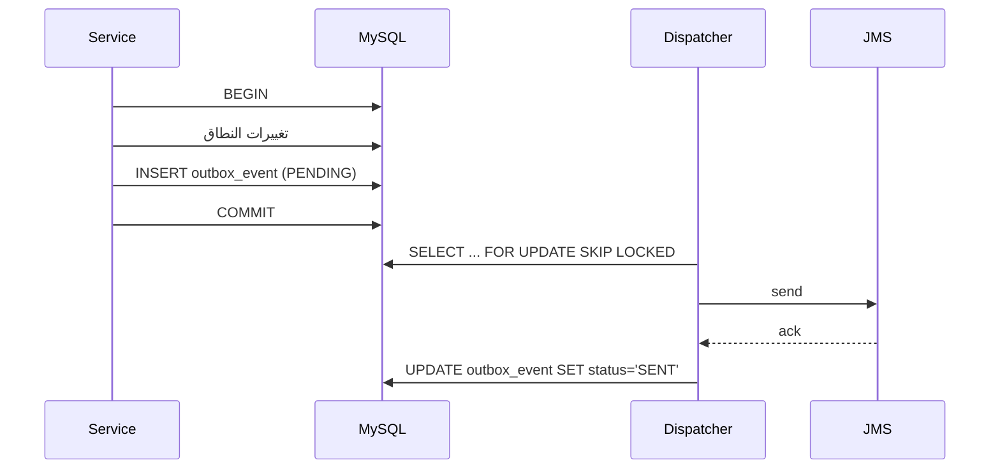

# 05 — Transactions & Concurrency

| Field | Value |
|---|---|
| Document ID | ARC-TX-001 |
| Version | 0.1 |
| Status | Approved (baseline 0.1) |
| DB | MySQL 8.0.38 · InnoDB |
| Isolation | `READ COMMITTED` |
| JTA | `jakarta.transaction` |

> **القاعدة الحاكمة:** لا تُقبل عملية طبية أو مالية بنتيجة "نصف صحيحة". إما أن تُحفظ كاملة، أو لا تُحفظ. وكل ازدواج محتمل يُمنع بثلاث طبقات: قيد قاعدة بيانات، قفل، ومفتاح Idempotency.

---

## 1. نموذج المعاملة

| البند | القرار | السبب |
|---|---|---|
| مدير المعاملات | JTA (GlassFish) | Jakarta EE أصلي |
| نمط الحقن | `@TransactionAttribute` | تصريحي وواضح |
| النطاق | طلب HTTP واحد = معاملة واحدة افتراضيًا | بساطة وسهولة تتبع |
| Commit | قبل إرسال الاستجابة | NFR-REL-001 |
| Rollback | عند أي `RuntimeException` أو `setRollbackOnly` | عدم حفظ جزئي |
| Timeout | 30 ثانية افتراضيًا، 120 للتقارير | منع المعاملات المعلّقة |
| XA | **ممنوع** | Outbox يغني عنه |

---

## 2. حدود المعاملة حسب العملية

| العملية | النطاق | ملاحظات |
|---|---|---|
| تسجيل مريض | خدمة واحدة | رقم طبي + مريض + تدقيق + outbox |
| حجز موعد | خدمة واحدة | فحص تعارض + إدراج + تدقيق |
| صرف دواء | خدمة واحدة | وصفة + دفعات + حركات + فاتورة + outbox |
| دفع | خدمة واحدة | دفعة + تخصيص + إيصال + تدقيق |
| تخصيص سرير | خدمة واحدة | قفل سرير + منع تداخل + تحديث |
| اعتماد نتيجة | خدمة واحدة | نتيجة + نسخة + إشعار |
| تقرير ثقيل | معاملة قراءة فقط | أو Async بلا معاملة طويلة |
| إرسال بريد | `NOT_SUPPORTED` | لا يمسك معاملة أثناء I/O |

**ممنوع:** فتح معاملة حول استدعاء HTTP خارجي، أو انتظار مستخدم، أو رفع ملف كبير.

---

## 3. مستويات العزل

### لماذا `READ COMMITTED`؟

| المستوى | المشكلة | القرار |
|---|---|---|
| `READ UNCOMMITTED` | قراءة قذرة | مرفوض |
| `READ COMMITTED` | يمنع القراءة القذرة؛ يسمح بـ Phantom محدود | **مختار** مع أقفال صريحة عند الحاجة |
| `REPEATABLE READ` (افتراضي MySQL) | Gap locks تزيد deadlocks | لا نعتمد عليه |
| `SERIALIZABLE` | خنق وتعارضات | مرفوض |

**التعويض:** كل حالة حساسة تستخدم قفلًا صريحًا أو قيد Unique، لا تعتمد على العزل وحده.

---

## 4. القفل المتفائل (Optimistic)

```java
@Entity
public class ClinicalNote extends BaseEntity {
    @Version
    private long version;
}
```

| البند | القرار |
|---|---|
| الاستخدام | الافتراضي لكل كيان قابل للتعديل |
| النقل | `version` في DTO + `If-Match` |
| الفشل | `409 VERSION_CONFLICT` + `currentVersion` |
| الواجهة | تعرض "تم التعديل من مستخدم آخر" + إعادة تحميل |
| لا يُستخدم | لعمليات الخصم/الدفع/السرير (تحتاج قفلًا متشائمًا) |

---

## 5. القفل المتشائم (Pessimistic) — الحالات المحددة

| الحالة | ما يُقفل | الاستعلام | لماذا |
|---|---|---|---|
| صرف دواء | دفعات الدواء المختارة | `SELECT ... FOR UPDATE` | منع صرف نفس الكمية مرتين |
| تخصيص سرير | السرير + التنويم | `SELECT ... FOR UPDATE` | منع سرير مزدوج |
| دفع فاتورة | الفاتورة | `SELECT ... FOR UPDATE` | منع تجاوز الرصيد |
| ترقيم مستند | عدّاد النوع | `SELECT ... FOR UPDATE` | منع رقم مكرر |
| إقفال وردية | جلسة الصندوق | `SELECT ... FOR UPDATE` | منع إقفال مزدوج |
| اعتماد نتيجة | النتيجة | `SELECT ... FOR UPDATE` | منع اعتمادين متزامنين |

### 5.1 مثال FEFO

```sql
SELECT id, batch_no, expiry_date, quantity_available
FROM stock_batches
WHERE drug_id = ?
  AND warehouse_id = ?
  AND status = 'ACTIVE'
  AND expiry_date > CURRENT_DATE
  AND quantity_available > 0
ORDER BY expiry_date ASC, id ASC
FOR UPDATE;
```

**قاعدة:** ترتيب الأقفال ثابت (`ORDER BY expiry_date, id`) لمنع deadlocks بين صرفين متزامنين.

### 5.2 مثال السرير

```sql
SELECT b.id, b.status
FROM beds b
WHERE b.id = ?
FOR UPDATE;

SELECT 1
FROM bed_assignments
WHERE bed_id = ?
  AND ended_at IS NULL
FOR UPDATE;
```

ثم إدراج `bed_assignment` جديد. القيد `UNIQUE(bed_id, active_flag)` يمنع أي تسرب.

---

## 6. القيود كخط دفاع أخير

| القيد | الغرض | مثال |
|---|---|---|
| `UNIQUE(bed_id, active_flag)` | سرير واحد نشط | `active_flag = 1` للنشط، `NULL` للمنتهي |
| `UNIQUE(provider_id, slot_start)` | موعد واحد لكل طبيب/فترة | مع `status IN ('BOOKED','CHECKED_IN')` |
| `UNIQUE(invoice_id, idempotency_key)` | دفع مكرر | مفتاح العميل |
| `UNIQUE(public_id)` | معرف عام فريد | كل الجداول |
| `CHECK(quantity > 0)` | كمية موجبة | حركات المخزون |
| `CHECK(amount >= 0)` | مبلغ غير سالب | الفواتير |
| `UNIQUE(dispensing_id, stock_batch_id)` | سطر صرف واحد لكل دفعة | منع التكرار |

**ملاحظة MySQL:** القيد الجزئي (Partial Index) غير مدعوم مباشرة؛ نستخدم عمود `active_flag` (`1` أو `NULL`) مع `UNIQUE`.

---

## 7. Idempotency

| البند | القرار |
|---|---|
| الجدول | `idempotency_keys` |
| المفتاح | `(user_id, endpoint, key)` فريد |
| القيمة | `request_hash`, `response_json`, `status`, `created_at`, `expires_at` |
| السلوك | نفس المفتاح + نفس الجسم ⇒ إرجاع الاستجابة المخزنة |
| اختلاف الجسم | `409 IDEMPOTENCY_MISMATCH` |
| المدة | 24 ساعة (قابلة للتهيئة) |
| التنظيف | مهمة يومية |
| إلزامي | الدفع، الصرف، الاسترداد، الاعتماد، إنشاء فاتورة |

**لماذا لا يكفي القفل؟** القفل يمنع التزامن، لكنه لا يمنع إعادة المحاولة بعد انقطاع الشبكة حيث وصل الطلب ونُفّذ لكن الاستجابة فُقدت.

---

## 8. Outbox داخل المعاملة



| القاعدة | التفصيل |
|---|---|
| الذرية | الحدث يُكتب في نفس معاملة التغيير |
| عدم الفقد | إن فشل JMS، يبقى `PENDING` |
| عدم التكرار | المستهلك يتحقق من `event_id` |
| الترتيب | `aggregate_id` + `created_at` |
| التزامن | Dispatcher واحد افتراضيًا، و`SKIP LOCKED` يسمح بأكثر |
| الفشل | 5 محاولات ثم `DEAD` + تنبيه |

---

## 9. إعادة المحاولة والتعارضات

| الحالة | السلوك | لا تفعل |
|---|---|---|
| `OptimisticLockException` | 409 + رسالة | لا تعد المحاولة تلقائيًا بلا وعي المستخدم |
| `Deadlock` (1213) | إعادة المحاولة مرة واحدة بعد 50–200ms | لا حلقة لا نهائية |
| `Lock wait timeout` (1205) | 503/409 + تسجيل | لا تجاهل |
| `Duplicate key` | 409 برسالة مفهومة | لا 500 |
| `Connection lost` | فشل واضح، لا نجاح وهمي | لا إعادة إرسال مالي بلا Idempotency |

**قاعدة:** إعادة المحاولة مسموحة فقط للعمليات Idempotent، وبحد أقصى مرتين.

---

## 10. ترتيب الأقفال

لمنع deadlocks، كل عملية تلتزم ترتيبًا ثابتًا:

| العملية | الترتيب |
|---|---|
| صرف | وصفة → دفعات (FEFO) → مخزون → فاتورة |
| دفع | فاتورة → دفعات مالية → صندوق |
| تنويم | مريض → تنويم → سرير |
| نقل | تنويم → سرير قديم → سرير جديد (بترتيب ID تصاعدي) |
| اعتماد نتيجة | طلب → نتيجة → نسخة |

**قاعدة عامة:** عند قفل أكثر من صف، رتّب حسب `id` تصاعديًا إن لم يوجد ترتيب دلالي.

---

## 11. المعاملات الطويلة والتقارير

| النمط | القرار |
|---|---|
| تقرير < 3 ثوانٍ | قراءة متزامنة |
| تقرير > 3 ثوانٍ | `202 Accepted` + `job_id` + Polling |
| تصدير كبير | ملف على الخادم + رابط مؤقت |
| تحليلات | Snapshot يومي، لا استعلام على الجداول الحية |
| مهام مجدولة | معاملة لكل دفعة صغيرة (100–500 صف) |
| أرشفة تدقيق | دفعات، `REQUIRES_NEW`، بلا قفل طويل |

---

## 12. مصفوفة اختبارات التزامن

| # | السيناريو | المتوقع | TC |
|---|---|---|---|
| C1 | صرفان متزامنان لنفس الدفعة | واحد ينجح، الآخر 409/كمية غير كافية | TC-167 |
| C2 | تخصيص نفس السرير لمريضين | واحد ينجح، الآخر 409 | TC-168 |
| C3 | دفعتان متزامنتان لنفس الفاتورة | مجموع لا يتجاوز الرصيد | TC-169 |
| C4 | نفس `Idempotency-Key` مرتين | استجابة واحدة، أثر واحد | TC-170 |
| C5 | تعديل ملاحظة موقّعة | 409 VERSION_CONFLICT | TC-171 |
| C6 | اعتماد نتيجة مرتين | اعتماد واحد | TC-172 |
| C7 | حجز نفس فترة الطبيب | واحد ينجح | TC-173 |
| C8 | إقفال وردية مرتين | واحد ينجح | TC-174 |
| C9 | تحويل مخزون يتجاوز الرصيد | 422 | TC-175 |
| C10 | فشل JMS بعد Commit | الحدث يبقى PENDING | TC-176 |
| C11 | فشل DB في منتصف الصرف | Rollback كامل | TC-177 |
| C12 | انقطاع الشبكة بعد الدفع | إعادة المحاولة لا تكرر | TC-178 |

> تُنفّذ بـ 20–50 خيطًا متزامنًا على بيئة اختبار، مع تحقق DB بعد كل سيناريو.

---

## 13. مضادّات الأنماط

| النمط | لماذا مرفوض |
|---|---|
| `@TransactionAttribute(NEVER)` على خدمة كتابة | لا حماية |
| استدعاء ذاتي لطريقة معاملاتية | لا يُطبَّق الـ Proxy |
| `EntityManager` في WAR | يكسر الحدود |
| قفل جدول كامل | يوقف المستشفى |
| `SELECT` بلا `FOR UPDATE` ثم `UPDATE` | Lost update |
| الاعتماد على `AUTO_INCREMENT` كمعرّف عام | كشف التسلسل |
| نوم داخل معاملة | يمسك أقفالًا بلا داعٍ |
| `XA` بين DB وJMS | تعقيد وهشاشة |

---

## 14. قرارات مرتبطة

| القرار | المرجع |
|---|---|
| Outbox | ADR-005 |
| قفل متفائل + متشائم انتقائي | ADR-008 |
| `READ_COMMITTED` | ADR-013 |
| Idempotency | `04-api-contracts.md` §4 |
| منع الحذف المالي | ADR-012 |

---

## 15. قائمة تحقق للمراجعة

- [ ] كل عملية كتابة داخل معاملة.
- [ ] لا استدعاء خارجي داخل معاملة.
- [ ] الحالات الحرجة لها قفل صريح أو Unique.
- [ ] كل عملية حساسة Idempotent.
- [ ] لا `catch` يبتلع استثناءً ويُكمل.
- [ ] لا نجاح قبل Commit.
- [ ] اختبار تزامن لكل مسار مالي/سريري.
- [ ] ترتيب أقفال موثّق.
