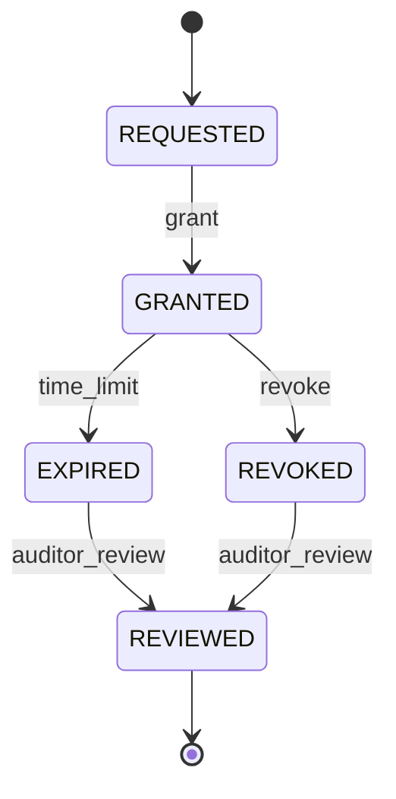

# 06 — Security Architecture

| Field | Value |
|---|---|
| Document ID | ARC-SEC-001 |
| Version | 0.1 |
| Status | Approved (baseline 0.1) |
| Model | Defense in depth · Least privilege · Audit by default |
| Standard reference | OWASP ASVS 4.0 (كمرجع تقني، لا ادعاء شهادة) |

> **حدود صريحة:** هذه الوثيقة تصف **ضوابط تقنية**. لا تدّعي امتثالًا قانونيًا (HIPAA/GDPR/محلي). أي ادعاء امتثال يحتاج مراجعة قانونية وتوقيعًا من الجهة المختصة (ASM-014).

---

## 1. أهداف الأمن

| الهدف | المعنى العملي | الضابط الأساسي |
|---|---|---|
| السرية | لا يرى المستخدم إلا ما يحتاجه | RBAC + Data Scope + Masking |
| السلامة | لا تعديل غير مصرح | Authorization + Audit + Versioning |
| التوافر | النظام يعمل وقت الحاجة | UPS + Backup + Monitoring |
| عدم الإنكار | كل فعل منسوب لصاحبه | Audit Insert-only + Hash chain |
| التتبع | يمكن تفسير ما حدث | Trace ID + Access Logs |
| الحد الأدنى | أقل صلاحية وأقل بيانات | Least privilege + DTO |

---

## 2. نموذج التهديد (STRIDE)

| التهديد | السيناريو | الضابط | المتبقي |
|---|---|---|---|
| **S**poofing | سرقة جلسة/كلمة مرور | Cookie HttpOnly + Rotation + Lockout + MFA اختياري | سرقة جهاز غير مقفل |
| **T**ampering | تعديل فاتورة/نتيجة | RBAC + Audit + Version + منع UPDATE بعد التوقيع | صلاحية DBA |
| **R**epudiation | "لم أصدّر الدواء" | Audit + User ID + Timestamp + Hash chain | ساعة خاطئة (NTP) |
| **I**nformation disclosure | قراءة مريض خارج النطاق | Data Scope + Field Masking + DTO | تصوير الشاشة |
| **D**enial of service | إغراق API | Rate limit + Timeout + Pool limit | هجوم داخل الشبكة |
| **E**levation of privilege | دور منخفض ينفّذ عملية إدارية | Server-side check + SoD | خطأ إعداد دور |
| CSRF | طلب كتابة من موقع آخر | CSRF token + SameSite | متصفح قديم |
| XSS | حقن سكربت في ملاحظة | React escaping + CSP + تعقيم | امتداد متصفح خبيث |
| IDOR | تغيير `public_id` لسجل آخر | Scope check لكل قراءة | تسريب معرف |
| Path traversal | تنزيل مرفق باسم `../../` | تخزين بأسماء عشوائية + تحقق ملكية | — |

---

## 3. المصادقة (Authentication)

### 3.1 كلمة المرور

| البند | القرار |
|---|---|
| الخوارزمية | `PBKDF2WithHmacSHA256` (JDK) |
| التكرارات | ≥ 600,000 |
| الملح | 16 بايت عشوائي لكل مستخدم |
| الطول | ≥ 12 حرفًا |
| التعقيد | لا يُفرض تنوّع رموز صارم؛ يُمنع القاموس الشائع |
| التاريخ | منع إعادة آخر 5 كلمات |
| الانتهاء | 180 يومًا للأدوار الحساسة، 365 للعادية (قابل للتهيئة) |
| التخزين | `password_hash`, `password_salt`, `password_algo`, `password_iterations` |
| الترقية | إعادة hash عند الدخول إن تغيّرت المعايير |

**لماذا PBKDF2 وليس Argon2id؟** لا اعتماديات خارجية، متوافق مع JDK 17، وكافٍ مع 600k تكرار. مسار الترقية موثّق في ADR-004.

### 3.2 القفل والمحاولات

| البند | القرار |
|---|---|
| الحد | 5 محاولات فاشلة |
| المدة | 15 دقيقة (قابلة للتهيئة) |
| النطاق | حساب + IP |
| التسجيل | `login_attempts` لكل محاولة |
| الإخطار | تنبيه للمسؤول عند 10 محاولات/ساعة |
| كشف التعداد | رسالة موحدة "بيانات الدخول غير صحيحة" |

### 3.3 الجلسة

| البند | القرار |
|---|---|
| التخزين | GlassFish HTTP Session (ذاكرة) |
| الكوكي | `HttpOnly; Secure; SameSite=Strict; Path=/` |
| Rotation | معرف جديد عند الدخول وعند رفع الصلاحية |
| الخمول | 30 دقيقة (قابل للتهيئة) |
| المطلق | 12 ساعة |
| الإبطال | فوري عند تعطيل المستخدم/تغيير الدور/تسجيل الخروج |
| التتبع | `user_sessions` للتدقيق (لا تُخزَّن الجلسة نفسها) |
| التزامن | حد أقصى 3 جلسات نشطة للمستخدم |

### 3.4 MFA

| البند | القرار |
|---|---|
| النوع | TOTP (RFC 6238) |
| التفعيل | اختياري للأدوار الحساسة (PD-008) |
| الاسترداد | 8 رموز لمرة واحدة، مخزّنة hash |
| التعطيل | يتطلب `IAM:WRITE` + سبب + تدقيق |
| الإلزام | قابل للتهيئة لكل دور |

### 3.5 Break-Glass



| القيد | القيمة |
|---|---|
| المدة | ≤ 60 دقيقة |
| النطاق | مريض واحد + سبب إلزامي |
| الصلاحية | قراءة فقط افتراضيًا |
| الإشعار | للمسؤول + المدقق فورًا |
| المراجعة | إلزامية خلال 72 ساعة |
| العرض | وسم واضح في الشريط العلوي |
| التدقيق | كل وصول مسجّل |

---

## 4. التخويل (Authorization)

### 4.1 النموذج

```
User → Roles → Permissions
User → Data Scopes (Branch / Department / Ward / Own Patients)
Permission + Scope + Resource → Allow / Deny
```

### 4.2 نقاط الفرض

| الطبقة | ماذا تفرض | لا تكفي وحدها |
|---|---|---|
| Nginx | TLS، Rate limit | لا تعرف المستخدم |
| Filter (WAR) | جلسة، CSRF، رأس أمان | لا تعرف نطاق البيانات |
| Service (EJB) | **الصلاحية + النطاق + القاعدة** | — |
| Repository | فلترة النطاق في الاستعلام | لا تعرف القاعدة |
| DB | قيود السلامة | لا تعرف الدور |
| UI | إخفاء الأزرار | **لا يُعتمد إطلاقًا** |

**قاعدة ذهبية:** كل نقطة نهاية تستدعي `authorization.require(...)` قبل أي قراءة/كتابة. لا استثناء.

### 4.3 نطاق البيانات

| النطاق | التطبيق |
|---|---|
| Branch | `branch_id = user.branch_id` |
| Department | `department_id IN user.departments` |
| Ward | `ward_id IN user.wards` |
| Own Patients | `attending_doctor_id = user.id` أو علاقة علاج |
| All (Audit) | قراءة تدقيق فقط، بلا تعديل |

**مثال خطر:** طبيب في قسم الباطنة يطلب `GET /patients/{id}` لمريض في قسم آخر ⇒ `403` حتى لو كان يملك `PAT:READ`. النطاق يُطبَّق في الاستعلام نفسه، لا بعد الجلب.

### 4.4 فصل المهام (SoD)

| العملية | لا يجمعها دور واحد |
|---|---|
| إنشاء مستخدم + اعتماد صلاحيته | `IAM:WRITE` + `IAM:APPROVE` |
| صرف دواء + اعتماد الجرد | `PHR:DISPENSE` + `INV:COUNT` |
| تسجيل دفعة + إقفال الصندوق | `BIL:PAY` + `BIL:CASH` (يُفضّل) |
| اعتماد نتيجة مختبر + إدخالها | `LAB:RESULT` + `LAB:VERIFY` |
| اعتماد قرار + تنفيذه | `DEC:APPROVE` + `DEC:EXECUTE` |

### 4.5 إخفاء الحقول

| التصنيف | مثال | من يرى |
|---|---|---|
| عام | الاسم، الجنس | كل من يملك `PAT:READ` |
| حساس | الهوية الوطنية، الهاتف | `PAT:READ` + نطاق |
| طبي حساس | تشخيص نفسي، حساسية | `EMR:READ` + علاقة علاج |
| مالي | الراتب، الخصم | `FIN:*` فقط |
| تدقيقي | IP، جلسات | `AUDIT:READ` فقط |

**التطبيق:** `@Sensitive(category = ...)` + `MaskingMapper` في DTO. لا تُرسل الحقول المخفية أصلًا، لا تُرسل مقنّعة فقط.

---

## 5. أمن الويب

| الضابط | القرار |
|---|---|
| TLS | 1.2+ فقط، HSTS في الإنتاج |
| CSRF | Double-submit cookie + رأس `X-CSRF-Token` |
| SameSite | `Strict` |
| XSS | React escaping + CSP `default-src 'self'` |
| `unsafe-inline` | ممنوع في الإنتاج (عدا hash موثّق) |
| Clickjacking | `frame-ancestors 'none'` |
| MIME sniffing | `X-Content-Type-Options: nosniff` |
| Referrer | `strict-origin-when-cross-origin` |
| CORS | لا حاجة (نفس الأصل)؛ مرفوض افتراضيًا |
| Rate limit | Nginx + التطبيق |
| رؤوس الأخطاء | بلا Stack/SQL/إصدارات |

### رؤوس الاستجابة الإلزامية

```
Strict-Transport-Security: max-age=31536000; includeSubDomains
Content-Security-Policy: default-src 'self'; img-src 'self' data:; style-src 'self'; script-src 'self'; connect-src 'self'; frame-ancestors 'none'; base-uri 'self'; form-action 'self'
X-Content-Type-Options: nosniff
X-Frame-Options: DENY
Referrer-Policy: strict-origin-when-cross-origin
Permissions-Policy: camera=(), microphone=(), geolocation=()
Cache-Control: no-store (للبيانات الحساسة)
```

---

## 6. حماية البيانات

### 6.1 التصنيف

| الفئة | أمثلة | التخزين | النقل | السجلات |
|---|---|---|---|---|
| سري للغاية | كلمة مرور، TOTP secret | Hash/مشفّر | TLS | ممنوع |
| طبي حساس | تشخيص، نتيجة، حساسية | DB | TLS | ممنوع |
| شخصي | اسم، هاتف، هوية | DB | TLS | ممنوع في Logs |
| مالي | فاتورة، دفعة | DB | TLS | مسموح بالمعرّف فقط |
| تشغيلي | IP، Trace ID | DB/Log | TLS | مسموح |

### 6.2 التشفير

| البند | القرار |
|---|---|
| أثناء النقل | TLS 1.2+ |
| أثناء التخزين (DB) | تشفير قرص/Volume (LUKS/BitLocker) — مسؤولية البنية |
| النسخ الاحتياطي | مشفّر (GPG/Age أو أداة النسخ) |
| الملفات | مخزّنة خارج webroot، أسماء عشوائية، وصول عبر API |
| الأسرار | خارج الكود، في ملف إعداد بصلاحية 600 |

**لا نستخدم تشفير عمود على مستوى التطبيق في v1** (يعقّد البحث والفهارس)؛ نعتمد تشفير القرص + صلاحيات DB. يُسجَّل كقرار في ADR-017.

### 6.3 السجلات

| ممنوع في Log | البديل |
|---|---|
| اسم مريض | `patientPublicId` |
| رقم هوية/هاتف | `***` أو hash |
| تشخيص | `encounterPublicId` |
| كلمة مرور/توكن | لا شيء |
| جسم الطلب الكامل | الحقول المسموحة فقط |

---

## 7. التدقيق وعدم الإنكار

| البند | القرار |
|---|---|
| الجدول | `audit_logs` (Insert-only) |
| الحقول | من، ماذا، متى، أين، قبل/بعد، Trace ID |
| السلسلة | `prev_hash` + `hash` لكل سجل |
| التحقق | مهمة يومية تتحقق من السلسلة |
| الصلاحية | التطبيق: INSERT فقط؛ لا UPDATE/DELETE |
| الاحتفاظ | 7 سنوات (PD-012) |
| الأرشفة | Partitioning شهري + أرشيف |
| وصول | `AUDIT:READ` فقط |

**ما يُسجَّل إلزاميًا:** الدخول/الخروج، تغيير الصلاحيات، قراءة سجل طبي حساس، إنشاء/تعديل/إلغاء مالي، صرف/إرجاع، اعتماد نتيجة، Break-Glass، تغيير إعداد.

---

## 8. أمن الملفات

| الضابط | القرار |
|---|---|
| الأنواع | PDF, JPG, PNG, WEBP فقط |
| الحجم | ≤ 10 MB |
| الاسم | UUID عشوائي، لا اسم المستخدم |
| التخزين | `/opt/smarthospital/files/<yyyy>/<mm>/` |
| الوصول | `GET /attachments/{id}` بعد فحص الملكية والصلاحية |
| التنفيذ | `Content-Disposition: attachment` + `X-Content-Type-Options` |
| الفحص | تحقق Magic Bytes، لا الامتداد فقط |
| الفيروسات | فحص ClamAV اختياري في الإنتاج |

---

## 9. الأسرار والإعدادات

| البند | القرار |
|---|---|
| كلمة مرور DB | ملف `glassfish-secrets.properties` بصلاحية 600 |
| مفتاح التشفير | خارج المستودع، نسخة ورقية/خزنة |
| JNDI | لا أسرار في `web.xml` |
| المتغيرات | `-D` في `domain.xml` أو ملف خارجي |
| المستودع | `.gitignore` + فحص `git grep` |
| التغيير | كل 180 يومًا أو عند مغادرة موظف |

---

## 10. التطوير الآمن

| المرحلة | النشاط |
|---|---|
| التصميم | مراجعة تهديدات لكل وحدة جديدة |
| الكود | مراجعة إلزامية للعمليات المالية/الصلاحيات |
| البناء | فحص اعتماديات (OWASP Dependency-Check) |
| الاختبار | ZAP baseline + اختبار IDOR + CSRF |
| النشر | فحص إعداد TLS + رؤوس |
| التشغيل | مراجعة Logs + تنبيهات |

---

## 11. خريطة OWASP ASVS (مختصرة)

| الفئة | التطبيق | الحالة |
|---|---|---|
| V1 Architecture | حدود وحدات، تهديدات | ✅ تصميم |
| V2 Authentication | PBKDF2، قفل، MFA | ✅ |
| V3 Session | Cookie، Rotation، Timeout | ✅ |
| V4 Access Control | RBAC + Scope + SoD | ✅ |
| V5 Validation | Bean Validation + قيود | ✅ |
| V6 Cryptography | TLS + PBKDF2 + تشفير نسخ | ✅ |
| V7 Error/Logging | أخطاء موحدة، بلا بيانات حساسة | ✅ |
| V8 Data Protection | تصنيف + تقنيع | ✅ |
| V9 Communication | TLS 1.2+ | ✅ |
| V10 Malicious Code | لا تنفيذ ملفات مرفوعة | ✅ |
| V11 Business Logic | قواعد عمل + Idempotency | ✅ |
| V12 Files | تحقق نوع/حجم/ملكية | ✅ |
| V13 API | عقد + Rate limit | ✅ |
| V14 Config | أسرار خارجية | ✅ |

> "✅ تصميم" تعني أن الضابط موثّق ومخطط، لا أنه مُختبر بعد. الاختبار في `testing/01`.

---

## 12. الاستجابة للحوادث

| المستوى | المثال | الإجراء | الزمن |
|---|---|---|---|
| P1 | تسريب بيانات/اختراق | عزل الخادم، إبطال الجلسات، إشعار المالك، تحقيق | فوري |
| P2 | وصول غير مصرح مؤكد | تعطيل الحساب، مراجعة Audit، إشعار | ≤ 1 ساعة |
| P3 | محاولات دخول مكثفة | حظر IP، مراقبة | ≤ 4 ساعات |
| P4 | خطأ إعداد أمني | إصلاح مجدول | ≤ 7 أيام |

**سجل الحادث:** الوقت، الاكتشاف، النطاق، السبب، الإجراء، الدروس المستفادة. لا يُحذف.

---

## 13. ما لا تدّعيه هذه الوثيقة

- لا ادعاء HIPAA/GDPR/امتثال محلي.
- لا ادعاء اختبار اختراق خارجي.
- لا ادعاء تشفير End-to-End.
- لا ادعاء منع Insider Threat.
- لا ادعاء توافق FHIR Security.

هذه ادعاءات تحتاج جهة خارجية ومراجعة قانونية.

---

## 14. المراجع

- `05-transactions-concurrency.md` — السلامة.
- `07-notification-architecture.md` — عدم فقد الأحداث.
- `deployment/02-network-topology.md` — Firewall وVLAN.
- `testing/01-test-plan.md` — اختبارات الأمن.
- `requirements/06-rbac-matrix.md` — الأدوار والصلاحيات.
