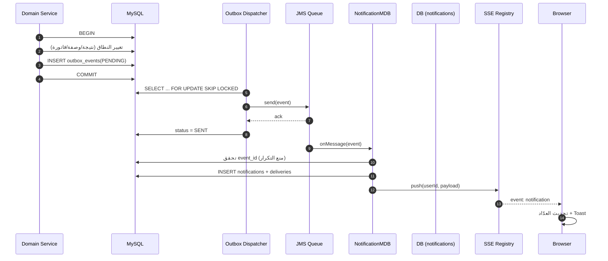

# 07 — Notification Architecture

| Field | Value |
|---|---|
| Document ID | ARC-NOT-001 |
| Version | 0.1 |
| Status | Approved (baseline 0.1) |
| Pattern | Transactional Outbox → JMS → MDB → Channel |
| Realtime | SSE + Polling fallback |
| Guarantee | At-least-once مع منع التكرار |

> **المبدأ:** الإشعار ليس "رسالة تجميلية". فقدان إشعار نتيجة مختبر حرجة قد يعني تأخر علاج. لذلك لا يُرسل الإشعار داخل معاملة العملية، ولا يُفقد إذا تعطّل JMS، ولا يتكرر إذا أعاد النظام المحاولة.

---

## 1. المتطلبات المرتبطة

| المتطلب | ما يعنيه معمارياً |
|---|---|
| FR-NOT-001 | إشعار داخلي عند أحداث محددة |
| FR-NOT-002 | أولوية Critical/High/Normal |
| FR-NOT-003 | لا تكرار لنفس المستخدم/الحدث |
| FR-NOT-004 | SSE + Fallback Polling |
| FR-NOT-005 | إعادة محاولة + تسجيل |
| FR-NOT-006 | Inbox + مقروء |
| NFR-REL-003 | فشل الإشعار لا يفقد العملية |
| NFR-REL-004 | 5 محاولات ثم DLQ |

---

## 2. التدفق الكامل



**نقاط الضمان:**

1. الحدث مكتوب في نفس معاملة التغيير ⇒ لا فقدان.
2. Dispatcher يستخدم `SKIP LOCKED` ⇒ لا ازدواج بين نسختين.
3. MDB يتحقق من `event_id` ⇒ لا تكرار.
4. SSE فشل ⇒ يبقى الإشعار في Inbox ويُقرأ بـ Polling.

---

## 3. جدول Outbox

```sql
outbox_events (
  id              BIGINT PK,
  event_id        CHAR(26) UNIQUE,      -- ULID
  event_type      VARCHAR(80),          -- LabResultReleased
  aggregate_type  VARCHAR(40),
  aggregate_id    CHAR(26),
  payload_json    JSON,
  status          ENUM('PENDING','PROCESSING','SENT','FAILED','DEAD'),
  attempts        INT DEFAULT 0,
  next_attempt_at DATETIME(6),
  last_error      VARCHAR(500),
  created_at      DATETIME(6),
  processed_at    DATETIME(6)
)
```

| الفهرس | الغرض |
|---|---|
| `(status, next_attempt_at, id)` | جلب الدفعة التالية |
| `(aggregate_type, aggregate_id, created_at)` | ترتيب الأحداث |
| `(created_at)` | الأرشفة |

**قاعدة:** لا يُحذف الحدث؛ يُؤرشف بعد 30 يومًا من `SENT`.

---

## 4. Dispatcher

| البند | القرار |
|---|---|
| النوع | `@Singleton @Startup` + `@Schedule(every 5s)` |
| الدفعة | 25 حدثًا |
| المطالبة | `UPDATE … SET status='PROCESSING', claimed_at=NOW(6), claim_token=? WHERE status='PENDING' … ORDER BY id LIMIT n` — بيان واحد ذرّي |
| المعاملة | `REQUIRES_NEW` لكل عملية (استعادة lease، مطالبة، تسليم، تسجيل فشل) |
| التسليم | تحقّق من عقد الحمولة ثم نشر إلى `jms/NotificationQueue` داخل المعاملة، و`SENT` بعد قبول الوسيط |
| الفشل | `attempts++` + backoff + `next_attempt_at` |
| الحد | `outbox.max.attempts` (افتراضي 8) ثم `DEAD` |
| المراقبة | `/admin/outbox/stats` + `/admin/outbox/events` |
| التزامن | أكثر من عامل مسموح؛ `claim_token` يمنع التقاطع |

**Backoff:** `min(300, 5·n²)` ثانية.

> **تحديث تنفيذي (2026-11-17) — يلغي `SKIP LOCKED`:** النمط الأولي (`SELECT … FOR UPDATE SKIP LOCKED` ثم `UPDATE` لكل صف) سبّب **deadlock على gap locks** في الفهرس الثانوي وأوقف المؤقّت 50 ثانية. الاستبدال: بيان `UPDATE … ORDER BY id LIMIT n` واحد يختم الصفوف بـ`claim_token` (ULID)، ثم `SELECT` بالمفتاح نفسه. كذلك تبيّن أن GlassFish **يتجاهل `NOT_SUPPORTED`** على callback المؤقّت، فيعمل الـpoller داخل معاملة حاوية؛ لذلك **كل** دوال `OutboxDispatcher` — بما فيها `recoverStale` — صارت `REQUIRES_NEW`، وإلا انتظرت المطالبة أقفالًا يملكها خيطها نفسه. `poll()` يغلّف كل شيء في `catch (Throwable)` لأن أي استثناء نظامي يلغي مؤقّتًا غير دائم نهائيًا (`EJB5119`). التفصيل في `testing/06-phase6-evidence.md` §4.

---

## 5. JMS Destinations

| الاسم | النوع | المستهلك | الغرض |
|---|---|---|---|
| `jms/NotificationQueue` | Queue | `NotificationMDB` | إنشاء إشعارات |
| `jms/AnalyticsQueue` | Queue | `AnalyticsMDB` | تحديث مؤشرات فورية |
| `jms/IntegrationQueue` | Queue | `IntegrationMDB` | رسائل خارجية (مستقبلي) |
| `jms/NotificationDLQ` | Queue | مراجعة يدوية | الرسائل الميتة |

**قاعدة:** Queue لا Topic. كل حدث يُعالَج مرة واحدة؛ التوسع لاحقًا عبر مستهلكين متعددين.

> **حالة التنفيذ (2026-11-17، محدّثة):** المسار المنفّذ هو **Outbox → Dispatcher → JMS Queue → `NotificationMdb` → Inbox + SSE**. الـDispatcher يتحقق من عقد الحمولة ثم ينشر إلى `jms/NotificationQueue` داخل معاملة الحاوية ويسجّل `SENT` بعد قبول الوسيط؛ فشل الإرسال يُرجع الحدث `PENDING` (TC-176). الـMDB يستهلك ويستدعي `NotificationDelivery` في معاملة `REQUIRES_NEW`؛ تُعدّ المحاولات على صف الـoutbox، وبعد 3 محاولات تُحجز الرسالة في `jms/NotificationDLQ` ويصبح الحدث `DEAD` قابلًا لإعادة التشغيل. `jms/AnalyticsQueue` و`jms/IntegrationQueue` ما زالتا تصميمًا مستقبليًا.

---

## 6. نموذج الإشعار

| الحقل | النوع | ملاحظة |
|---|---|---|
| `id` | BIGINT | داخلي |
| `public_id` | ULID | للـ API |
| `recipient_user_id` | BIGINT | المستخدم |
| `event_id` | ULID | منع التكرار |
| `type` | VARCHAR | `LAB_CRITICAL`, `PRESCRIPTION_READY`, ... |
| `priority` | ENUM | `CRITICAL`, `HIGH`, `NORMAL` |
| `title_key` | VARCHAR | مفتاح ترجمة |
| `body_key` | VARCHAR | مفتاح ترجمة |
| `params_json` | JSON | قيم آمنة (بلا PHI) |
| `link` | VARCHAR | مسار داخلي |
| `read_at` | DATETIME | null = غير مقروء |
| `created_at` | DATETIME | UTC |
| `expires_at` | DATETIME | اختياري |

**قاعدة الخصوصية:** لا يُخزَّن اسم المريض أو التشخيص في نص الإشعار. يُخزَّن `patientPublicId` ويُجلب الاسم عند العرض حسب الصلاحية.

---

## 7. الأولويات

| الأولوية | أمثلة | القناة | السلوك |
|---|---|---|---|
| `CRITICAL` | نتيجة مختبر حرجة، تفاعل دوائي شديد، Break-Glass | SSE + Inbox + Banner | لا يُكتم، يظهر حتى يُقرأ |
| `HIGH` | وصفة جاهزة، سرير متاح، فاتورة متأخرة | SSE + Inbox | Toast + عدّاد |
| `NORMAL` | اعتماد تقرير، تحديث حالة | Inbox | عدّاد فقط |

**قاعدة:** الأولوية يحددها **نوع الحدث**، لا المرسل. لا يمكن لمستخدم رفع أولوية إشعار يدويًا.

> **تحديث تنفيذي (2026-11-17):** في قاعدة البيانات تُخزَّن الأولوية كعدد صحيح `priority` (0–100) بجانب `severity` النصية. تُشتق تلقائيًا من الخطورة (`CRITICAL=100` · `WARNING=50` · `INFO=0`)، ويمكن للمُنتج تمرير `priority` صريح. المطالبة من الـoutbox مرتّبة `ORDER BY priority DESC, id` (FIFO داخل النطاق نفسه)، وصندوق الوارد مرتّب `ORDER BY priority DESC, created_at DESC, id DESC`، فيتصدّر الحدث الحرج حتى لو وصل متأخرًا. الإثبات: TC-134 (حرج يقفز 36 حدثًا `INFO`) وTC-139 (ترتيب الوارد).

---

## 8. منع التكرار (Deduplication)

| المستوى | الآلية |
|---|---|
| الحدث | `event_id` فريد في `outbox_events` |
| الاستهلاك | `UNIQUE(recipient_user_id, event_id)` في `notifications` |
| القناة | لا إرسال ثانٍ لنفس `notification_id` |
| SSE | العميل يتجاهل `id` مكررًا |
| Polling | نفس القاعدة |

**الاستثناء:** التذكيرات الدورية (مثل "مهمة متأخرة") لها `dedupe_key` يومي (`type + entity + date`).

---

## 9. القنوات

| القناة | v1 | ملاحظات |
|---|---|---|
| In-App Inbox | ✅ | المصدر الأساسي |
| SSE | ✅ | فوري داخل المتصفح |
| Polling | ✅ | احتياطي كل 20 ثانية |
| Email (SMTP داخلي) | اختياري | للإشعارات غير الحرجة |
| SMS | Future | يحتاج مزوّد وموافقة |
| Push/Mobile | Future | لا تطبيق أصلي |

**قاعدة:** لا تُستخدم قناة خارجية لإشعار حرج في v1؛ الاعتماد على Inbox + SSE.

---

## 10. SSE

| البند | القرار |
|---|---|
| المسار | `GET /api/v1/notifications/stream` |
| الصيغة | `text/event-stream` |
| المصادقة | جلسة + CSRF لا ينطبق على GET |
| الاتصال | اتصالان كحد أقصى/مستخدم |
| Heartbeat | كل 20 ثانية |
| الاستئناف | `Last-Event-ID` |
| الإغلاق | عند تسجيل الخروج/انتهاء الجلسة |
| الخادم | Registry في الذاكرة (ConcurrentHashMap) |
| الفشل | العميل يتحول إلى Polling |

> **تحديث تنفيذي (2026-11-17):** يرسل الخادم `Cache-Control: no-cache, no-transform` و`X-Accel-Buffering: no` و`Connection: keep-alive` كي لا يخزّن Nginx الإطارات؛ ويوجد إعداد مرجعي جاهز في `deploy/nginx/smart-hospital.conf` (`proxy_buffering off`، `proxy_read_timeout 1h`، `Connection ""`). كل نبضة 20 ثانية تتحقق من `user_sessions.ended_at` وتغلق `SseEventSink` بعد تسجيل الخروج أو الإبطال الإداري (`DELETE /admin/sessions/{id}`)، والإثباتان TC-137 (ترويسات + إغلاق بعد 9 ثوانٍ).

```java
@GET
@Path("/stream")
@Produces(MediaType.SERVER_SENT_EVENTS)
public void stream(@Context Sse sse, @Context SecurityContext ctx) {
    SseEventSink sink = sse.newEventSink();
    registry.register(currentUser(ctx), sink);
    // heartbeat via ScheduledExecutor
}
```

**قيد:** في حال تشغيل أكثر من خادم تطبيق لاحقًا، يحتاج Registry إلى Backplane (JMS Topic). موثّق كنقطة توسّع.

> **تحديث تنفيذي (2026-11-17):** التوزيع **غير متزامن**: خيط كاتب واحد (`sh-notify-push`) يستهلك طابورًا محدودًا (4096، سياسة إسقاط)، لأن الكتابة المتزامنة داخل `afterCompletion` كانت تُبقي أقفال صفوف الـOutbox مفتوحة وتوقف الطابور على `Lock wait timeout`. المستمع الذي يبقى مشغولًا >30 ثانية يُغلق من الـHeartbeat. كذلك يلزم `<async-supported>true</async-supported>` و`ASYNC` dispatcher للمرشّحات في `web.xml`، وإلا أعاد المسار 500.

---

## 11. Polling Fallback

| البند | القرار |
|---|---|
| المسار | `GET /notifications?unread=true&since=<timestamp>` |
| الفاصل | 20 ثانية (يتضاعف عند الخمول إلى 60) |
| الحجم | ≤ 50 إشعارًا |
| التوقف | عند إخفاء الصفحة (`visibilitychange`) |
| إعادة SSE | محاولة كل 60 ثانية |

---

## 12. القوالب والتعريب

| البند | القرار |
|---|---|
| التخزين | `notification_templates` (type, locale, title, body) |
| المتغيرات | `{{patientName}}`, `{{resultValue}}` — تُفلتر حسب الصلاحية |
| اللغات | ar, en |
| المعاينة | إلزامية قبل التفعيل |
| التغيير | إصدار جديد، لا تعديل مباشر على قالب مستخدم |
| الافتراضي | قالب مضمّن إن لم يوجد مخصص |

> **تحديث تنفيذي (2026-11-17):** القوالب مُنفّذة في جدول `notification_templates` (7 قوالب عربية/إنجليزية مزروعة في V012). يُحلّ القالب عبر `templateCode` + `params` وتُستبدل `{placeholder}` في العنوان والنص؛ والخطورة الافتراضية للقالب تُستخدم إن لم تُحدَّد صراحة. تُدار عبر `GET /admin/outbox/templates` و`PUT /admin/outbox/templates/{code}` بصلاحية `SYS:CONFIG` (404 لقالب غير موجود). الإثبات: TC-135.

---

## 13. التتبع والتسليم

| الجدول | الغرض |
|---|---|
| `notifications` | الإشعار نفسه |
| `notification_deliveries` | محاولة لكل قناة (channel, status, attempts, error) |
| `notification_preferences` | تفضيلات المستخدم لكل نوع/قناة |

| الحالة | المعنى |
|---|---|
| `PENDING` | لم يُرسل بعد |
| `SENT` | أُرسل للقناة |
| `DELIVERED` | تأكد الوصول (SSE/Inbox) |
| `FAILED` | فشل قابل لإعادة المحاولة |
| `DEAD` | فشل نهائي |

---

## 14. التصعيد (Escalation)

| الحدث | القاعدة |
|---|---|
| نتيجة حرجة | الطبيب المعالج → إن لم يقرأ خلال 15 دقيقة → رئيس القسم |
| وصفة معلّقة | الصيدلي → 30 دقيقة → مشرف الصيدلية |
| فاتورة متأخرة | المالية → 24 ساعة → المدير المالي |
| Break-Glass | المسؤول + المدقق فورًا |

**قاعدة:** التصعيد إشعار جديد، لا تعديل للأصل. ويُسجَّل في `audit_logs`.

---

## 15. المراقبة والتنبيهات

| المؤشر | الحد | الإجراء |
|---|---|---|
| `outbox_pending` | > 500 | تنبيه |
| `outbox_dead` | > 0 | تنبيه حرج |
| `notification_delivery_failed` | > 10/ساعة | تنبيه |
| `sse_connections` | > 300 | مراجعة |
| `mdb_errors` | > 5/دقيقة | تنبيه |
| `dlq_depth` | > 0 | مراجعة يدوية |

---

## 16. أنماط الفشل

| الفشل | الأثر | التعافي |
|---|---|---|
| JMS متوقف | Outbox يتراكم | يعالج عند العودة |
| MDB يفشل | إعادة محاولة ثم DLQ | مراجعة + إعادة إرسال |
| SSE ينقطع | لا تحديث فوري | Polling |
| DB متوقف | لا إشعارات جديدة | لا فقدان؛ الأحداث في Outbox |
| قالب ناقص | إشعار بلا نص | Fallback |
| مستخدم محذوف/معطّل | لا إشعار | يُتجاهل ويُسجَّل |

---

## 17. قرارات مرتبطة

| القرار | المرجع |
|---|---|
| Outbox | ADR-005 |
| SSE | ADR-006 |
| إعادة المحاولة | NFR-REL-004 |
| الخصوصية | `06-security-architecture.md` §6 |

---

## 18. قائمة تحقق

- [ ] كل حدث له `event_id` فريد.
- [ ] الإشعار لا يحتوي PHI.
- [ ] كل مستهلك Idempotent.
- [ ] DLQ مراقب.
- [ ] SSE له Fallback.
- [ ] القوالب معرّبة ومختبرة.
- [ ] التصعيد موثّق.
- [ ] لا إشعار بلا صلاحية وصول للرابط.
