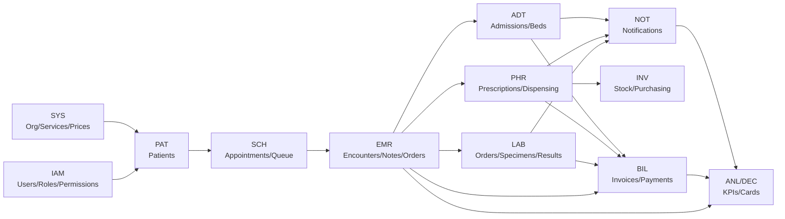
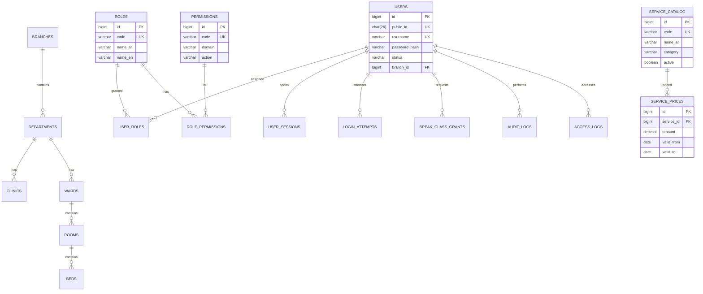
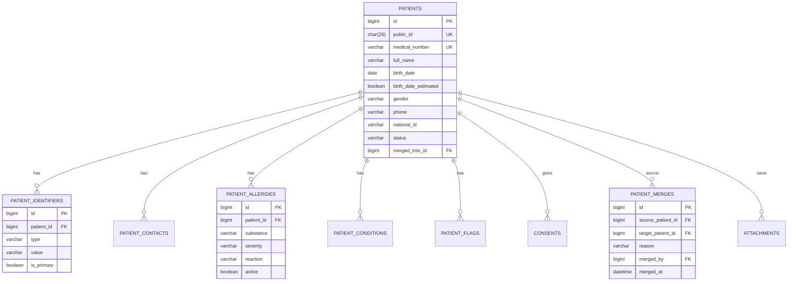
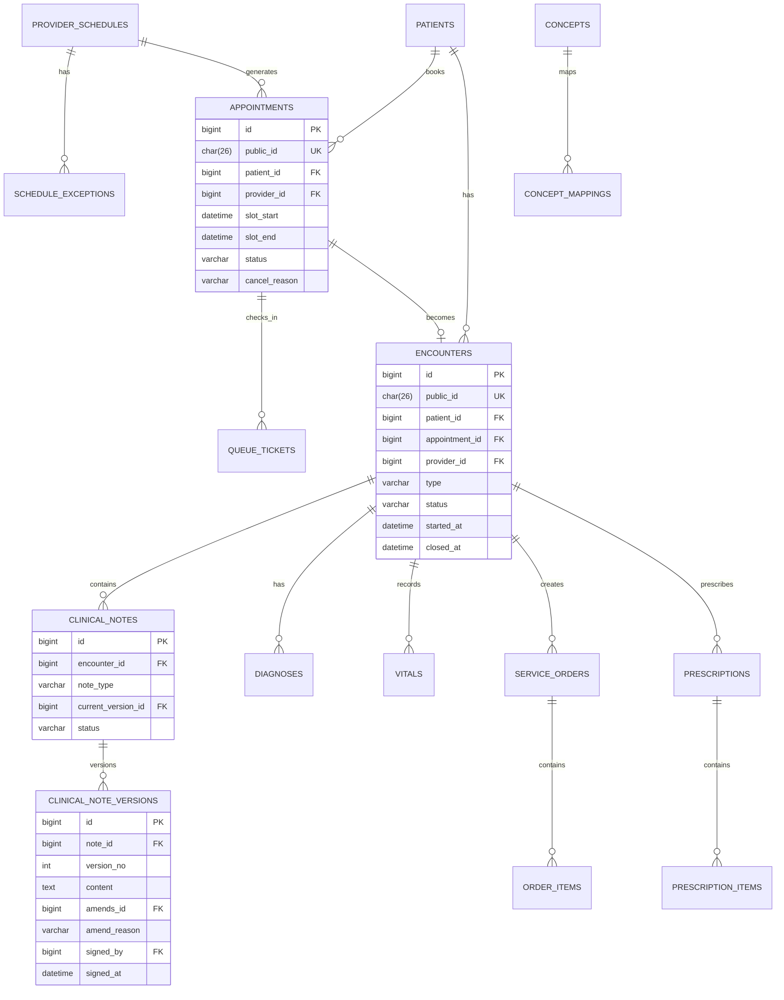
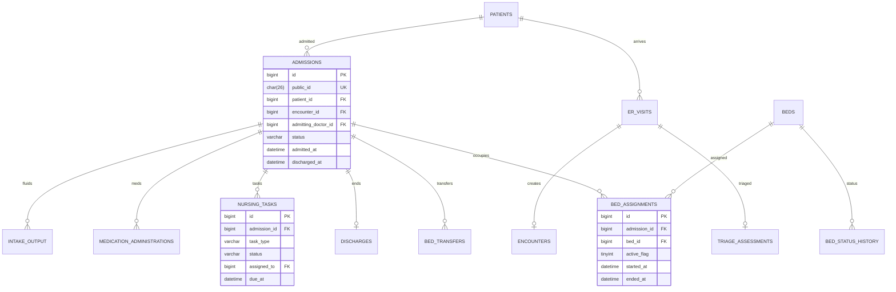
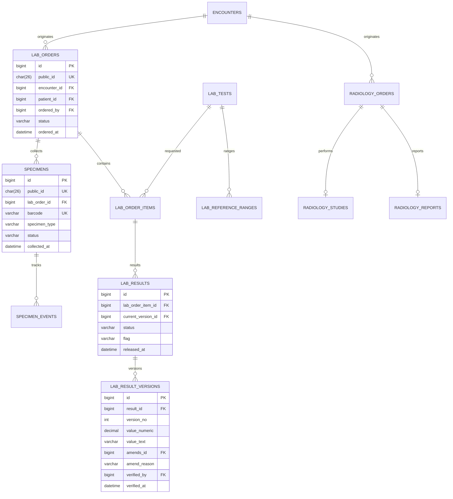
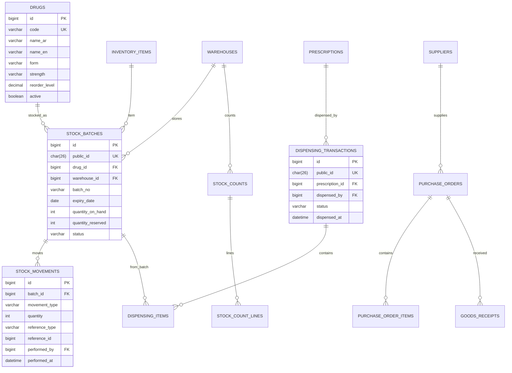
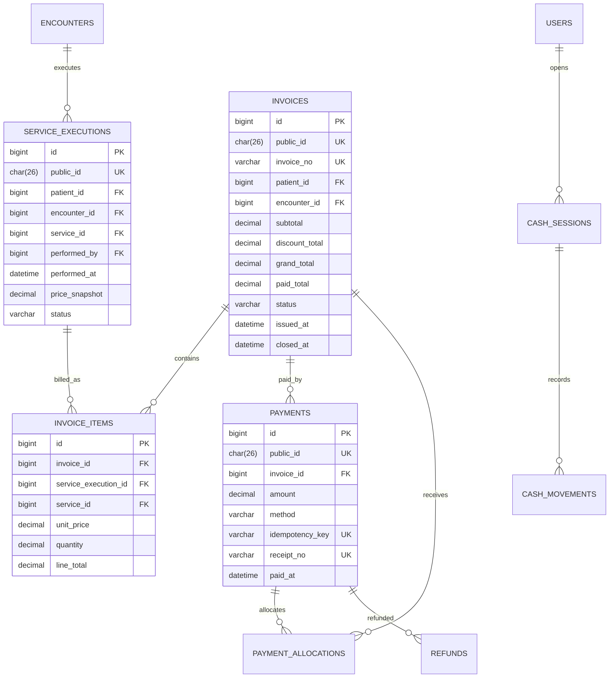
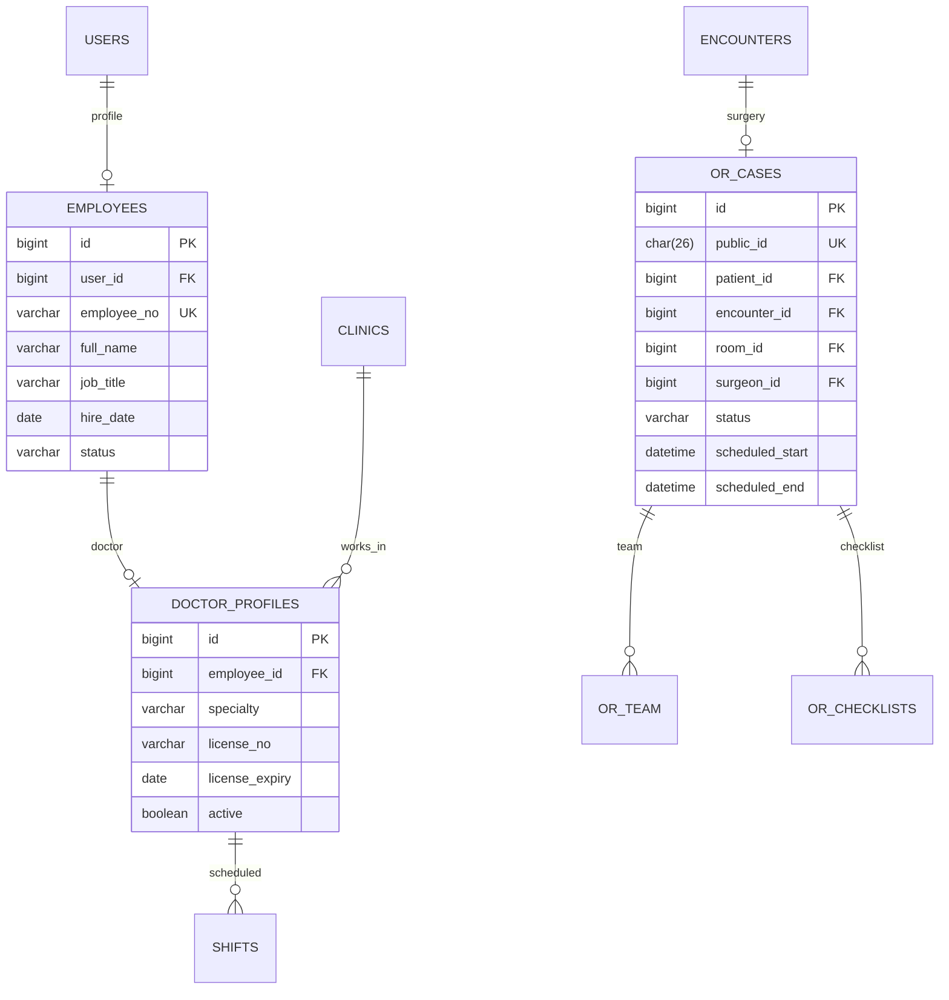
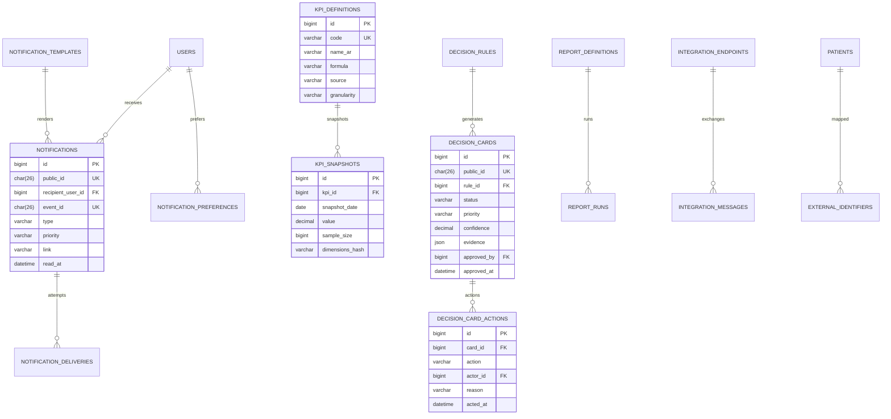

# 01 — Entity Relationship Diagram (ERD)

| Field | Value |
|---|---|
| Document ID | DB-ERD-001 |
| Version | 0.1 |
| Status | Approved (baseline 0.1) |
| DB | MySQL 8.0.38 · InnoDB · utf8mb4 |
| Notation | Crow's foot (Mermaid) |

> **ملاحظة:** هذا مخطط **منطقي**. الأنواع الدقيقة والقيود في `02-data-dictionary.md` و`03-schema-constraints-indexes.md`. كل جدول يحمل الأعمدة المشتركة (`id`, `public_id`, `created_at`, `created_by`, `updated_at`, `updated_by`, `version`) حتى لا تتكرر في كل رسم.

---

## 1. الخريطة العامة (9 نطاقات)

---

## 2. النطاق A — الهوية والمنصة (IAM / SYS)

| الجدول | الغرض |
|---|---|
| `branches` | الفرع (مستشفى واحد فعليًا، مع جاهزية التوسع) |
| `departments` | الأقسام الطبية/الإدارية |
| `clinics` | العيادات الخارجية |
| `wards` / `rooms` / `beds` | الهيكل التنويمي |
| `users` | حسابات المستخدمين |
| `roles` / `permissions` / `role_permissions` / `user_roles` | RBAC |
| `user_sessions` | تتبع الجلسات (لا تُخزَّن الجلسة) |
| `login_attempts` | محاولات الدخول |
| `break_glass_grants` | وصول طارئ |
| `settings` | إعدادات المستشفى (key/value مصنّف) |
| `service_catalog` / `service_prices` | الخدمات والأسعار بتاريخ سريان |
| `templates` | قوالب توثيق/إشعار/طباعة |
| `working_hours` / `holidays` | ساعات العمل |
| `attachments` | بيانات وصفية للملفات (الملف على القرص) |
| `audit_logs` / `access_logs` | تدقيق ووصول |
| `outbox_events` | الأحداث |
| `idempotency_keys` | منع التكرار |
| `job_runs` | سجل المهام المجدولة |

---

## 3. النطاق B — المرضى (PAT)

| القاعدة | التطبيق |
|---|---|
| لا حذف مريض | `status = MERGED/INACTIVE` فقط |
| منع التكرار | فهرس على `national_id`, `phone`, وتطبيع الاسم |
| الحساسية | `active` + `severity` + `reaction` |
| الدمج | `patient_merges` + تحويل كل المراجع |

---

## 4. النطاق C — المواعيد والزيارة (SCH / EMR)

| الحالة | القاعدة |
|---|---|
| الموعد | `BOOKED → CHECKED_IN → COMPLETED / CANCELLED / NO_SHOW` |
| الزيارة | `OPEN → CLOSED` (لا إعادة فتح بعد الإغلاق) |
| الملاحظة | `DRAFT → SIGNED` (التصحيح بنسخة جديدة) |
| التشخيص | أساسي واحد على الأكثر + ثانوي متعدد |
| الطلب | `service_orders` + `order_items` لأنواع المختبر/الأشعة/الإجراءات |

---

## 5. النطاق D — الطوارئ والتنويم والتمريض (ER / ADT / NUR)

| القاعدة | التطبيق |
|---|---|
| سرير واحد نشط | `UNIQUE(bed_id, active_flag)` مع `NULL` للمنتهي |
| نقل | إغلاق تعيين + تعيين جديد في نفس المعاملة |
| خروج | `DISCHARGED` + تحرير السرير → `CLEANING` |
| مهمة تمريض | `PENDING → IN_PROGRESS → DONE / CANCELLED` |

---

## 6. النطاق E — المختبر والأشعة (LAB / RAD)

| الحالة | المسار |
|---|---|
| طلب | `ORDERED → COLLECTED → RECEIVED → IN_PROCESS → RESULTED → VERIFIED` |
| عينة | `COLLECTED → RECEIVED → IN_PROCESS → RESULTED → DISCARDED` |
| نتيجة | `DRAFT → VERIFIED → AMENDED` |
| أشعة | `ORDERED → SCHEDULED → PERFORMED → REPORTED → SIGNED` |

---

## 7. النطاق F — الصيدلية والمخزون (PHR / INV)

| القاعدة | التطبيق |
|---|---|
| FEFO | اختيار الدفعة الأقرب انتهاءً الصالحة |
| منع السالب | `CHECK(quantity_on_hand >= 0)` |
| حركة لكل تغيير | `stock_movements` Append-only |
| دفعة منتهية | `status = EXPIRED` ولا تُصرف |
| إرجاع | حركة `RETURN` مرتبطة بالأصل |

---

## 8. النطاق G — الفواتير والمالية (BIL)

| القاعدة | التطبيق |
|---|---|
| لا حذف فاتورة | `VOIDED` أو إشعار دائن |
| رصيد مشتق | `paid_total` يُحدَّث داخل معاملة الدفع |
| منع الدفع المكرر | `idempotency_key` فريد |
| إقفال | `cash_sessions` + منع تعديل بعد الإقفال |
| سعر تاريخي | `price_snapshot` في `service_executions` |

---

## 9. النطاق H — الموارد البشرية وغرف العمليات (HRM / ORS)

---

## 10. النطاق I — الإشعارات والتحليلات والتكامل (NOT / RPT / ANL / DEC / INT)

---

## 11. خريطة العلاقات الحرجة

| العلاقة | Cardinality | قاعدة |
|---|---|---|
| Patient → Encounter | 1:N | زيارة واحدة لكل لقاء |
| Appointment → Encounter | 1:0..1 | لا زيارة بلا مريض |
| Encounter → LabOrder | 1:N | طلب واحد قد يحمل عدة فحوصات |
| LabOrder → Specimen | 1:N | عينة واحدة قد تخدم عدة فحوصات |
| Prescription → Dispensing | 1:N | صرف جزئي مسموح |
| Admission → BedAssignment | 1:N | نقل يغلق القديم ويفتح جديدًا |
| Invoice → Payment | 1:N | دفع جزئي مسموح |
| Encounter → ServiceExecution | 1:N | كل خدمة منفذة قابلة للفوترة |
| User → Role | M:N | عبر `user_roles` |
| Role → Permission | M:N | عبر `role_permissions` |

---

## 12. ما لا يظهر في ERD

- جداول Audit/Outbox/Idempotency (مشتركة، لا علاقات أعمال).
- جداول Views التحليلية (`v_*`) — ليست كيانات.
- جداول مؤقتة للمهام.
- جداول الإعدادات key/value.

---

## 13. المراجع

- `02-data-dictionary.md` — الأعمدة والأنواع.
- `03-schema-constraints-indexes.md` — القيود والفهارس.
- `04-migrations-seed.md` — الترحيلات والبيانات.
