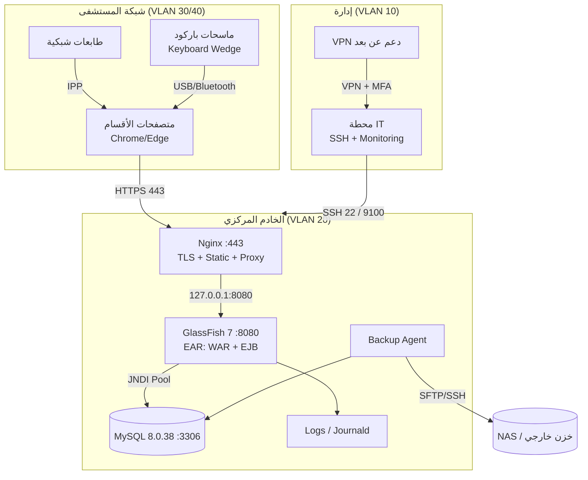

# 01 — Server Architecture

**خادم واحد مركزي داخل المستشفى: مكوّنات واضحة، حدود موارد، ومسار توسّع بلا إعادة كتابة**

| Field | Value |
|---|---|
| Document ID | DEP-SRV-001 |
| Version | 0.1 |
| Status | Approved (baseline 0.1) |
| Baseline OS | Ubuntu Server 24.04 LTS (PD-001) |
| Related | `02-network-topology.md`, `03-installation.md`, `04-backup-recovery.md`, `05-monitoring-operations.md`, `architecture/01-system-architecture.md`, ASM-002 |

---

## 1. المبادئ

1. **خادم واحد في v1.** لا Kubernetes، لا microservices، لا HA. البساطة التشغيلية أولوية.
2. **كل شيء محلي.** لا اعتماد على إنترنت خارجي لتشغيل النظام (NFR-REL-006).
3. **لا تثبيت على العميل.** المتصفح فقط (NFR-OPS-007).
4. **الفصل المنطقي قبل الفصل الفيزيائي.** GlassFish وMySQL على نفس الخادم لكن بعزل مستخدمين وملفات وصلاحيات.
5. **التوسّع الرأسي أولًا.** زيادة CPU/RAM/SSD أرخص وأبسط من إعادة المعمارية.
6. **كل شيء قابل لإعادة البناء.** EAR + Migrations + إعدادات = خادم جديد خلال ساعات.

---

## 2. الأحجام

### 2.1 خط الأساس (ASM-002)

| المورد | الحد الأدنى | الموصى به | ملاحظة |
|---|---|---|---|
| CPU | 8 vCPU | 12–16 vCPU | 200 مستخدم متزامن (NFR-PERF-007) |
| RAM | 16 GB | 32 GB | JVM 6–8 GB + MySQL 8–12 GB + OS/Nginx |
| Disk | 500 GB SSD | 2 × 1 TB SSD (RAID 1) | نظام + DB + نسخ محلية |
| Network | 1 Gbps | 1 Gbps (10 Gbps إن توفر) | ASM-003 |
| UPS | 15–20 دقيقة | 30 دقيقة | إيقاف آمن (ASM-004) |

### 2.2 توزيع الذاكرة الموصى به (32 GB)

| المكوّن | التخصيص | ملاحظة |
|---|---|---|
| MySQL `innodb_buffer_pool_size` | 12 GB | 35–40% من RAM |
| GlassFish JVM Heap | 8 GB (`-Xms8g -Xmx8g`) | Metaspace + Direct إضافي |
| OS + Page Cache | 6 GB | Nginx، نظام الملفات |
| احتياطي | 6 GB | ذروات وتحديثات |

> على 16 GB: MySQL 6 GB + JVM 4 GB + OS 4 GB + احتياطي 2 GB. لا ترفع الـ Heap فوق 50% من RAM.

### 2.3 تقدير التخزين (5 سنوات)

| الفئة | الافتراض | الحجم التقديري |
|---|---|---|
| زيارات/مواعيد | 1,500 زيارة/يوم × 365 × 5 | ~2.7M صف |
| سجلات سريرية ونتائج | ~10 صفوف/زيارة | ~27M صف |
| تدقيق | 2–5M صف/سنة × 5 | 10–25M صف |
| مالية/مخزون | ~1M صف/سنة | ~5M صف |
| لقطات KPI | 36 × 365 × 10 أبعاد × 5 | ~0.7M صف |
| **قاعدة البيانات** | مع الفهارس | **60–120 GB** |
| مرفقات (محدودة) | ≤ 10 MB/ملف، حجم منخفض | 20–50 GB |
| سجلات التطبيق | 30–90 يومًا | 10–20 GB |
| نسخ احتياطي محلي | 14 يومًا + شهري | 150–300 GB |
| **الإجمالي الموصى به** | مع هامش 40% | **≥ 500 GB، والأفضل 1 TB** |

**قاعدة:** إذا تجاوز استهلاك القرص 70%، يُفتح إجراء سعة قبل الوصول إلى 80%.

---

## 3. المكوّنات والمسؤوليات

| المكوّن | الإصدار | الدور | المستخدم | المنفذ |
|---|---|---|---|---|
| Ubuntu Server | 24.04 LTS | نظام التشغيل | — | — |
| OpenJDK (Temurin) | 17 LTS | تشغيل GlassFish | `glassfish` | — |
| GlassFish | 7.0.x Full | حاوية Jakarta EE 10 (EAR) | `glassfish` | 8080/8181/4848 (localhost) |
| MySQL Community | 8.0.38 | قاعدة البيانات | `mysql` | 3306 (localhost) |
| Nginx | 1.24+ | TLS، Reverse Proxy، ملفات ثابتة | `www-data` | 443/80 |
| Restic / Borg | أحدث مستقر | نسخ احتياطي مشفّر | `backup` | — |
| chrony | — | مزامنة الوقت | `chrony` | 123 |
| UFW | — | جدار حماية محلي | root | — |
| node_exporter (اختياري) | — | مقاييس النظام | `prometheus` | 9100 (localhost) |
| Prometheus/Grafana (اختياري) | — | مراقبة | — | 9090/3000 (localhost) |

**قاعدة الإصدارات:** تُثبّت نسخ محددة (Pin) وتُحدّث وفق نافذة صيانة. لا `latest` في الإنتاج.

---

## 4. الطوبولوجيا المنطقية



**قاعدة:** لا يُعرّض GlassFish أو MySQL مباشرة للشبكة. كل الوصول عبر Nginx أو localhost.

---

## 5. المنافذ وقواعد الوصول

| المنفذ | الخدمة | الاستماع | المصدر المسموح |
|---|---|---|---|
| 443 | HTTPS | `0.0.0.0` | VLAN 30/40 (سريري) + VLAN 10 (إدارة) |
| 80 | HTTP → 443 | `0.0.0.0` | نفس المصادر (لإعادة التوجيه فقط) |
| 22 | SSH | VLAN 20 | VLAN 10 فقط |
| 8080 | GlassFish HTTP | `127.0.0.1` | Nginx فقط |
| 8181 | GlassFish HTTPS | `127.0.0.1` | لا يُستخدم في v1 |
| 4848 | GlassFish Admin | `127.0.0.1` | نفق SSH فقط |
| 3306 | MySQL | `127.0.0.1` | GlassFish فقط |
| 9100 | node_exporter | `127.0.0.1` أو VLAN 10 | Prometheus |
| 123 | NTP | `0.0.0.0` (اختياري) | خوادم الوقت الداخلية |

**منع صريح:** 3306/8080/4848 من VLAN 30/40. أي محاولة تُسجّل في UFW.

---

## 6. هيكل الملفات

```text
/opt/smart-hospital/
├── app/
│   ├── smart-hospital-ear-<version>.ear
│   ├── migrations/            # SQL + Ant
│   └── config/
│       ├── application.properties   # غير سرّي
│       └── secrets.env              # 600، مملوك لـ glassfish
├── logs/                      # سجلات التطبيق (خارج GlassFish)
├── backup/
│   ├── staging/               # قبل النقل إلى NAS
│   └── scripts/
└── releases/                  # نسخ EAR السابقة (Rollback)

/var/lib/mysql/                # بيانات MySQL
/etc/nginx/                    # Nginx + TLS
/opt/glassfish7/               # GlassFish
/var/log/                      # Journald / Nginx
```

**الصلاحيات:** `secrets.env` 600 لمالك `glassfish`؛ لا قراءة لـ `www-data` أو مستخدمي التطبيق. النسخ الاحتياطي يقرأ عبر `backup` بصلاحية محددة.

---

## 7. بيئات النشر

| البيئة | الغرض | البيانات | النطاق |
|---|---|---|---|
| **DEV** | تطوير محلي | وهمية | جهاز المطوّر |
| **TEST** | اختبارات آلية | وهمية | خادم اختبار |
| **STAGING** | محاكاة إنتاج + UAT | وهمية بحجم واقعي | خادم مطابق |
| **PROD** | التشغيل | حقيقية | خادم المستشفى |

**قواعد:**
- لا بيانات مرضى حقيقية في DEV/TEST/STAGING (ASM-009).
- نفس إصدار MySQL وGlassFish في STAGING وPROD.
- ترحيل الإنتاج يمر عبر STAGING أولًا.
- لا وصول إنترنت من PROD إلا للتحديثات الأمنية المخطط لها.

---

## 8. التوسّع (Scaling Path)

| المرحلة | الإشارة | الإجراء | الأثر على الكود |
|---|---|---|---|
| 0 | الوضع الحالي | خادم واحد | لا شيء |
| 1 | CPU > 70% أو Heap > 75% مستمر | زيادة vCPU/RAM | لا شيء |
| 2 | I/O قاعدة البيانات عنق الزجاجة | SSD أسرع / فصل DB على خادم | تغيير JNDI فقط (NFR-SCL-002) |
| 3 | تطبيق مشبع | خادم تطبيق ثانٍ + Nginx LB + Sticky Sessions | لا شيء (NFR-SCL-003) |
| 4 | تقارير ثقيلة | Read Replica للتحليلات (لاحقًا) | تغيير مصدر قراءة التحليلات |
| 5 | توفّر عالٍ | Cluster/HA + LB | مشروع منفصل (Future) |

**قاعدة:** لا ننتقل إلى المرحلة التالية قبل قياس فعلي وتوثيق. الترقية لا تُبرّر بالتخمين.

---

## 9. التوافر والإيقاف

| البند | القرار |
|---|---|
| توافر v1 | خادم واحد، لا HA (ASM-021) |
| RPO | ≤ 15 دقيقة (Binary Logs) |
| RTO | ≤ 4 ساعات |
| نافذة صيانة | خارج ساعات الذروة، بإشعار مسبق |
| إيقاف آمن | Nginx → GlassFish → MySQL (بالترتيب) |
| إقلاع | MySQL → GlassFish → Nginx → فحص `/health/ready` |
| انقطاع كهرباء | UPS + إيقاف آلي عند 20% |
| انقطاع إنترنت | لا أثر على LAN |

**ترتيب الإيقاف:** إيقاف استقبال الطلبات (Nginx) → انتظار المهام الجارية (GlassFish) → إيقاف MySQL بعد Commit. لا `kill -9`.

---

## 10. الافتراضات والقرارات المفتوحة

| # | البند | الحالة |
|---|---|---|
| DEP-Q1 | نظام التشغيل | Ubuntu 24.04 LTS (PD-001) |
| DEP-Q2 | خادم فيزيائي أم VM؟ | كلاهما مدعوم؛ VM على Hypervisor داخلي مقبول |
| DEP-Q3 | NAS للنسخ | مطلوب للنسخ الخارجي؛ يمكن استخدام خادم ملفات |
| DEP-Q4 | مراقبة كاملة (Prometheus/Grafana) | اختيارية v1؛ الحد الأدنى Health + Logs + تنبيهات |
| DEP-Q5 | شهادة TLS | CA داخلي أو نطاق حقيقي (PD-010) |
| DEP-Q6 | UPS | مطلوب (ASM-004) |
| DEP-Q7 | وقت التشغيل | 24/7 للطوارئ؛ صيانة مخططة فقط |

---

## 11. معايير القبول

- [ ] الخادم يلبي الحد الأدنى 8 vCPU / 16 GB / SSD.
- [ ] كل المنافذ الحساسة على localhost فقط.
- [ ] TLS يعمل بدرجة A على الأقل (SSL Labs أو مكافئ داخلي).
- [ ] `/health/ready` يعيد DB + JMS + Disk.
- [ ] النسخ الاحتياطي يعمل ويفك التشفير في تمرين.
- [ ] إعادة تشغيل الخادم تعيد الخدمة تلقائيًا خلال ≤ 10 دقائق.
- [ ] استهلاك الذاكرة والقرص ضمن الحدود بعد 72 ساعة حمل.
