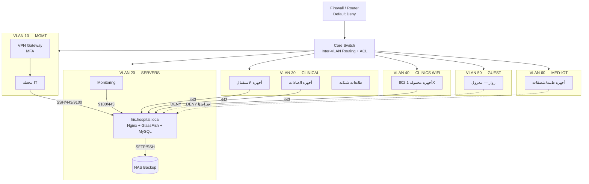

# 02 — Network Topology

**شبكة محلية معزولة، تقسيم VLAN، وقواعد جدار حماية قابلة للتدقيق**

| Field | Value |
|---|---|
| Document ID | DEP-NET-001 |
| Version | 0.1 |
| Status | Approved (baseline 0.1) |
| Related | `01-server-architecture.md`, `03-installation.md`, `architecture/06-security-architecture.md`, ASM-003/023/024/025 |

> **ملاحظة:** عناوين IP هنا **نموذجية** (10.20.0.0/16). المستشفى يستبدلها بخطته الفعلية دون تغيير أي إعداد تطبيقي غير `server.hostname` وروابط DNS.

---

## 1. مبادئ التصميم

1. **الحد الأدنى من الوصول.** كل VLAN يرى ما يحتاجه فقط.
2. **لا إنترنت للنظام.** تشغيل HIS لا يعتمد على اتصال خارجي (ASM-025).
3. **فصل الإدارة عن السريري.** محطة IT ليست على نفس شبكة الأقسام.
4. **عنونة ثابتة للخوادم والطابعات.** DHCP للعملاء فقط مع حجوزات.
5. **كل قاعدة جدار حماية موثّقة** بسبب ومالك وتاريخ مراجعة.
6. **لا Wi-Fi سريري مفتوح.** شبكة الأقسام إما سلكية أو 802.1X.

---

## 2. تقسيم VLAN

| VLAN | الاسم | الشبكة النموذجية | البوابة | الغرض | الوصول إلى الخادم |
|---|---|---|---|---|---|
| 10 | MGMT | 10.20.10.0/24 | .1 | إدارة الخوادم والشبكة | 22, 443, 9100 |
| 20 | SERVERS | 10.20.20.0/24 | .1 | الخادم المركزي + NAS | داخلي |
| 30 | CLINICAL-WIRED | 10.20.30.0/23 | .1 | أجهزة الأقسام السلكية | 443 |
| 40 | CLINICS-WIFI | 10.20.40.0/23 | .1 | عيادات/أجهزة محمولة | 443 |
| 50 | GUEST | 10.20.50.0/24 | .1 | زوار | **لا شيء** |
| 60 | MED-IOT | 10.20.60.0/24 | .1 | أجهزة طبية/طابعات ملصقات | 443 (مستقبلًا، حسب الجهاز) |
| 99 | OOB | 10.20.99.0/24 | .1 | إدارة خارج النطاق (اختياري) | حسب الحاجة |

**قاعدة:** VLAN 50 (Guest) معزول تمامًا عن 20/30/40/60. لا استثناءات.

---

## 3. خطة العنونة (نموذجية)

| العنصر | العنوان | DNS | ملاحظة |
|---|---|---|---|
| Gateway | 10.20.20.1 | — | Core Switch |
| DNS-1 / DNS-2 | 10.20.20.5 / .6 | `dns1`, `dns2` | داخلي فقط |
| NTP | 10.20.20.7 | `ntp.hospital.local` | chrony |
| الخادم المركزي | 10.20.20.10 | `his.hospital.local` | Nginx 443 |
| NAS / Backup | 10.20.20.20 | `nas.hospital.local` | SFTP/SSH |
| Monitoring | 10.20.20.30 | `mon.hospital.local` | اختياري |
| DHCP | 10.20.30.2–.4 | — | نطاقات الأقسام |
| طابعات شبكية | 10.20.30.100–.199 | `prn-*` | حجز DHCP |
| عملاء الأقسام | 10.20.30.20–.250 | — | DHCP |
| Wi-Fi عيادات | 10.20.40.20–.250 | — | DHCP + 802.1X |

**قاعدة:** لا عناوين عامة (Public IP) للخادم. لا NAT إلى الداخل. لا Port Forwarding.

---

## 4. الطوبولوجيا

---

## 5. مصفوفة جدار الحماية

| # | المصدر | الوجهة | المنفذ/البروتوكول | القرار | السبب |
|---|---|---|---|---|---|
| F-01 | VLAN 30/40 | 10.20.20.10 | TCP 443 | سماح | واجهة النظام |
| F-02 | VLAN 30/40 | 10.20.20.10 | TCP 80 | سماح | إعادة توجيه إلى 443 فقط |
| F-03 | VLAN 10 | 10.20.20.10 | TCP 22 | سماح | إدارة SSH (مفاتيح فقط) |
| F-04 | VLAN 10 | 10.20.20.10 | TCP 443/9100 | سماح | مراقبة/إدارة |
| F-05 | VLAN 30/40 | 10.20.20.10 | TCP 3306/8080/4848 | **منع** | لا وصول مباشر |
| F-06 | VLAN 50 | أي | أي | **منع** | ضيوف |
| F-07 | VLAN 60 | 10.20.20.10 | TCP 443 | **منع افتراضيًا** | يُفتح لكل جهاز بعد مراجعة |
| F-08 | 10.20.20.10 | NAS | TCP 22 / SFTP | سماح | نسخ احتياطي |
| F-09 | 10.20.20.10 | Internet | أي | **منع** | لا اعتماد خارجي |
| F-10 | 10.20.20.10 | NTP/DNS داخلي | UDP 123 / 53 | سماح | وقت واسم |
| F-11 | VLAN 10 | Internet | 443 | سماح (عبر Proxy) | تحديثات أمنية مخطط لها |
| F-12 | VPN | VLAN 10 | 22/443 | سماح بعد MFA | دعم عن بعد |
| F-13 | VLAN 30 | طابعات VLAN 30 | IPP 631/9100 | سماح | طباعة |
| F-14 | VLAN 40 | طابعات VLAN 30 | IPP 631/9100 | سماح | طباعة من العيادات |

**مراجعة:** كل قاعدة لها مالك وتاريخ. القواعد غير المستخدمة 90 يومًا تُراجع وتُزال.

---

## 6. DNS والشهادات

### 6.1 DNS

| السجل | القيمة | TTL |
|---|---|---|
| `his.hospital.local` | 10.20.20.10 | 300 |
| `nas.hospital.local` | 10.20.20.20 | 300 |
| `ntp.hospital.local` | 10.20.20.7 | 3600 |
| `mon.hospital.local` | 10.20.20.30 | 300 |

- DNS داخلي فقط؛ لا سجل عام.
- اسم بديل (`smart-hospital.hospital.local`) اختياري.
- TTL قصير يسمح بتغيير IP عند الترقية.

### 6.2 TLS

| البند | القرار |
|---|---|
| الجهة | CA داخلي (AD CS / Step-CA) أو شهادة نطاق حقيقي (PD-010) |
| SAN | `his.hospital.local` + اسم بديل |
| المدة | ≤ 397 يومًا (سياسة CA) |
| التجديد | قبل 30 يومًا، آلي إن أمكن |
| البروتوكول | TLS 1.2 + 1.3 فقط |
| الشفرات | حديثة (AEAD)، بلا CBC قديم |
| HSTS | `max-age=31536000; includeSubDomains` بعد التأكد |
| الشهادة | تُثبّت في المتصفحات عبر GPO/MDM إن أمكن |

**بدون شهادة موثوقة:** يظهر تحذير متصفح لكل مستخدم — غير مقبول في الإنتاج.

---

## 7. محطات العمل

| البند | المتطلب |
|---|---|
| المتصفح | Chrome أو Edge آخر إصدارين (ASM-005) |
| الدقة | 1366×768 فأعلى (NFR-USA-002) |
| الذاكرة | ≥ 4 GB |
| الشبكة | 100 Mbps سلكي مفضل؛ Wi-Fi 5+ للعيادات |
| التثبيت | لا شيء (NFR-OPS-007) |
| PDF | عارض مدمج/Adobe Reader للطباعة |
| الباركود | ماسح Keyboard Wedge (يدعم العربية/الإنجليزية) |
| الطابعات | شبكية IPP؛ طابعة ملصقات اختيارية للأسورة |
| القفل | شاشة مقفلة بعد 10 دقائق خمول (سياسة OS) |
| التحديثات | عبر WSUS/إدارة مركزية |

**ممنوع:** Internet Explorer، متصفح قديم، إضافات غير مرخّصة، حفظ كلمات المرور في المتصفح على أجهزة مشتركة.

---

## 8. Wi-Fi

| الشبكة | المصادقة | الوصول | ملاحظة |
|---|---|---|---|
| `HOSP-CLINICAL` | WPA2/WPA3-Enterprise (802.1X) | VLAN 40 → 443 | شهادة جهاز أو مستخدم |
| `HOSP-GUEST` | Captive Portal | Internet فقط | معزولة عن VLAN 20/30/40/60 |
| `HOSP-IOT` | مفتاح قوي + MAC filtering | VLAN 60 | أجهزة طبية فقط، مراجعة أمنية |

**قاعدة:** لا شبكة مفتوحة تصل إلى HIS. لا مشاركة كلمة مرور Wi-Fi سريرية.

---

## 9. الوقت (NTP)

| البند | القرار |
|---|---|
| المصدر | NTP داخلي (خادم الشبكة) → مصدر خارجي موثوق إن لزم |
| العملاء | يشيرون إلى `ntp.hospital.local` |
| الخادم | chrony، تصحيح تدريجي |
| التخزين | UTC في DB |
| الحد | انحراف > 1 ثانية = تنبيه |
| الأثر | سجلات وتدقيق وتسلسل أحداث |

**لا تُعطّل مزامنة الوقت.** ساعة خاطئة تفسد التدقيق والتقارير.

---

## 10. الدعم عن بعد

| البند | القرار |
|---|---|
| الوصول | VPN + MFA إلزامي |
| الحساب | مؤقت، يفتح بتذكرة، يُغلق بعدها |
| المسار | VPN → Jump Host (VLAN 10) → الخادم |
| التسجيل | جلسة مسجّلة + أوامر مدققة |
| الصلاحية | لا وصول دائم للمورد |
| الطوارئ | إجراء موثق + موافقة المالك |

---

## 11. سيناريوهات الفشل

| السيناريو | الأثر | التخفيف |
|---|---|---|
| انقطاع الإنترنت | لا أثر على HIS | كل شيء محلي (ASM-025) |
| فشل Switch أساسي | انقطاع قسم | Stack/Spare + مسار بديل |
| فشل Wi-Fi | الأقسام السلكية تعمل | كابلات احتياطية في النقاط الحرجة |
| تعارض IP | فشل جهاز | DHCP reservations + IPAM |
| شهادة منتهية | تحذير/انقطاع | تنبيه قبل 30 يومًا |
| Broadcast storm | بطء شامل | Storm control + VLAN فصل |
| جهاز مصاب | خطر انتشار | Segmentation + EDR + منع Guest |

---

## 12. معايير القبول

- [ ] كل VLAN مطبّق ومختبر من محطة في كل شريحة.
- [ ] Guest لا يصل إلى 443 على الخادم (اختبار عملي).
- [ ] 3306/8080/4848 غير قابلة للوصول من VLAN 30/40.
- [ ] `his.hospital.local` يُحل داخليًا ويقدم شهادة صالحة.
- [ ] NTP متزامن على الخادم وكل العملاء.
- [ ] النسخ الاحتياطي يصل إلى NAS عبر القاعدة F-08 فقط.
- [ ] جلسة VPN تجريبية تعمل وتُسجّل.
- [ ] لا Port Forwarding من الإنترنت إلى الداخل.
