# 02 — State Machines (SM)

| Field | Value |
|---|---|
| Document ID | WF-SM-001 |
| Version | 0.1 |
| Status | Approved (baseline 0.1) |
| Rule | أي انتقال غير مذكور هنا = مرفوض في الخدمة (409 Conflict) |

---

## 1. لماذا آلات حالة صريحة؟

بدونها يتحول النظام إلى أعلام متناقضة: `is_paid=true` و`balance>0`، أو نتيجة `VERIFIED` و`editable=true`.
كل كيان له دورة حياة يُنمذج كآلة حالة، والانتقالات تُفحص مركزيًا عبر `StateMachineService`.

**التنفيذ:** `enum` للحالات + جدول انتقالات مسموحة + `transition(entity, event, actor)` تتحقق من:
1. الحالة الحالية.
2. الحدث.
3. الصلاحية.
4. الحراسات (Guards) مثل "لا صرف بلا مخزون".

---

## 2. SM-APPOINTMENT

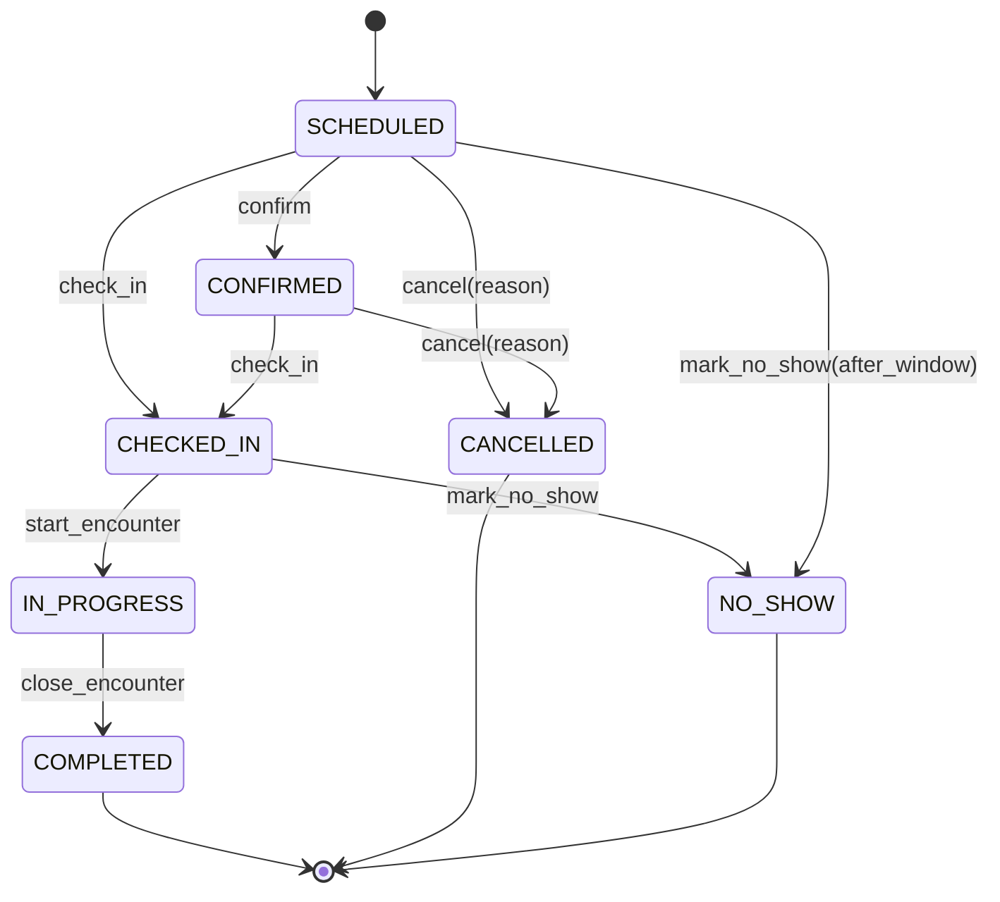

| From | Event | To | Guard | Permission |
|---|---|---|---|---|
| – | create | SCHEDULED | طبيب مفعّل + فترة صالحة | `SCH:CREATE` |
| SCHEDULED | confirm | CONFIRMED | – | `SCH:UPDATE` |
| SCHEDULED/CONFIRMED | check_in | CHECKED_IN | داخل نافذة الوصول | `SCH:CHECKIN` |
| CHECKED_IN | start_encounter | IN_PROGRESS | زيارة أُنشئت | `EMR:CREATE` |
| IN_PROGRESS | close_encounter | COMPLETED | الزيارة مغلقة | `EMR:SIGN` |
| SCHEDULED/CONFIRMED | cancel | CANCELLED | سبب إن < 24h | `SCH:CANCEL` |
| CHECKED_IN | mark_no_show | NO_SHOW | بعد 30 دقيقة | `SCH:NOSHOW` |
| COMPLETED | * | – | ممنوع | – |

**ممنوع صراحةً:** `COMPLETED → SCHEDULED`، `CANCELLED → CHECKED_IN`.

---

## 3. SM-ENCOUNTER

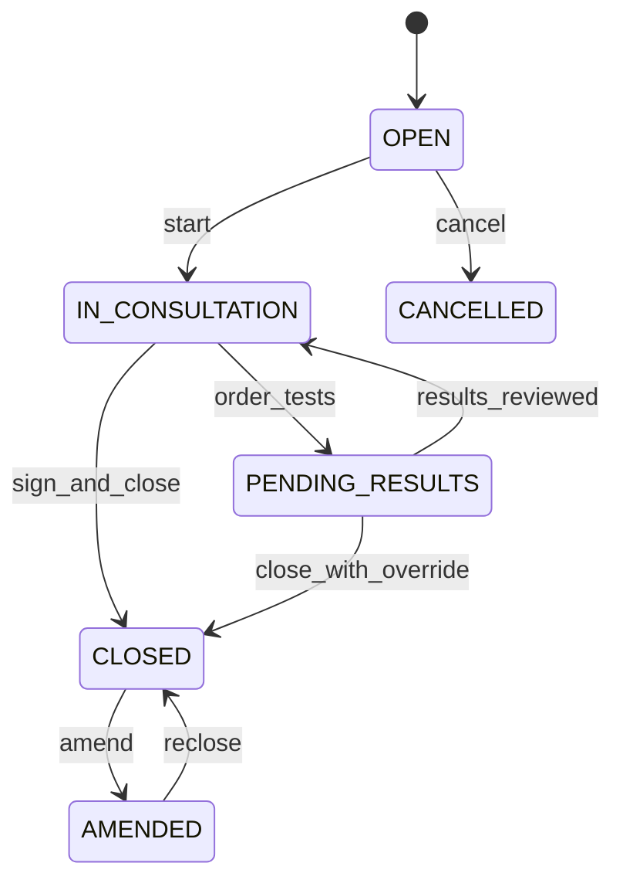

| From | Event | To | Guard |
|---|---|---|---|
| – | create | OPEN | مريض + طبيب + قسم |
| OPEN | start | IN_CONSULTATION | – |
| IN_CONSULTATION | order_tests | PENDING_RESULTS | طلب واحد على الأقل |
| PENDING_RESULTS | results_reviewed | IN_CONSULTATION | كل النتائج الحرجة مقروءة |
| IN_CONSULTATION | sign_and_close | CLOSED | تشخيص + توقيع |
| PENDING_RESULTS | close_with_override | CLOSED | `EMR:CLOSE_OVERRIDE` + سبب |
| CLOSED | amend | AMENDED | `EMR:AMEND` + سبب |
| AMENDED | reclose | CLOSED | توقيع جديد |

---

## 4. SM-LAB-ORDER

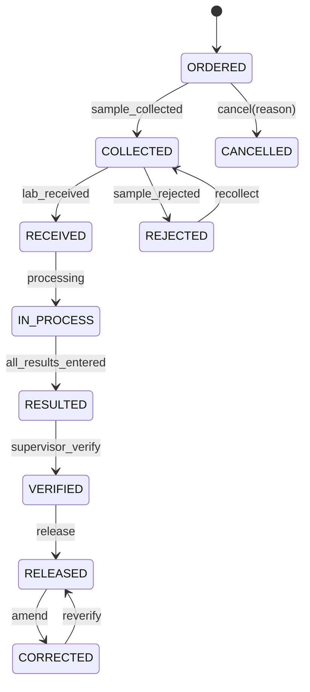

| Guard | الوصف |
|---|---|
| sample_collected | عينة مسجلة + باركود |
| all_results_entered | كل بنود الطلب لها نتيجة |
| supervisor_verify | صلاحية `LAB:VERIFY` + `dual_control` |
| cancel | لا عينة بعد، أو صلاحية إلغاء |
| amend | سبب + نسخة جديدة |

**ممنوع:** `ORDERED → RESULTED` مباشرة.

---

## 5. SM-LAB-RESULT

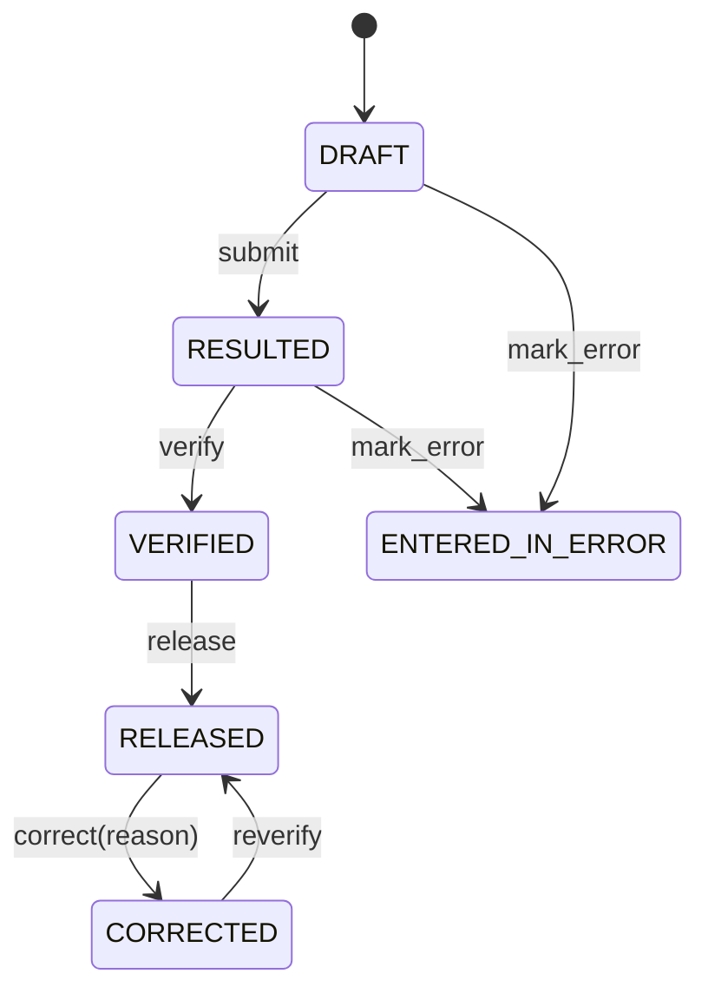

| Guard | الوصف |
|---|---|
| verify | ليس نفس مدخل النتيجة عند `dual_control` |
| correct | نتيجة `RELEASED` + سبب + نسخة جديدة |
| mark_error | قبل `RELEASED` فقط |

**قاعدة:** `RELEASED` لا يعود `DRAFT` أبدًا.

---

## 6. SM-PRESCRIPTION

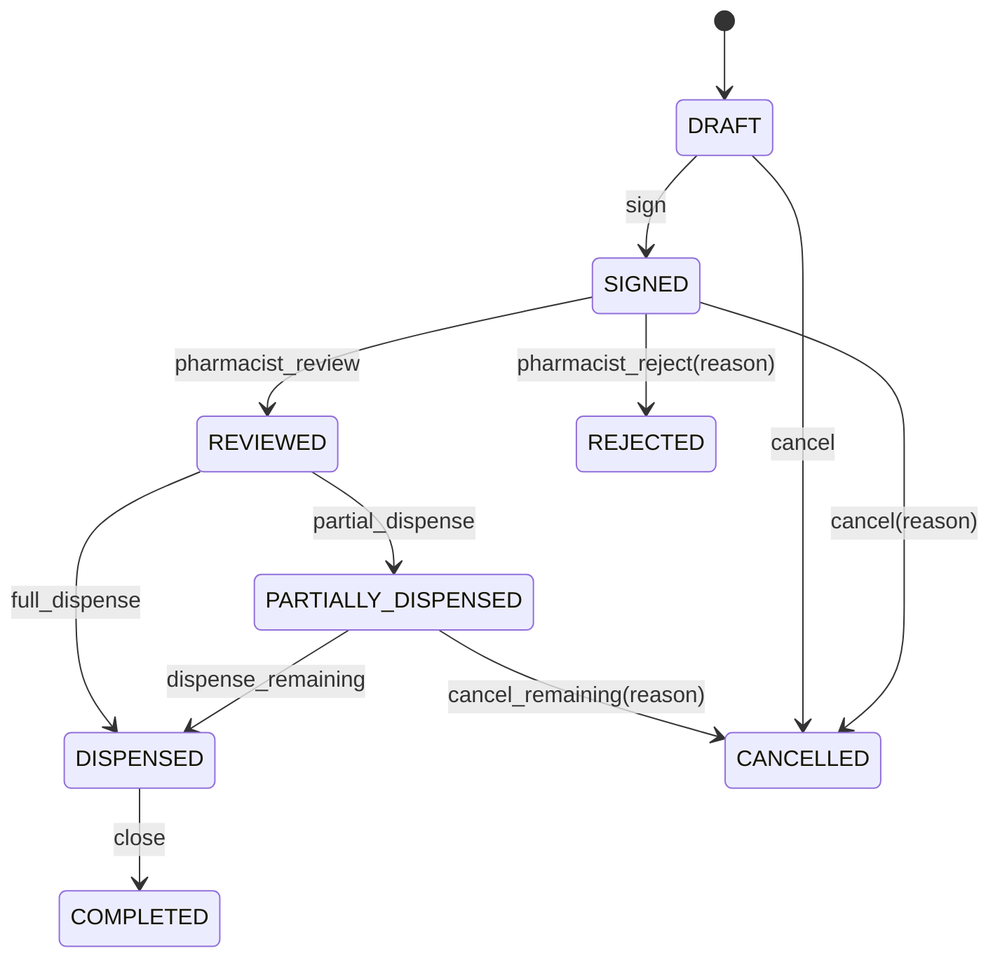

| Guard | الوصف |
|---|---|
| sign | زيارة مفتوحة + طبيب مخوّل |
| pharmacist_review | صلاحية `PHR:REVIEW` |
| full_dispense | كل البنود صُرفت |
| cancel | لا صرف سابق (وإلا إرجاع) |

---

## 7. SM-DISPENSING

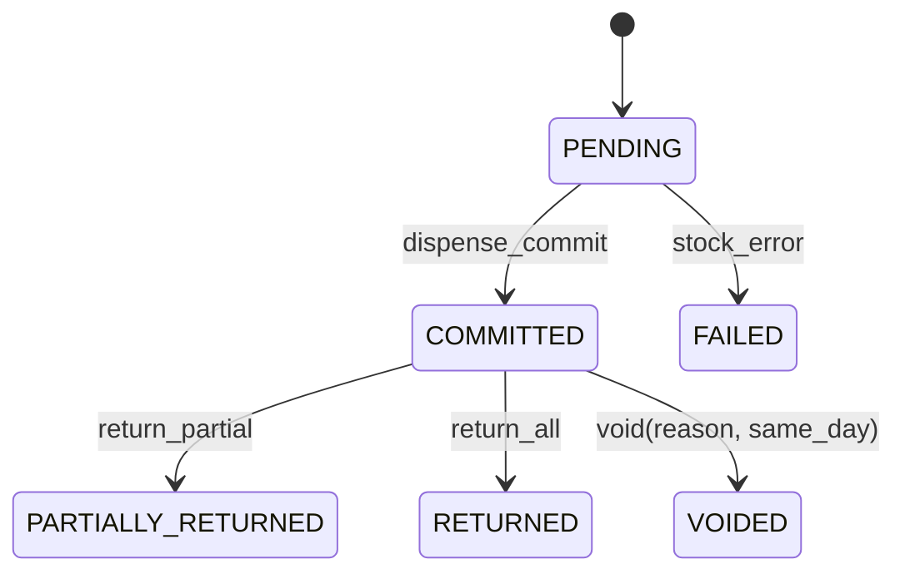

| Guard | الوصف |
|---|---|
| dispense_commit | مخزون كافٍ + دفعات صالحة + صلاحية |
| void | نفس اليوم + `PHR:VOID` + عكس الحركات |

**ملاحظة:** `COMMITTED` هو الأثر المالي/المخزني؛ لا يُحذف.

---

## 8. SM-INVOICE

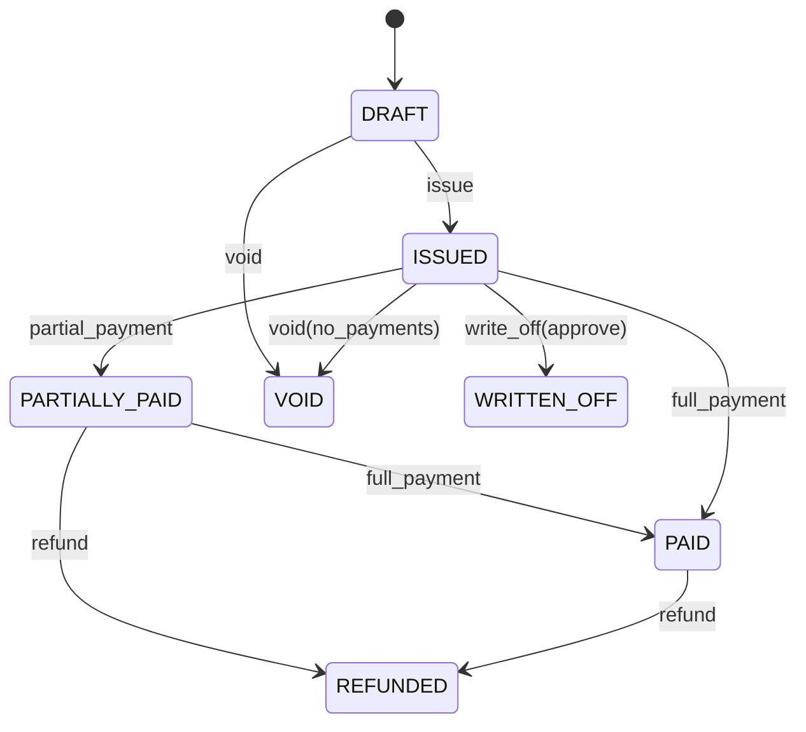

| Guard | الوصف |
|---|---|
| issue | بنود > 0 + خدمات منفذة |
| partial_payment | 0 < paid < total |
| full_payment | paid = total |
| void | لا دفعات + صلاحية |
| refund | ≤ paid + اعتماد |
| write_off | صلاحية مالية عليا + سبب |

**ممنوع:** `PAID → ISSUED`، حذف فاتورة.

---

## 9. SM-PAYMENT

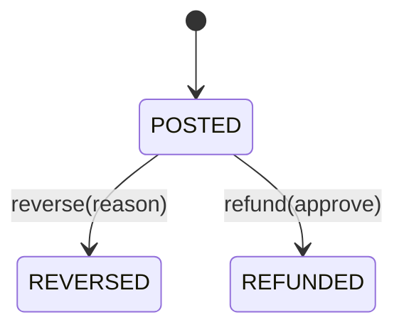

| Guard | الوصف |
|---|---|
| POSTED | مبلغ > 0 + idempotency جديد |
| reverse | خطأ إدخال، نفس اليوم، صلاحية |
| refund | استرداد فعلي باعتماد |

**قاعدة:** `POSTED` لا يُعدّل مبلغه؛ يُعكس ويُسجّل جديد.

---

## 10. SM-ADMISSION

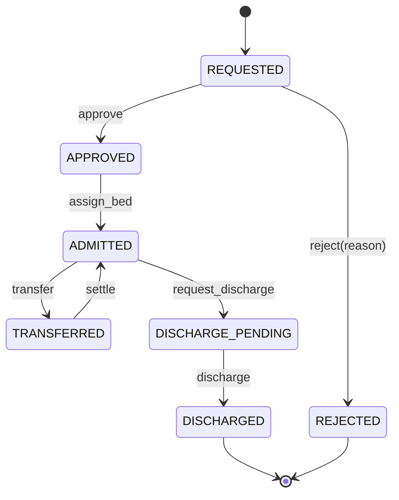

| Guard | الوصف |
|---|---|
| approve | زيارة + تشخيص + قسم |
| assign_bed | سرير متاح + لا تخصيص فعّال |
| discharge | ملخص خروج + فاتورة مسوّاة/استثناء |

---

## 11. SM-BED-ASSIGNMENT

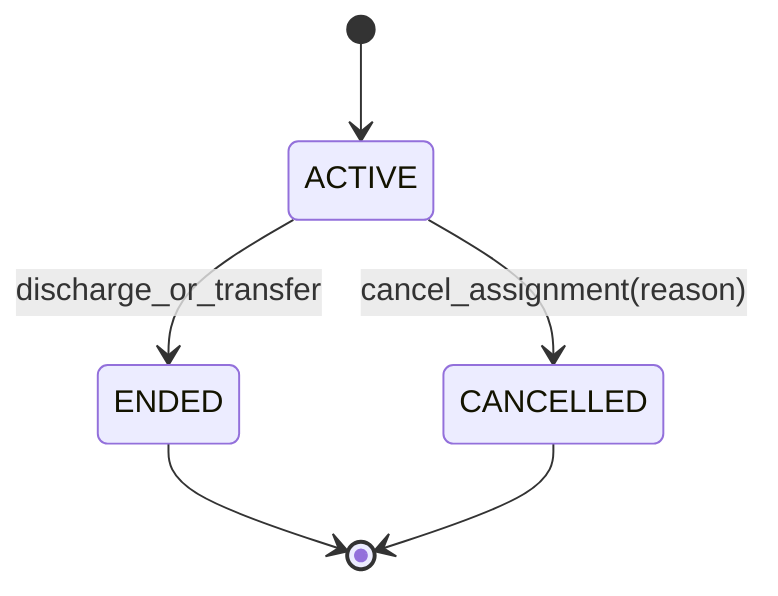

**قيد DB:** `UNIQUE(bed_id, active_flag)` حيث `active_flag=1` للتخصيص الفعّال و`NULL` للمنتهي.

---

## 12. SM-BED

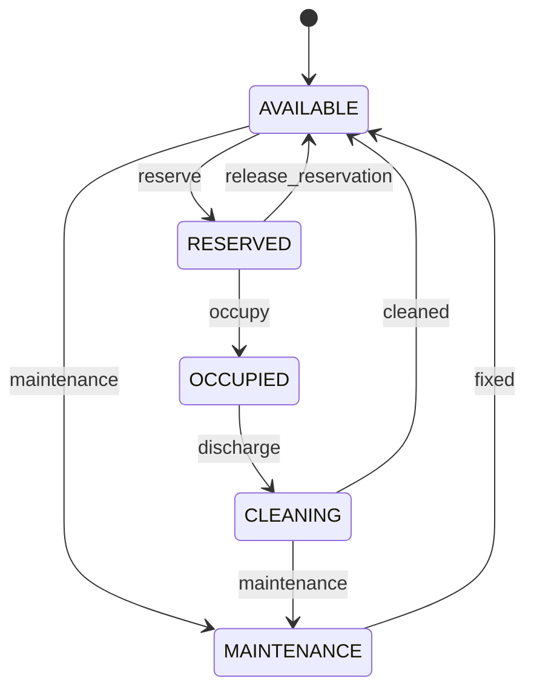

**قاعدة:** لا تخصيص إلا من `AVAILABLE` أو `RESERVED`.

---

## 13. SM-STOCK-BATCH

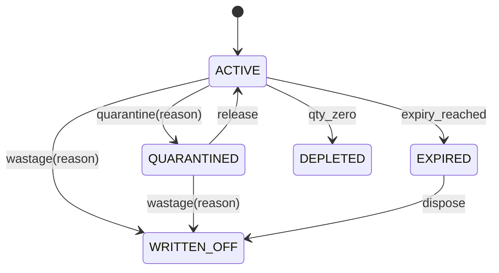

**قاعدة:** `EXPIRED`/`QUARANTINED` غير قابلة للصرف.

---

## 14. SM-PURCHASE-ORDER

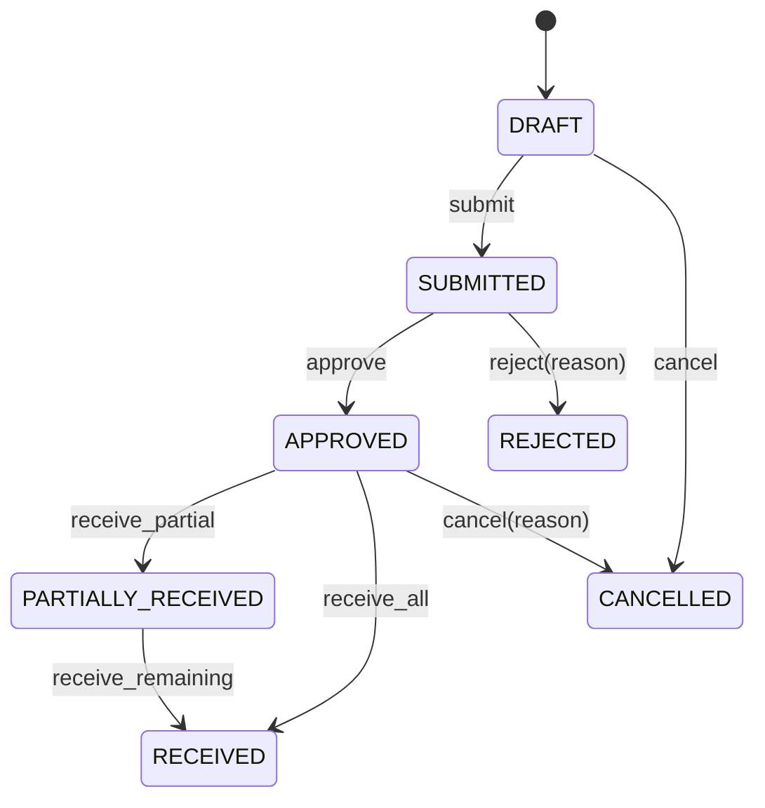

---

## 15. SM-RADIOLOGY-ORDER

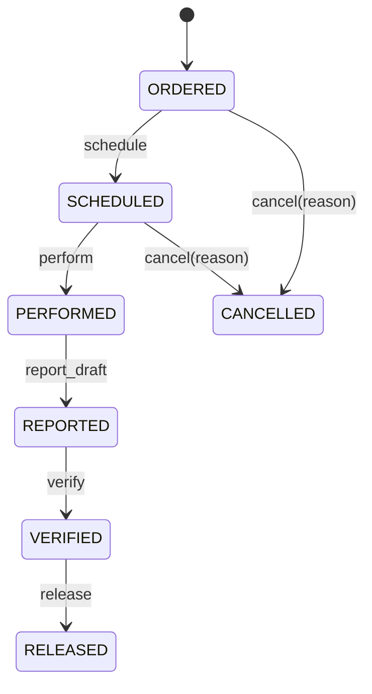

---

## 16. SM-OR-CASE

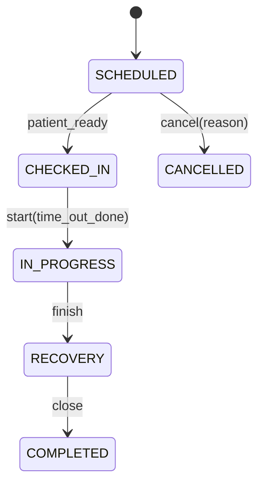

**Guard:** `start` يتطلب إكمال Checklist (Time-Out) إن كانت مفعّلة.

---

## 17. SM-DECISION-CARD

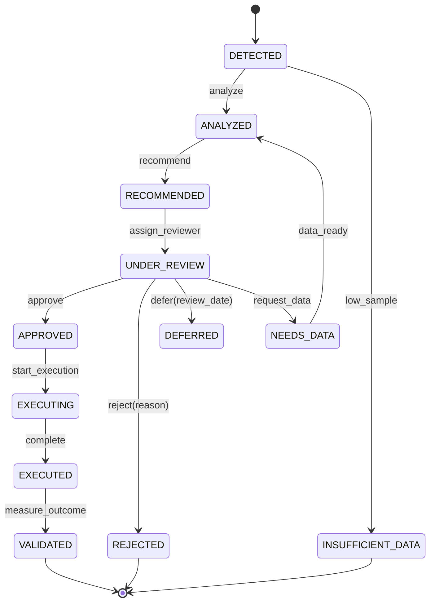

| Guard | الوصف |
|---|---|
| recommend | أدلة + خط أساس + ثقة محسوبة |
| approve | دور مخوّل ≠ منشئ التوصية |
| start_execution | خطة + مسؤول + تاريخ |
| measure_outcome | نفس KPI ونفس نافذة القياس |

---

## 18. SM-USER-ACCOUNT

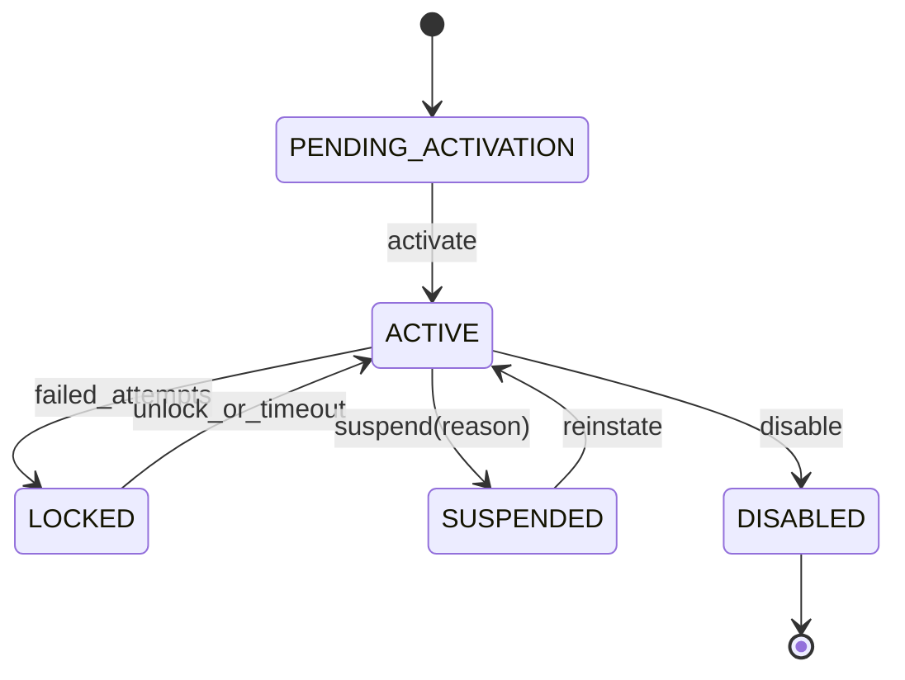

**قاعدة:** أي انتقال إلى `LOCKED/SUSPENDED/DISABLED` يُبطل الجلسات.

---

## 19. SM-BREAK-GLASS

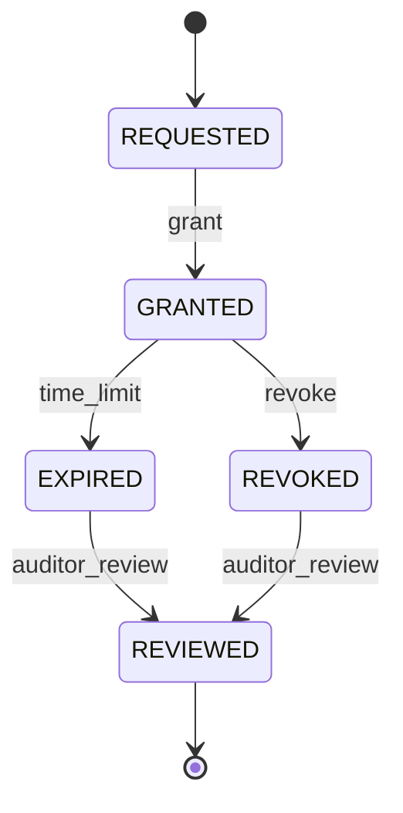

**Guard:** `GRANTED` ≤ 60 دقيقة + سبب + مريض واحد + إشعار.

---

## 20. جدول الانتقالات الممنوعة عالميًا

| Entity | Transition | السبب |
|---|---|---|
| Invoice | PAID → ISSUED | يمحو أثر الدفع |
| LabResult | RELEASED → DRAFT | يمحو الاعتماد |
| ClinicalNote | SIGNED → DRAFT | يمحو التوقيع |
| Payment | POSTED → (deleted) | يمحو أثر مالي |
| Admission | DISCHARGED → ADMITTED (نفس السجل) | يُفسد مدة الإقامة |
| StockBatch | EXPIRED → ACTIVE | خطر صرف منتهٍ |
| DecisionCard | REJECTED → APPROVED | يتجاوز قرارًا موثقًا |
| UserAccount | DISABLED → ACTIVE (مباشرة) | يتجاوز مراجعة أمنية |

---

## 21. ربط آلات الحالة بالاختبارات

| SM | TC |
|---|---|
| SM-APPOINTMENT | TC-030..TC-035 |
| SM-ENCOUNTER | TC-039..TC-049 |
| SM-LAB-ORDER/RESULT | TC-072..TC-082 |
| SM-PRESCRIPTION/DISPENSING | TC-090..TC-101 |
| SM-INVOICE/PAYMENT | TC-108..TC-117 |
| SM-ADMISSION/BED | TC-057..TC-065 |
| SM-DECISION-CARD | TC-154..TC-162 |
| SM-USER-ACCOUNT / SM-BREAK-GLASS | TC-007..TC-016 |
